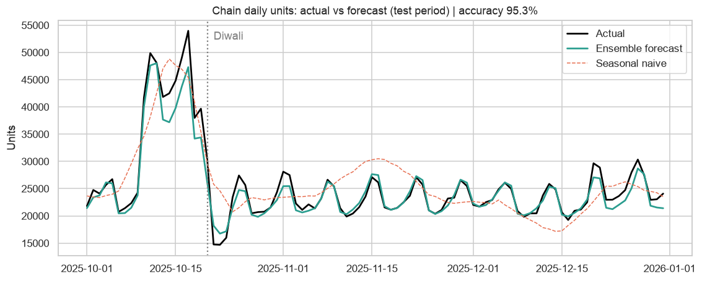
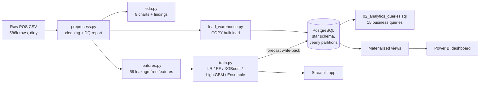

# Retail Sales Forecasting & Data Warehouse Analytics System

An end-to-end retail analytics project for **BharatMart**, a fictional 10-store Indian retail chain: messy POS data → cleaning → EDA → **PostgreSQL star-schema warehouse** → **15 advanced SQL analyses** → **ML demand forecasting (28 days ahead)** → **Power BI dashboards** + **Streamlit web app**.

**Headline results** (test set Oct–Dec 2025, including Diwali; every forecast made 28 days in advance):

| Level | Forecast accuracy (1 − WAPE) |
|---|---|
| Store × product × day (hardest) | **78.3%** (noise ceiling 81.5% → **96% of the achievable**) |
| Store × product × week | **87.7%** |
| Store × day | **92.2%** |
| Chain × day | **95.1%** |

The best model beats a seasonal-naive baseline by **+10.5 accuracy points** with R² = 0.897.



---

## Architecture



## Tech stack
Python · Pandas · NumPy · Scikit-learn · XGBoost · LightGBM · PostgreSQL 16 · Power BI (DAX) · Streamlit · Plotly · Matplotlib/Seaborn · Git

## Project structure
```
retail-sales-forecasting/
├── run_pipeline.py              # runs every step in order
├── requirements.txt
├── src/
│   ├── config.py                # paths, dates, horizon, DB settings
│   ├── calendar_india.py        # Diwali/Holi/Eid/Rakhi dates, national holidays, sale events
│   ├── generate_data.py         # 1. dataset generator (realistic demand + injected dirt)
│   ├── preprocess.py            # 2. cleaning
│   ├── eda.py                   # 3. exploratory analysis
│   ├── load_warehouse.py        # 4. ETL into PostgreSQL
│   ├── features.py              # 5. feature engineering
│   ├── forecast.py              #    metrics, model wrappers, future forecasting
│   └── train.py                 # 6. training, tuning, evaluation, write-back
├── sql/
│   ├── 01_schema.sql            # star schema DDL (partitioned fact table)
│   ├── 02_analytics_queries.sql # 15 business-insight queries
│   └── 03_bi_views.sql          # materialized views + BI views
├── app/streamlit_app.py         # 7. web app
├── powerbi/                     # 8. DAX measures, theme, step-by-step dashboard guide
├── data/
│   ├── raw/retail_sales_raw.csv          # the dataset (dirty, as a POS would export it)
│   ├── processed/retail_sales_clean.csv  # cleaned
│   └── exports/                          # Power BI tables, test predictions, 28-day forecast
├── models/                      # production + evaluation models, metrics.json
└── reports/                     # figures, EDA summary, data-quality report, model comparison
```

## Quick start
```bash
pip install -r requirements.txt

# Option 1: full pipeline (PostgreSQL running; set PGUSER/PGPASSWORD if not postgres/postgres)
python run_pipeline.py

# Option 2: no database
python run_pipeline.py --skip-db

streamlit run app/streamlit_app.py
```
The dataset and trained models are already included, so you can launch the app immediately. The full pipeline takes about 10–15 minutes on a laptop.

---

## 1. Dataset
Kaggle retail datasets are either tiny or too clean to show real data engineering, so `generate_data.py` simulates a realistic chain:

- **10 stores** in 4 regions, in 3 formats (Hypermarket, Supermarket, Express), and **40 products** in 6 categories.
- **Daily data from 2022 to 2025**, 584,400 store-product-days, ₹652 crore of revenue.
- **Demand drivers**: store growth trends, weekly patterns by category, yearly seasonality (summer beverages, winter apparel), **festivals on their real moving dates** (Diwali, Dussehra, Holi, Eid, Raksha Bandhan), promotions with category-specific price elasticity, post-promotion dips, chain-wide sale events, April price revisions, stockouts, and over-dispersed (negative-binomial) noise.
- **Injected real-world dirt**: mixed date formats, duplicate uploads, missing prices, quantities and store names, negative quantities, extra-zero typos, and inconsistent labels (`ELECTRONICS`, `Bombay`/`Mumbai`).

Because the generator knows the true expected demand, it computes an **oracle benchmark**: the best accuracy any model could reach on this data (81.5%). Real datasets never give you this, and it's what lets us say the model reaches 96% of what is achievable.

## 2. Cleaning (`reports/data_quality_report.json`)
| Issue | Rows fixed |
|---|---|
| DD-MM-YYYY dates parsed explicitly (never guessed) | 5,868 |
| Duplicate rows removed | 2,338 |
| Category labels standardised | 7,767 |
| City names standardised | 29,358 |
| Missing prices, filled from the same product's price that day at other stores | 5,844 |
| Negative quantities | 249 |
| Extra-zero typos detected and corrected | 111 |
| Quantities imputed by interpolation within the series | 3,173 |

Typo detection compares each value to a **local 15-day rolling median**, not a global z-score. A global rule would wrongly "fix" genuine Diwali spikes, which reach 3–4x normal.

## 3. EDA highlights (`reports/eda_summary.md`)
- Revenue grows ~16% per year.
- Grocery is the largest category (₹200 Cr) but has the thinnest margin (12.5%); Apparel earns 41%.
- In the 3 days before Diwali: Home & Kitchen sells 3.5x normal, Electronics 3.1x, Apparel 3.0x.
- A 20% discount lifts Electronics units 2.0x but Grocery only 1.4x.
- Express stores earn the most revenue per square foot.
- Autocorrelation peaks at lags 7 and 364, which motivates weekday-aligned lags and last-year features.

## 4. Data warehouse
- **Star schema**: `fact_sales`, keyed by store × product × day, plus `dim_date` (Indian fiscal year, holidays, days to Diwali), `dim_store`, `dim_product`, `dim_promotion`, and `fact_forecast` holding the ML output.
- The fact table is **range-partitioned by year**, so a query filtered to 2025 scans only the 2025 partition.
- The ETL uses `COPY FROM STDIN` bulk loading and **reconciles row counts, units and revenue** against the source file.
- **Materialized views** pre-aggregate the data for Power BI.
- **SQL techniques** in the 15 queries: CTEs, `LAG`/`LEAD` for MoM, YoY and same-store growth, running YTD totals, `DENSE_RANK` top-N per region, Pareto ABC analysis, `NTILE`, moving-average window frames, `ROLLUP` subtotals, `FILTER` aggregates, `PERCENTILE_CONT` promo lift, and forecast WAPE computed in SQL.

## 5. Machine learning

**Setup.** Every model forecasts daily units per store × product, **28 days ahead**. All features built from past sales are shifted by at least 28 days, so the model never sees information a planner wouldn't have (I verified that `lag_28` at day *t* equals sales at *t*−28). Planned information is used for the forecast day itself: the calendar, festivals, the promotion calendar and the price list.

**Split (time-based, never shuffled).**
- Training runs until June 2025.
- Validation (Jul–Sep 2025) is used for model selection and ensemble weights.
- The test set (Oct–Dec 2025, including Diwali) is **used once**.
- All models are refit on train + validation before scoring the test set.

**Features (59).**
- Weekday-aligned lags at 28, 35, 42, 49 and 56 days.
- Rolling means, standard deviation and max, plus an exponentially weighted average.
- Promotion-free baseline demand.
- A **Diwali-aligned last-year value**: a plain lag-364 misses Diwali when it moves from Oct 24 to Nov 12.
- Year-over-year growth.
- Store-traffic and chain-wide product demand signals.
- Days to or from each festival.
- Promotion depth, promo-day index, days since the last promotion, and share of stores on promotion.
- Price changes and calendar features.

**Model comparison (test set).**

| Model | Accuracy | MAE | R² |
|---|---|---|---|
| Ensemble (0.6 LightGBM + 0.4 XGBoost) *(selected on validation)* | 78.3% | 13.88 | 0.897 |
| LightGBM (Tweedie) | 78.4% | 13.86 | 0.897 |
| XGBoost (Tweedie) | 77.9% | 14.18 | 0.891 |
| Random Forest | 77.0% | 14.71 | 0.882 |
| Linear Regression (log space) | 75.8% | 15.51 | 0.875 |
| Seasonal naive (last year × growth) | 67.8% | 20.65 | 0.777 |
| Naive (last 4 weeks average) | 64.5% | 22.73 | 0.711 |

LightGBM alone scored 0.1 points higher on the test set. The ensemble is still reported as the choice because it won on validation. Picking whichever model looks best on the test set would make the test score optimistic.

### Key decisions (the "why", for interviews)

1. **WAPE instead of MAPE.** MAPE divides by each day's actual sales, so it explodes on slow-moving days (1 earbud sold vs 2 is a "100% error"). WAPE, `Σ|error| / Σ actual`, weights errors by volume, which is how retailers measure forecasts.
2. **Tweedie loss.** Units are non-negative, right-skewed counts, and fast movers sell over 10x more than slow movers. Tweedie with a log link models this directly; plain squared error lets the fast movers dominate training.
3. **Linear Regression in log space, with smearing.** Demand effects multiply together (weekend × promo × festival), and a log turns products into sums, which a linear model can fit. Converting back with `exp()` under-predicts, because the average of the logs is less than the log of the average (Jensen's inequality). Duan's smearing factor corrects that bias.
4. **Level-normalised target for tree models.** A tree predicts averages of past training values, so it **cannot predict higher than anything it has seen**. With 16% yearly growth, every Diwali is a new record. Training on `units / recent baseline` and multiplying back fixes this. Validated result: LightGBM bias improved from −5.0% to −3.1%, and accuracy rose for LightGBM (77.3% → 77.6%) and Random Forest (76.5% → 77.1%). XGBoost dipped slightly (77.1% → 76.9%) at that step, before recovering to 77.9% after fix 5. Samples are weighted by the baseline so the loss still matches absolute unit errors.
5. **Festival-aware cross-validation.** Early stopping on Jul–Sep (no festivals) stopped training after about 90 rounds, before the model had learned the 3–4x Diwali jumps. Rounds and hyper-parameters are now chosen across two folds: a festive quarter (Oct–Dec 2024) and a normal one. The boosters also train from 2022, so they see 3 Diwalis. Result: test accuracy rose from 77.6% to 78.3%, and Diwali bias improved from −9.0% to −6.4%.
6. **Oracle benchmark.** This separates "the model is weak" from "the data is noisy". Accuracy on single store-product-days can't pass ~81.5%, because selling 3 vs 5 earbuds on one day is partly random. That's also why accuracy rises to 95% at chain level.

**Per category (test):** Grocery 79.8%, Beverages & Snacks 79.0%, Personal Care 78.5%, Apparel 72.6%, Home & Kitchen 69.4%, Electronics 68.9%. Slow movers are harder to forecast because their relative noise is higher.

**Known limitation:** the model still under-forecasts overall by ~3% and by ~6% during Diwali. A next step would be a post-hoc bias correction learned on festive validation folds, or more years of festival history.

## 6. Power BI
See [`powerbi/POWERBI_GUIDE.md`](powerbi/POWERBI_GUIDE.md). It covers connecting to PostgreSQL or importing CSVs, the star-schema relationships, 39 DAX measures (YoY, Indian FYTD, same-store growth, ABC class, festive uplift, forecast accuracy) and a 5-page layout: Executive, Stores, Products & Promotions, Festivals, and ML Forecast.

## 7. Streamlit app
`streamlit run app/streamlit_app.py`
- 28-day forecast for any store and product, with history, KPIs and CSV download.
- **What-if promotions**: pick a discount and dates, and see the predicted unit lift.
- Business KPIs and trend charts, plus the model report.
- Upload your own CSV in the same format.

## Honest note on the data
The dataset is synthetic, which is stated clearly so nobody is misled. What that means in practice:
- The model's job is realistic: demand has noise, stockouts, moving festivals and promotions, and it's evaluated strictly out-of-time.
- On real retail data, store-product-day accuracy is often 50–70%, so the **relative** gains over baselines matter more than the absolute numbers.
- To use a real dataset, map it to the columns in `features.REQUIRED` and rerun the pipeline from `preprocess.py`.

## Resume bullets
- Built an end-to-end retail forecasting and BI system on 584k store-product-days: Python ETL, a PostgreSQL star schema with yearly partitioning and materialized views, 15 analytical SQL queries, LightGBM/XGBoost forecasting, Power BI dashboards and a Streamlit app.
- Engineered 59 leakage-free features, including Diwali-aligned seasonal lags. 28-day-ahead forecasts reached 78% accuracy (1 − WAPE) at store-product-day level (96% of the noise ceiling) and 95% at chain level, beating a seasonal-naive baseline by 10.5 points.
- Diagnosed systematic under-forecasting caused by tree models' inability to extrapolate growth, and fixed it with a level-normalised target and festival-aware time-series cross-validation.
- Built a data-cleaning pipeline that repaired 50k+ data-quality issues (mixed date formats, duplicates, typos, missing values), with automated reconciliation between source and warehouse.
