# Phase 1: Python & Data Basics

Welcome to **Phase 1** of the BharatMart retail sales forecasting project! 

If you already know basic Python (variables, lists, functions, and `for` loops), you are in the right place. In this phase, you will learn the essential data tools, spreadsheet-like operations, and basic statistics that every data scientist uses daily.

---

## 🗺️ Where We Are in the Journey

```mermaid
flowchart LR
    P1["Phase 1: Python & Data Basics"] --> P2["Phase 2: Data Cleaning"]
    P2 --> P3["Phase 3: EDA"]
    P3 --> P4["Phase 4: SQL & Warehousing"]
    P4 --> P5["Phase 5: Features"]
    P5 --> P6["Phase 6: ML Models"]
    P6 --> P7["Phase 7: Evaluation"]
    P7 --> P8["Phase 8: Deployment"]

    style P1 fill:#2563eb,stroke:#1d4ed8,stroke-width:2px,color:#fff
    style P2 fill:#f1f5f9,stroke:#94a3b8,color:#334155
    style P3 fill:#f1f5f9,stroke:#94a3b8,color:#334155
    style P4 fill:#f1f5f9,stroke:#94a3b8,color:#334155
    style P5 fill:#f1f5f9,stroke:#94a3b8,color:#334155
    style P6 fill:#f1f5f9,stroke:#94a3b8,color:#334155
    style P7 fill:#f1f5f9,stroke:#94a3b8,color:#334155
    style P8 fill:#f1f5f9,stroke:#94a3b8,color:#334155
```



At **BharatMart**, we track daily sales across **10 stores** and **40 products** over **4 years** (2022–2025). That gives us over **580,000 rows** of records. Trying to analyze this with regular Python lists and nested loops would be slow and clumsy. 

Instead, we use Python's purpose-built **Data Science Toolkit**.

---

## 1. The Python Data Science Toolkit

In professional data science, you rarely write algorithms from scratch. Instead, you use battle-tested, high-performance libraries. Here are the core libraries you will encounter in this project:

```
┌────────────────────────────────────────────────────────────────────────┐
│                        Python Data Science Stack                       │
├───────────────────────────────────┬────────────────────────────────────┤
│  Data Wrangling & Numbers         │  Visualization & Apps              │
│  • Pandas (Smart DataFrames)      │  • Matplotlib (Base plotting)      │
│  • NumPy (Lightning fast arrays)  │  • Seaborn (Statistical charts)    │
│                                   │  • Streamlit (Interactive web app) │
├───────────────────────────────────┴────────────────────────────────────┤
│  Machine Learning Algorithms                                           │
│  • Scikit-learn (Preprocessing, metrics, baseline models)              │
│  • LightGBM & XGBoost (High-performance gradient boosting trees)      │
└────────────────────────────────────────────────────────────────────────┘
```

### 🐼 Pandas — Excel Inside Python
* **Analogy:** Think of Pandas as Microsoft Excel or Google Sheets, but controlled by Python code instead of mouse clicks.
* **Why we use it:** It lets you load CSV files, filter thousands of rows in milliseconds, handle missing values, and calculate summary tables with single-line commands.

### 🔢 NumPy — Fast Math on Large Arrays
* **Analogy:** Think of NumPy as a turbocharged calculator designed specifically for long lists of numbers (called *arrays*).
* **Why we use it:** Standard Python lists are flexible but slow when doing math on millions of values. NumPy is written in C and runs math operations almost instantly using *vectorization* (calculating all rows at once without manual loops).

### 📊 Matplotlib & Seaborn — Drawing Charts from Code
* **Analogy:** Matplotlib is your blank canvas and colored pens. Seaborn is an artist who takes your data and paints clean, professional charts using beautiful presets.
* **Why we use them:** We use Matplotlib to size and export figure files, and Seaborn to produce sales distributions, correlation heatmaps, and weekly seasonality plots.

### 🤖 Scikit-learn — The Machine Learning Toolbox
* **Analogy:** A Swiss Army knife for data science.
* **Why we use it:** It provides ready-to-use tools to split your data into training and test sets, scale numbers, calculate error metrics (like MAE and RMSE), and run classic algorithms like Linear Regression.

### 🌐 Streamlit — Turning Python into Web Apps
* **Analogy:** A magic wand that converts a regular `.py` file directly into a clean web application with buttons, sliders, and charts without needing HTML, CSS, or JavaScript.
* **Why we use it:** In Phase 8, our entire store manager dashboard (`app/streamlit_app.py`) is built with Streamlit.

### ⚡ XGBoost & LightGBM — Advanced ML Powerhouses
* **Analogy:** If Scikit-learn's baseline model is a reliable family sedan, LightGBM and XGBoost are Formula 1 race cars.
* **Why we use them:** These are **Gradient Boosted Decision Tree** algorithms. They are widely used in commercial retail forecasting because they handle complex relationships, seasonality spikes, and promotions exceptionally well. In our project, LightGBM delivers the highest forecast accuracy!

### Project Dependencies
All of these libraries and their verified versions are listed in our project's dependency file:
👉 Check out: [requirements.txt](file:///Users/kumarshivank/Downloads/retail-sales-forecasting/requirements.txt)

You can install all of them into your virtual environment with:
```bash
pip install -r requirements.txt
```

---

## 2. DataFrames — Your Smart Spreadsheet

The foundational data structure in Pandas is the **DataFrame**.

A DataFrame represents tabular data organized into **rows** (observations) and **columns** (attributes). Each column has a name and a specific data type (like integer, float, string, or datetime).

```
          Column 1      Column 2      Column 3       Column 4
            date        store_id     product_name   units_sold
Row 0   2024-01-01        S01        Basmati Rice       24
Row 1   2024-01-01        S01        Masala Chai        45
Row 2   2024-01-01        S02        Mustard Oil        18
```

### Creating a DataFrame from a Python Dictionary

You can easily build a small DataFrame manually from a standard Python dictionary:

```python
import pandas as pd

# Data represented as a dictionary of lists
data = {
    "store_id": ["S01", "S01", "S02", "S02", "S03"],
    "city": ["Delhi", "Delhi", "Mumbai", "Mumbai", "Bangalore"],
    "product": ["Basmati Rice", "Atta 5kg", "Basmati Rice", "Moong Dal", "Atta 5kg"],
    "units_sold": [35, 20, 42, 15, 28],
    "unit_price": [120.0, 210.0, 120.0, 140.0, 210.0]
}

# Convert dictionary into a Pandas DataFrame
df = pd.DataFrame(data)
print(df)
```

**Output:**
```text
  store_id       city       product  units_sold  unit_price
0      S01      Delhi  Basmati Rice          35       120.0
1      S01      Delhi      Atta 5kg          20       210.0
2      S02     Mumbai  Basmati Rice          42       120.0
3      S02     Mumbai     Moong Dal          15       140.0
4      S03  Bangalore      Atta 5kg          28       210.0
```

### Reading CSV Files with `pd.read_csv()`

In practice, data is stored in files rather than hardcoded in dictionaries. Pandas makes loading files effortless:

```python
import pandas as pd

# Load the raw sales data from disk
# parse_dates tells Pandas to convert date strings into real datetime objects
df = pd.read_csv("data/raw/retail_sales_raw.csv", parse_dates=["date"])
```

> [!TIP]
> Always pass `parse_dates=["date"]` when reading time-series data. This allows Pandas to understand months, weekdays, and years automatically!

### Viewing and Inspecting Your Data

Whenever you load a new dataset, never assume it is clean. Always run these four inspection commands first:

```python
# 1. .head(n) -> Preview the first n rows (default is 5)
print(df.head(3))

# 2. .shape -> Returns a tuple: (total_rows, total_columns)
print("Data shape (rows, cols):", df.shape)

# 3. .info() -> Shows column data types and counts of non-null values
print(df.info())

# 4. .describe() -> Computes summary statistics for all numeric columns
print(df.describe())
```

Let's see what each tells you:

| Command | What it tells you | Why it matters |
|---|---|---|
| `df.head(3)` | First 3 rows of actual data | Verify that column headers and rows parsed properly |
| `df.shape` | `(586240, 11)` | Confirms whether you loaded the complete dataset |
| `df.info()` | Data types (`int64`, `float64`, `object`) | Catch numbers mistakenly loaded as text strings |
| `df.describe()` | Min, Max, Mean, Quartiles | Instantly spot negative prices or impossible quantities |

---

## 3. Basic Data Operations

Now that your data is in a DataFrame, let's explore the five most common operations used throughout this project.

### 1. Selecting Columns

To pick a single column (which returns a 1D Pandas `Series`):
```python
# Returns a Series of units sold
units = df["units_sold"]
```

To pick multiple columns (pass a Python list inside brackets `[[ ... ]]` to return a 2D `DataFrame`):
```python
# Returns a subset DataFrame with 3 columns
subset = df[["store_id", "product", "units_sold"]]
print(subset.head(2))
```

> [!NOTE]
> Single brackets `df["col"]` return a **Series** (one column). Double brackets `df[["col"]]` return a **DataFrame** (a table with one column).

### 2. Filtering Rows (Boolean Indexing)

You can filter rows by specifying true/false conditions inside the brackets:

```python
# Find all rows where unit price is greater than 150
premium_products = df[df["unit_price"] > 150.0]

# Combine multiple conditions using & (AND) or | (OR)
# IMPORTANT: Wrap each condition in parentheses ()
delhi_high_sales = df[(df["city"] == "Delhi") & (df["units_sold"] >= 30)]
print(delhi_high_sales)
```

### 3. Sorting Data

Sort rows easily using `.sort_values()`:

```python
# Sort by units_sold from highest to lowest
bestsellers = df.sort_values("units_sold", ascending=False)

# Sort by multiple columns: store first, then date
ordered_records = df.sort_values(["store_id", "city"], ascending=[True, True])
```

### 4. Grouping Data (`groupby`)

Grouping is how we summarize data across categories (e.g., total sales per city, or average units per product). This follows the **Split-Apply-Combine** pattern:

```
Original Data              Split by City           Apply Sum           Combine
┌─────────┬───────┐      ┌───────────────┐      ┌─────────────┐      ┌─────────┬───────┐
│ Mumbai  │  42   │ ───► │ Mumbai: 42, 15│ ───► │ Mumbai: 57  │ ───► │ Mumbai  │  57   │
│ Delhi   │  35   │      │ Delhi:  35, 20│      │ Delhi:  55  │      │ Delhi   │  55   │
│ Delhi   │  20   │      │ B'lore: 28    │      │ B'lore: 28  │      │ B'lore  │  28   │
│ Mumbai  │  15   │      └───────────────┘      └─────────────┘      └─────────┴───────┘
│ B'lore  │  28   │
└─────────┴───────┘
```

```python
# Total units sold per city
city_units = df.groupby("city")["units_sold"].sum()
print(city_units)

# Calculate multiple statistics at once using .agg()
store_summary = df.groupby("store_id")["units_sold"].agg(["count", "mean", "max"])
print(store_summary)
```

### 5. Adding and Modifying Columns

In Pandas, you perform math across entire columns without writing a loop. This is called **vectorization**:

```python
# Calculate total transaction revenue: price * quantity
df["total_revenue"] = df["unit_price"] * df["units_sold"]

# Apply a 10% promotional discount column
df["discounted_price"] = df["unit_price"] * 0.90

print(df[["product", "units_sold", "unit_price", "total_revenue"]].head(3))
```

---

## 4. Basic Statistics You Need to Know

Machine learning models predict numbers. Before you can evaluate predictions, you must master four basic statistical metrics.

### 1. Mean (The Arithmetic Average)
* **How it works:** Add up all values, then divide by the count of items.
* **Formula:** $\text{Mean} = \frac{\sum x}{n}$
* **Real-World Example:** Suppose daily sales of Basmati Rice in Store S01 over 5 normal days are:
  $$10, 12, 11, 13, 10$$
  $$\text{Mean} = \frac{10 + 12 + 11 + 13 + 10}{5} = \frac{56}{5} = 11.2 \text{ units/day}$$

### 2. Median (The Middle Value)
* **How it works:** Sort the numbers from smallest to largest and pick the exact middle number.
* **Why it matters:** The **mean is sensitive to extreme spikes (outliers)**, while the **median is robust**.

Imagine that on Day 6, it is **Diwali**, and a caterer buys **150 units**:
* New values: `10, 10, 11, 12, 13, 150`
* New Mean: $\frac{206}{6} = 34.3 \text{ units}$
* New Median: Middle of 11 and 12 $= 11.5 \text{ units}$

> [!IMPORTANT]
> If a store manager orders 34 bags of rice every day based on the **mean**, they will overstock and waste inventory on normal days! The **median** (11.5) provides a much safer reflection of typical daily demand.

| Measure | Sensitive to Spikes? | Best Used For |
|---|---|---|
| **Mean** | Yes (pulled toward extremes) | Financial totals, overall revenue accounting |
| **Median** | No (ignores extreme outliers) | Typical daily sales, retail inventory targets |

### 3. Standard Deviation (Spread and Volatility)
* **What it means:** How far values typically stray from the mean.
* **Low Standard Deviation:** Sales are steady and predictable every day (e.g., Milk or Salt).
* **High Standard Deviation:** Sales swing wildly from zero to huge spikes (e.g., Air Conditioners, Diwali Fireworks).

```
Low Spread (Stable):     ---(10)-(11)-(12)-(11)-(12)---     Std Dev ≈ 0.8
High Spread (Volatile):  (0)-------(12)-------------(45)    Std Dev ≈ 18.5
```

### 4. Percentiles & Quantiles (Ranking Demand)
* A percentile tells you what percentage of values fall below a given number.
* **50th Percentile:** Exactly the median (50% of days sold less than this).
* **75th Percentile ($Q_3$):** 75% of days sold less; only the top 25% busiest days sold more.
* **99th Percentile:** Represents peak surge capacity (used for emergency inventory planning).

### Computing Statistics with Pandas

Pandas computes all of these with single method calls:

```python
import pandas as pd

# Sample sales series
sales = pd.Series([10, 12, 11, 13, 10, 150])

print("Mean:               ", sales.mean())              # 34.33
print("Median:             ", sales.median())            # 11.50
print("Standard Deviation: ", sales.std())               # 56.68
print("25th Percentile:    ", sales.quantile(0.25))      # 10.25
print("75th Percentile:    ", sales.quantile(0.75))      # 12.75
print("90th Percentile:    ", sales.quantile(0.90))      # 81.50
```

---

## 5. Project Configuration (`src/config.py`)

In amateur projects, you often see paths like `"C:/Users/name/Desktop/data.csv"` hardcoded into 10 different files. If the file moves or someone runs the code on Mac or Linux, everything breaks!

In BharatMart, we centralize all settings in one dedicated configuration file:
👉 View file: [src/config.py](file:///Users/kumarshivank/Downloads/retail-sales-forecasting/src/config.py)

### What `config.py` Manages

```python
# Snippet from src/config.py
from pathlib import Path

# 1. Portable project root directory
ROOT = Path(__file__).resolve().parents[1]

# 2. Centralized folder paths
DATA_RAW = ROOT / "data" / "raw"
DATA_PROCESSED = ROOT / "data" / "processed"
MODELS_DIR = ROOT / "models"
REPORTS_DIR = ROOT / "reports"
FIGURES_DIR = REPORTS_DIR / "figures"
SQL_DIR = ROOT / "sql"

# 3. Core files
RAW_FILE = DATA_RAW / "retail_sales_raw.csv"
CLEAN_FILE = DATA_PROCESSED / "retail_sales_clean.csv"

# 4. Dates and ML split points
START_DATE = "2022-01-01"
END_DATE = "2025-12-31"
RANDOM_SEED = 42

# 5. Forecasting Horizon
HORIZON = 28               # We forecast 28 days ahead
VAL_START = "2025-07-02"   # Validation window: Jul-Sep 2025
TEST_START = "2025-10-01"  # Test window: Oct-Dec 2025 (includes Diwali)
```

### Why Central Configuration is Best Practice

1. **Write Once, Use Everywhere:** Every script (`src/preprocess.py`, `src/train.py`, `src/eda.py`) imports from `config.py`:
   ```python
   from src.config import CLEAN_FILE, HORIZON, RANDOM_SEED
   ```
2. **Cross-Platform Compatibility:** Using Python's `pathlib.Path` ensures paths resolve seamlessly on Windows (`\`), macOS (`/`), and Linux (`/`).
3. **Automatic Folder Creation:** `config.py` automatically checks if directories like `models/` and `reports/figures/` exist and creates them on startup.
4. **No Forecast Leakage:** Key rules—like our **28-day forecast horizon (`HORIZON = 28`)**—are defined in one place so feature engineering and model training stay perfectly aligned.

---

## 6. How the Project is Organized

Here is the architectural layout of the repository:

```text
retail-sales-forecasting/
├── app/                  # Interactive web application (Streamlit)
│   └── streamlit_app.py
├── data/                 # All data files (split by lifecycle stage)
│   ├── raw/              # Original unprocessed sales CSV
│   ├── processed/        # Cleaned dataset and engineered features
│   └── exports/          # Aggregated CSVs exported for Power BI & SQL
├── models/               # Serialized ML models (.joblib) & metrics.json
├── powerbi/              # Enterprise dashboard guides and DAX formulas
├── reports/              # Visual analysis outputs
│   ├── figures/          # Generated PNG charts from EDA
│   ├── eda_summary.md    # Business insights document
│   └── model_comparison.csv
├── sql/                  # PostgreSQL data warehouse schema and queries
│   ├── 01_schema.sql
│   ├── 02_analytics_queries.sql
│   └── 03_bi_views.sql
├── src/                  # Core Python modules
│   ├── config.py         # Paths, constants, and database settings
│   ├── generate_data.py  # Synthetic retail data generator
│   ├── preprocess.py     # Data cleaning and outlier fixing
│   ├── eda.py            # Automated chart generator
│   ├── features.py       # Time-series feature engineering (59 features)
│   ├── train.py          # Machine learning model training pipeline
│   ├── forecast.py       # 28-day forward inference engine
│   └── load_warehouse.py # Database loading and aggregation exports
├── learning/             # 8-phase step-by-step learning guides
│   ├── learning.md       # Master learning roadmap
│   └── 01-python-and-data-basics/
│       └── README.md     # (You are reading this file!)
├── requirements.txt      # Python dependencies
└── run_pipeline.py       # One-click end-to-end execution script
```

### Running the Whole System

The entire pipeline—from generating raw data to cleaning, computing charts, and training machine learning models—can be run with a single command via [run_pipeline.py](file:///Users/kumarshivank/Downloads/retail-sales-forecasting/run_pipeline.py):

```bash
# Run the complete pipeline (skipping database if PostgreSQL is not installed)
python run_pipeline.py --skip-db
```

This master script executes each phase sequentially and prints time elapsed for each stage:

```text
=== Generate dataset ===
--- Generate dataset done in 6s

=== Clean & preprocess ===
--- Clean & preprocess done in 4s

=== Exploratory data analysis ===
--- Exploratory data analysis done in 8s

=== Train & evaluate models ===
--- Train & evaluate models done in 42s

All done. Launch the app with:  streamlit run app/streamlit_app.py
```

---

## 7. Key Takeaways

Before moving on, make sure you feel confident with these core ideas:

* **Pandas is your primary workbench:** Almost all data manipulation in Python relies on Pandas DataFrames.
* **Vectorization over loops:** Never use a Python `for` loop to add or multiply columns in a DataFrame; use direct operations like `df["price"] * df["units"]`.
* **Inspect before you analyze:** Always check `.head()`, `.shape`, `.info()`, and `.describe()` right after loading data.
* **Watch out for the mean:** Mean is distorted by promotions and festival peaks (like Diwali); median is much more reliable for understanding baseline demand.
* **Centralize settings in `config.py`:** Never hardcode paths or dates across multiple files. Keep them in a single, reusable module.
* **Structured folder layout:** Keeping `src/`, `data/`, `models/`, and `reports/` separate ensures your project remains professional, reproducible, and easy to maintain.

---

## Next Steps

Now that you have a firm grasp of Python data libraries, DataFrames, and basic statistics, you're ready to see how real-world data gets messy—and how we fix it!

👉 Proceed to: **[Phase 2: Data Cleaning →](file:///Users/kumarshivank/Downloads/retail-sales-forecasting/learning/02-data-cleaning/README.md)**
