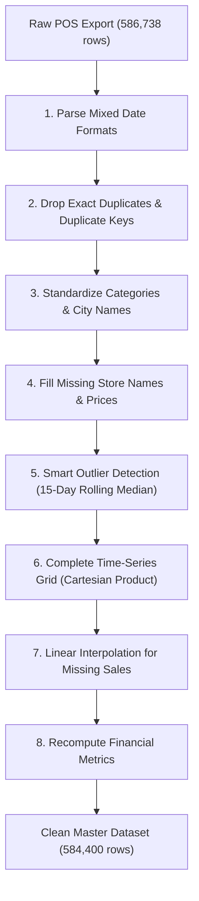
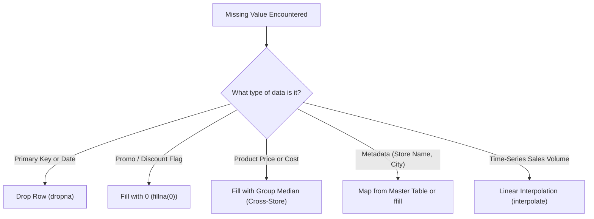
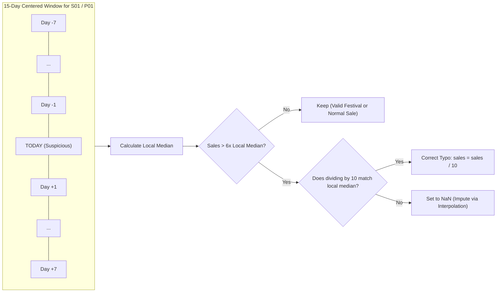

# Phase 2: Data Cleaning & Preprocessing 🧹

> **Welcome to Phase 2!** In textbooks, data always arrives pristine, formatted, and ready for modeling. In the real world, **80% of a data scientist's time** is spent discovering, investigating, and cleaning messy data.
>
> In this phase, you'll learn why dirty data happens, how it tricks machine learning models, and how to build a robust cleaning pipeline using the real code from BharatMart.

---

## 🧭 The Big Picture: From Raw POS to Clean Dataset

When BharatMart's Point of Sale (POS) registers export daily transactions, the raw file contains duplicate records, confusing dates, missing prices, typos, and mismatched city names.

Here is the exact step-by-step cleaning pipeline implemented in [`preprocess.py`](file:///Users/kumarshivank/Downloads/retail-sales-forecasting/src/preprocess.py):



---

## 1. Why Real-World Data is Messy

### 🏪 The Analogy: The Tired Cashier at 10:00 PM
Imagine a cashier at BharatMart's Indiranagar store scanning items all day long:
- A customer buys 10 packets of basmati rice, but the cashier's finger slips on the numpad and types `100`.
- The barcode scanner fails to read a bruised bag of apples, so the cashier skips entering the price to keep the queue moving.
- The internet connection stutters at midnight during batch sync, causing the store's daily register file to upload twice.
- An older POS terminal in Jaipur runs on legacy software formatted for Indian dates (`DD-MM-YYYY`), while the modern terminal in Mumbai exports in international ISO format (`YYYY-MM-DD`).

None of this happens out of malice — it is simply human and hardware reality.

### ⚠️ Common Data Defects in Retail
If you feed dirty data directly to an ML model, the consequences are disastrous:
- **"Garbage In, Garbage Out" (GIGO):** A model trained on inflated typo numbers will predict massive phantom demand, causing warehouse managers to over-order stock that rots on shelves.
- **Silent Model Failures:** A string date like `"05-03-2024"` might be interpreted by one library as March 5th and another as May 3rd, completely shifting seasonal holiday trends.

| Data Problem | Real-World Cause | What Happens If Ignored? |
| :--- | :--- | :--- |
| **Typos & Extra Zeros** | Cashier types `1490` instead of `149` | Model over-forecasts sales by 10x |
| **Negative Quantities** | Returns entered without a separate return code | Distorts baseline sales averages |
| **Missing Prices/Stores** | Sensor glitch or network drop | Crashes feature engineering scripts |
| **Mixed Date Formats** | Multi-vendor POS hardware across regions | Breaks chronological ordering |
| **Casing & Typo Variations** | Manual free-text entry (`DELHI` vs `Delhi`) | Treats one city as multiple different entities |
| **Duplicate Rows** | Double file uploads or retry scripts | Artificially inflates revenue and volume |

### 🛠️ How Our Project Simulates Reality
In this project, [`generate_data.py`](file:///Users/kumarshivank/Downloads/retail-sales-forecasting/src/generate_data.py) doesn't just synthesize ideal sales; it specifically introduces real-world errors via the `inject_dirt()` function:

```python
# Snippet from src/generate_data.py
def inject_dirt(df: pd.DataFrame) -> pd.DataFrame:
    # 1) ~1% of dates exported in DD-MM-YYYY by older POS systems
    # 2) Inconsistent category labels (ALL CAPS or whitespace padding)
    # 3) City name variants ("Bombay" vs "Mumbai", "Bangalore" vs "Bengaluru")
    # 4) Missing values in unit_price, units_sold, store_name
    # 5) Typos: negative quantities and extra zero typed (e.g. 150 instead of 15)
    # 6) Exact duplicate rows (~0.4%) from accidental double uploads
    ...
```

Let's inspect how the cleaning script systematically repairs all of them!

---

## 2. The Data Quality Report

> [!IMPORTANT]
> **Golden Rule of Data Engineering:** Never modify, drop, or impute data in silence. Always record an audit trail so your team can verify what changed.

### 📋 What is a Data Quality (DQ) Report?
A **Data Quality Report** is an automated scorecard that records the state of your data before and after cleaning. It tracks:
1. How many raw records entered the pipeline.
2. How many fixes were applied for each category of defect.
3. How many clean records were written out.

In BharatMart, every run of [`preprocess.py`](file:///Users/kumarshivank/Downloads/retail-sales-forecasting/src/preprocess.py) maintains an in-memory dictionary called `report` and exports it to [`data_quality_report.json`](file:///Users/kumarshivank/Downloads/retail-sales-forecasting/reports/data_quality_report.json).

### 🔍 BharatMart's Actual Data Quality Report
Here is the actual JSON report generated from our dataset:

```json
{
  "raw_rows": 586738,
  "dates_in_dd_mm_yyyy_format": 5868,
  "unparseable_dates_dropped": 0,
  "exact_duplicates_removed": 2338,
  "duplicate_keys_removed": 0,
  "category_labels_standardised": 7767,
  "city_names_standardised": 29358,
  "missing_store_names_filled": 1948,
  "missing_prices_filled": 5844,
  "missing_units_in_raw": 2922,
  "negative_units_set_to_nan": 249,
  "extra_zero_typos_corrected": 111,
  "other_outliers_set_to_nan": 2,
  "missing_grid_rows_added": 0,
  "units_imputed_by_interpolation": 3173,
  "clean_rows": 584400,
  "date_range": [
    "2022-01-01",
    "2025-12-31"
  ]
}
```

Notice how every single defect injected by [`generate_data.py`](file:///Users/kumarshivank/Downloads/retail-sales-forecasting/src/generate_data.py) is accounted for: exactly 2,338 duplicates dropped, 111 extra-zero typos rescued, and 3,173 missing sales imputed!

---

## 3. Fixing Date Formats

### 📅 The Ambiguity of Date Strings
Dates are notoriously difficult because different countries and software systems use conflicting conventions:
- **`2024-03-05`** → Unambiguous ISO 8601 format: March 5th, 2024 (`YYYY-MM-DD`).
- **`05-03-2024`** → Is this **March 5th** (Indian/British `DD-MM-YYYY`) or **May 3rd** (US `MM-DD-YYYY`)?

If you rely on automatic date parsers without instructions, the computer might parse `01-05-2024` as January 5th and `13-05-2024` as May 13th (because month 13 doesn't exist). This silently scrambles your time series!

### 🛡️ How `preprocess.py` Solves This Safely
Instead of guessing, [`preprocess.py`](file:///Users/kumarshivank/Downloads/retail-sales-forecasting/src/preprocess.py#L28-L32) uses a two-pass parsing strategy:

```python
def parse_dates(s: pd.Series) -> tuple[pd.Series, int]:
    # Pass 1: Try parsing strictly as standard ISO (YYYY-MM-DD)
    iso = pd.to_datetime(s, format="%Y-%m-%d", errors="coerce")
    
    # Pass 2: Try parsing strictly as Indian format (DD-MM-YYYY)
    dmy = pd.to_datetime(s, format="%d-%m-%Y", errors="coerce")
    
    # If ISO succeeded, keep it; if ISO failed (became NaT), fill from dmy
    parsed = iso.fillna(dmy)
    count_dmy = int((iso.isna() & dmy.notna()).sum())
    return parsed, count_dmy
```

### 💡 Why this code works:
1. `format="%Y-%m-%d"` tells Pandas exactly where the year, month, and day are.
2. `errors="coerce"` ensures that invalid dates turn into `NaT` ("Not a Time") rather than crashing the program.
3. `.fillna(dmy)` seamlessly merges the two passes.
4. Any row that failed both passes has `isna() == True` and can be safely logged and dropped.

---

## 4. Handling Missing Values

### ❓ What is `NaN`?
In Python and Pandas, missing data is represented as `NaN` (Not a Number) or `None`. It means: *"We expected a value here, but nothing was recorded."*

### 🧭 Five Strategies for Missing Values



| Strategy | When to Use | Retail Example | Pandas Syntax |
| :--- | :--- | :--- | :--- |
| **Drop Row** | Critical identifiers are missing and cannot be recovered | Transaction date is completely unparseable | `df.dropna(subset=['date'])` |
| **Fill with Zero** | Missing implies the absence of an event | No promotion was active, so discount is 0% | `df['discount_pct'].fillna(0)` |
| **Group Median** | Value is consistent across peers on that day | A product's price was blank, but 9 other stores recorded it | `df.groupby(['product_id', 'date'])['unit_price'].transform('median')` |
| **Forward/Back Fill** | Static master attributes that don't change daily | Store square footage or product brand | `df.groupby('store_id')['store_size_sqft'].ffill().bfill()` |
| **Linear Interpolation** | Continuous time series with smooth trends | Tuesday sales missing between Monday (20) and Wednesday (24) | `df.groupby(['store_id', 'product_id'])['units_sold'].transform(lambda s: s.interpolate())` |

### 📈 How Linear Interpolation Works
Imagine a line connecting two known points on a graph:
- **Monday:** 20 units sold
- **Tuesday:** `NaN` (POS sync failed)
- **Wednesday:** 26 units sold

Linear interpolation draws a straight line between 20 and 26. Since Tuesday is exactly halfway between Monday and Wednesday, it receives:

$$\text{Tuesday Sales} = 20 + \frac{26 - 20}{2} = 23\text{ units}$$

In [`preprocess.py`](file:///Users/kumarshivank/Downloads/retail-sales-forecasting/src/preprocess.py#L115-L116):
```python
df["units_sold"] = (
    df.groupby(["store_id", "product_id"])["units_sold"]
      .transform(lambda s: s.interpolate(limit_direction="both"))
      .round()
)
```
`limit_direction="both"` ensures that even if a missing value occurs at the very start or end of the series, it is filled using the nearest valid boundary.

---

## 5. Detecting Outliers — The Smart Way

### 🚨 What is an Outlier?
An **outlier** is an observation that lies abnormally far away from other values in the dataset.
- Normal daily sales of Basmati Rice: `35, 42, 38, 40, 44`
- Anomaly: `420` (cashier pressed an extra 0) or `-45` (accidental negative sign)

### ❌ Why the Naive Z-Score Fails in Retail
Many introductory data science tutorials suggest using the **Z-Score** (number of standard deviations from the global mean):

$$Z = \frac{x - \mu}{\sigma}$$

If $|Z| > 3$, the tutorial says: *"Delete it, it's an outlier!"*

> [!CAUTION]
> **Why Z-Score fails in Indian Retail:**
> During festival seasons like **Diwali, Dussehra, and Dhanteras**, sales naturally jump **3x to 5x** above normal levels.
> - A Hypermarket selling 10 mixer grinders on an average Tuesday might legitimately sell **50 mixer grinders** on Dhanteras.
> - A naive global Z-score flags this Dhanteras spike as an "outlier" and deletes or caps it!
> - **The consequence:** Your forecasting model never learns that Diwali causes huge spikes, leading to empty shelves during the biggest revenue week of the year!

### ✅ The Smart Approach: Centered 15-Day Rolling Median
Instead of measuring against the entire 4-year average across all stores, [`preprocess.py`](file:///Users/kumarshivank/Downloads/retail-sales-forecasting/src/preprocess.py#L34-L54) compares each day's sales against its **local neighborhood**:

1. Group data by `[store_id, product_id]`.
2. Look at the **centered 15-day window** (7 days before + current day + 7 days after).
3. Compute the **median** of this local window.



### 💡 Why Rolling *Median* and not Rolling *Mean*?
The mean is easily dragged up by a single huge typo. If 14 days had sales of 10 and 1 day had a typo of 1,000:
- **Rolling Mean:** $\frac{14 \times 10 + 1000}{15} = 76$ (distorted!)
- **Rolling Median:** Sort the 15 values → middle value is still **10** (immune to the typo!).

### 🔬 The "Extra Zero" Rescue Logic
In retail POS systems, cashiers often accidentally double-tap a key (typing `1490` instead of `149`). Rather than throwing away good transactions, [`preprocess.py`](file:///Users/kumarshivank/Downloads/retail-sales-forecasting/src/preprocess.py#L44-L54) tests if dividing by 10 restores the number:

```python
# 1. Group by store and product, then calculate centered 15-day median
g = df.groupby(["store_id", "product_id"])["units_sold"]
local_med = g.transform(lambda x: x.rolling(15, center=True, min_periods=5).median())

# 2. Ratio of today's sales to local median
ratio = df["units_sold"] / local_med.clip(lower=1)
suspect = (ratio > 6) & (df["units_sold"] >= 30)

# 3. If dividing by 10 brings it back within [0.3x, 3.0x] of the local median,
# it was an extra zero typo!
fixable = suspect & ((df["units_sold"] / 10) / local_med.clip(lower=1)).between(0.3, 3)

# 4. Correct the typo, or set unfixable extreme noise to NaN
df.loc[fixable, "units_sold"] = (df.loc[fixable, "units_sold"] / 10).round()
df.loc[suspect & ~fixable, "units_sold"] = np.nan
```

During Diwali, sales rise to ~2.5x to 3.5x normal, which easily stays under the `ratio > 6` threshold. Genuine holiday peaks are protected, while genuine `10x` cashier typos are caught and repaired!

---

## 6. Handling Duplicates

### 👥 What are Duplicate Rows?
Duplicates happen when identical or conflicting records exist in your table. There are two distinct types:
1. **Exact Duplicate Rows:** Every single column in row A is identical to row B. Usually caused by an automated ETL script retrying a failed network upload.
2. **Duplicate Primary Keys:** Two rows share the same `(date, store_id, product_id)`, but other columns differ (e.g. one row has price ₹99 and another has ₹105).

### 🧹 How `preprocess.py` Handles Them
In [`preprocess.py`](file:///Users/kumarshivank/Downloads/retail-sales-forecasting/src/preprocess.py#L68-L73):

```python
# Step 1: Remove exact duplicates
n = len(df)
df = df.drop_duplicates()
report["exact_duplicates_removed"] = n - len(df)

# Step 2: Ensure unique business keys (date + store + product)
n = len(df)
df = df.drop_duplicates(subset=["date", "store_id", "product_id"], keep="first")
report["duplicate_keys_removed"] = n - len(df)
```

In our dataset, **2,338 exact duplicate rows** were found and eliminated, ensuring each daily store transaction is counted exactly once.

---

## 7. Completing the Grid (Cartesian Product)

### 🧩 The Problem: The "Missing Days" Trap
In standard retail databases, if Store S03 sells **0 units** of Product P29 on October 14th, the POS terminal often logs **no row at all** for that day!

If you plot sales over time, your table skips from October 13th directly to October 15th:
```
Date         Store  Product  Units Sold
2024-10-13   S03    P29      4
2024-10-15   S03    P29      2    <-- Where is October 14th?
```

> [!WARNING]
> Machine learning models that use lagged features (e.g., *"sales from 7 days ago"*) will break if rows are missing. Shifting the table by 7 rows would look at the wrong calendar date!

### 📐 The Solution: The Cartesian Product Grid
A **Cartesian Product** creates every possible combination of:
$$\text{All Stores} \times \text{All Products} \times \text{All Calendar Dates}$$

For BharatMart:
- **10 Stores**
- **40 Products**
- **1,461 Days** (4 years: 2022 to 2025, including leap year 2024)

$$\text{Total Grid Size} = 10 \times 40 \times 1,461 = 584,400\text{ rows}$$

### 💻 The Implementation in `preprocess.py`
Here is how [`preprocess.py`](file:///Users/kumarshivank/Downloads/retail-sales-forecasting/src/preprocess.py#L98-L116) builds the full grid:

```python
# 1. Extract all unique stores, products, and full continuous date range
stores = df["store_id"].unique()
products = df["product_id"].unique()
all_dates = pd.date_range(df["date"].min(), df["date"].max())

# 2. Build MultiIndex of all possible combinations
full = pd.MultiIndex.from_product(
    [sorted(stores), sorted(products), all_dates],
    names=["store_id", "product_id", "date"]
)

# 3. Reindex the DataFrame to the full grid
df = df.set_index(["store_id", "product_id", "date"])
df = df.reindex(full).reset_index()

# 4. Fill static store and product attributes that became blank
attr_cols = ["store_name", "city", "state", "region", "store_type", "store_size_sqft"]
df[attr_cols] = df.groupby("store_id")[attr_cols].transform(lambda s: s.ffill().bfill())

prod_cols = ["product_name", "category", "sub_category", "brand"]
df[prod_cols] = df.groupby("product_id")[prod_cols].transform(lambda s: s.ffill().bfill())
```

Once the grid is complete, any newly created empty days have their missing sales smoothly interpolated, guaranteeing a completely regular time series with **zero missing dates**.

---

## 8. Text Standardization

### 🔤 The Problem: Inconsistent Strings
Computers are literal. To Python:
- `"DELHI"`, `"delhi"`, `"Delhi"`, and `" Delhi "` are **four completely different strings**.
- `"Bangalore"` and `"Bengaluru"` refer to the same physical city, but a `groupby('city')` command would split their revenue into two separate buckets.

### 🧼 The Cleaning Solution
In [`preprocess.py`](file:///Users/kumarshivank/Downloads/retail-sales-forecasting/src/preprocess.py#L75-L82), text cleaning follows three standard steps:

```python
# 1. Standardize category names: strip whitespace, lowercase, map to canonical title
CATEGORIES = [
    "Grocery & Staples", "Beverages & Snacks", "Personal Care",
    "Home & Kitchen", "Electronics", "Apparel"
]
canon = {c.lower(): c for c in CATEGORIES}

# Strips spaces, converts to lowercase, then maps back to official capitalization
cat_clean = df["category"].str.strip().str.lower().map(canon)
df["category"] = cat_clean

# 2. Harmonize historical city names
CITY_FIX = {"Bangalore": "Bengaluru", "Bombay": "Mumbai"}
df["city"] = df["city"].replace(CITY_FIX)
```

In our dataset:
- **7,767 category labels** had casing or extra whitespace corrected.
- **29,358 city names** were harmonized into official terminology (`Bengaluru` and `Mumbai`).

---

## 9. Recomputing Financials

Once the quantities, prices, and discounts are verified and cleaned, we **never trust the original raw revenue column**. If a cashier typed an extra zero or a discount percentage was missing, the raw revenue is corrupt.

In [`preprocess.py`](file:///Users/kumarshivank/Downloads/retail-sales-forecasting/src/preprocess.py#L118-L126), all financial numbers are recomputed from scratch using clean primitives:

```python
# Convert to appropriate data types
df["discount_pct"] = df["discount_pct"].astype(int)
df["is_promo"] = df["is_promo"].astype(int)
df["units_sold"] = df["units_sold"].astype(int)

# Financial formulas
df["gross_sales"]     = (df["units_sold"] * df["unit_price"]).round(2)
df["discount_amount"] = (df["gross_sales"] * df["discount_pct"] / 100).round(2)
df["revenue"]         = (df["gross_sales"] - df["discount_amount"]).round(2)
df["cost"]            = (df["units_sold"] * df["unit_cost"]).round(2)
df["profit"]          = (df["revenue"] - df["cost"]).round(2)
```

Finally, sanity checks ensure that no `NaN` values, duplicate keys, or negative sales exist in the clean output:

```python
assert df.isna().sum().sum() == 0, "Cleaning left NaNs behind!"
assert not df.duplicated(["date", "store_id", "product_id"]).any()
assert (df["units_sold"] >= 0).all()
```

---

## 🎯 Key Takeaways

1. **80% of Data Science is Data Cleaning:** You cannot build high-performing models on corrupt foundations.
2. **Always Keep an Audit Trail:** Use a Data Quality Report ([`data_quality_report.json`](file:///Users/kumarshivank/Downloads/retail-sales-forecasting/reports/data_quality_report.json)) so every modification is transparent and verifiable.
3. **Parse Dates Explicitly:** Never let automated parsers guess ambiguous formats like `05-03-2024`. Use explicit formats (`%Y-%m-%d` and `%d-%m-%Y`).
4. **Use Domain-Aware Outlier Detection:** Simple global Z-scores delete legitimate holiday spikes (Diwali/Dhanteras). A **local 15-day rolling median** respects seasonal surges while catching 10x cashier typos.
5. **Complete the Grid for Time Series:** Gaps in sales history break rolling averages and lag features. Build a full Cartesian product ($Stores \times Products \times Dates$) before modeling.
6. **Standardize Text:** Strip extra spaces, lowercase before mapping, and harmonize city aliases so grouping operations yield accurate insights.

---

## 🚀 Next Steps

Now that our sales dataset is clean, continuous, and verified, we are ready to explore trends, seasonalities, and store comparisons!

👉 **Continue to [Phase 3: Exploratory Data Analysis →](file:///Users/kumarshivank/Downloads/retail-sales-forecasting/learning/03-exploratory-data-analysis/README.md)**
