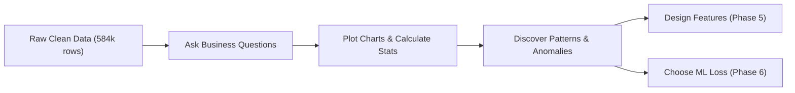
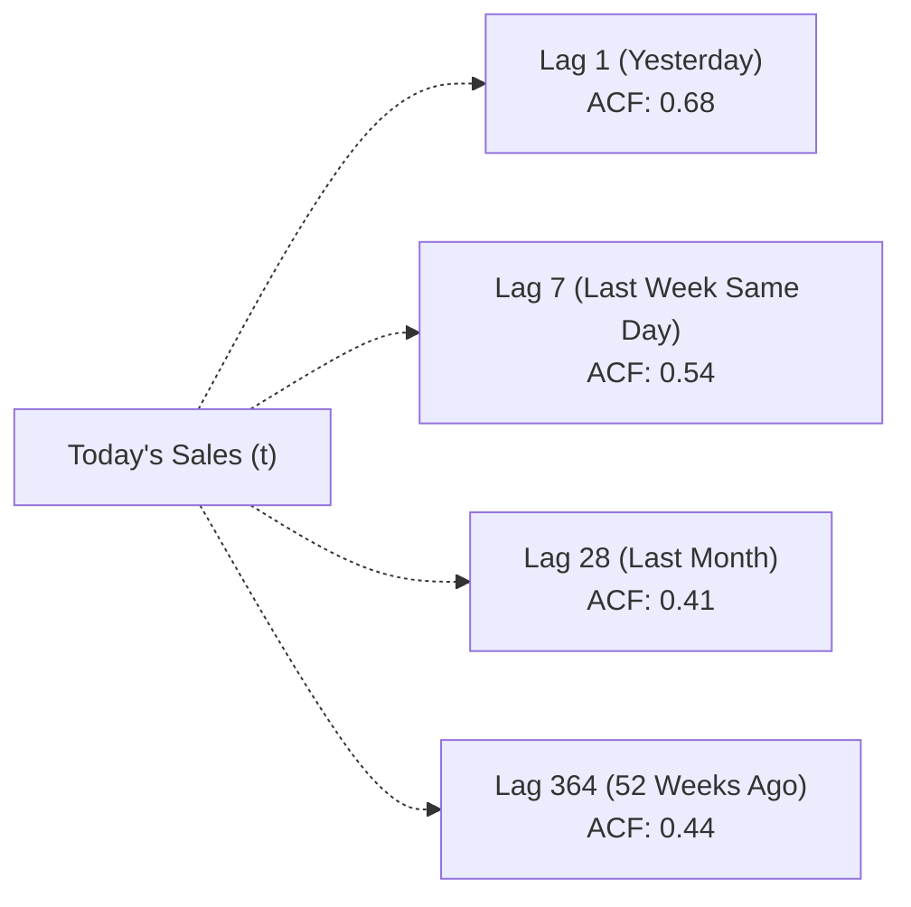
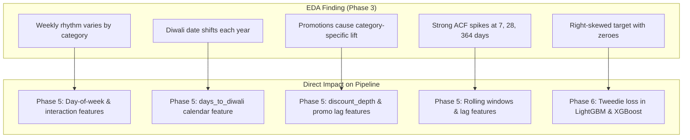

# 🔍 Phase 3: Exploratory Data Analysis (EDA)

> **Welcome to Phase 3!** In [Phase 2: Data Cleaning & Preprocessing](file:///Users/kumarshivank/Downloads/retail-sales-forecasting/learning/02-data-cleaning/README.md), we took messy, missing, and duplicate sales records and scrubbed them into a clean 584,000-row dataset. Now comes the most exciting part of data science: **Exploratory Data Analysis (EDA)**. Before typing a single line of machine learning code, we will put on our detective hats and explore the hidden stories, rhythms, and surprises in BharatMart's data.

---

## 📋 Table of Contents

1. [What is EDA and Why Do We Do It?](#1-what-is-eda-and-why-do-we-do-it)
2. [Visualization Libraries: The Data Scientist's Toolkit](#2-visualization-libraries-the-data-scientists-toolkit)
3. [Key Questions We Ask in This Project](#3-key-questions-we-ask-in-this-project)
   - [3.1 Weekly Patterns (Day-of-Week Analysis)](#31-weekly-patterns-day-of-week-analysis)
   - [3.2 Seasonal Trends & YoY Growth](#32-seasonal-trends--yoy-growth)
   - [3.3 Festival Impact (Diwali, Lunar Calendars)](#33-festival-impact-diwali-lunar-calendars)
   - [3.4 Promotion Effects & Forward Buying](#34-promotion-effects--forward-buying)
   - [3.5 Category & Store Space Productivity](#35-category--store-space-productivity)
   - [3.6 Autocorrelation: The Memory of Time Series](#36-autocorrelation-the-memory-of-time-series)
4. [Types of Charts and When to Use Them](#4-types-of-charts-and-when-to-use-them)
5. [The 8 EDA Charts in This Project](#5-the-8-eda-charts-in-this-project)
6. [Key Takeaways: How EDA Feeds Machine Learning](#6-key-takeaways-how-eda-feeds-machine-learning)
7. [Next Steps](#7-next-steps)

---

## 1. What is EDA and Why Do We Do It?

### 🏗️ The Construction Analogy

Imagine you are hired to build a modern shopping mall. Would you order 50 truckloads of cement and start pouring foundations on Day 1 without ever visiting the plot?

Of course not! You would first **survey the land**:
- Is the ground solid rock, soft clay, or swampy wetland?
- Where does rainwater naturally flow during monsoons?
- Are there underground pipes or electrical lines?

**Exploratory Data Analysis (EDA)** is that land survey. Your machine learning model is the building. If you train complex models on data you haven't inspected, your model will collapse when exposed to the real world.



### 🎯 The Four Goals of EDA

When exploring any dataset, we pursue four primary objectives:

1. **Find Patterns & Trends**: Does demand rise on weekends? Does it peak in winter?
2. **Spot Anomalies & Outliers**: Did an item spike 10x because of a flash sale or a data entry error?
3. **Understand Distributions**: Are unit sales normally distributed (like human heights) or heavily skewed (mostly small numbers with occasional massive spikes)?
4. **Generate Hypotheses**: If discounts boost Electronics sales by 100%, do they also boost Grocery sales by that much?

> [!IMPORTANT]
> **The Golden Rule of Data Science: Garbage In, Garbage Out (GIGO)**  
> Algorithms are mathematical engines — they will happily fit whatever numbers you feed them. If your dataset contains hidden traps (like festivals that shift dates or skewed zeroes) and you fail to notice them, your model will produce confident nonsense. EDA is your insurance policy against GIGO.

---

## 2. Visualization Libraries: The Data Scientist's Toolkit

Python gives us three main plotting libraries. Think of them as different tools in an artist's toolkit:

```
┌─────────────────────────────────────────────────────────────┐
│  Plotly: Interactive, web-ready charts (hover, zoom, click) │
├─────────────────────────────────────────────────────────────┤
│  Seaborn: Statistical beauty with 1 line of high-level code │
├─────────────────────────────────────────────────────────────┤
│  Matplotlib: The foundational canvas (draws anything)       │
└─────────────────────────────────────────────────────────────┘
```

### ✏️ 1. Matplotlib: The Foundation (The Pencil)
- **What it is**: The oldest, most flexible plotting library in Python.
- **Analogy**: Like a graphite pencil — you can draw literally anything, but you have to specify every single stroke (ticks, margins, axis labels, line widths).
- **In our project**: Used in [`src/eda.py`](file:///Users/kumarshivank/Downloads/retail-sales-forecasting/src/eda.py#L8-L13) for multi-axis layouts and saving high-res PNGs to disk.

```python
import matplotlib.pyplot as plt

# A basic line plot with Matplotlib
days = ["Mon", "Tue", "Wed", "Thu", "Fri", "Sat", "Sun"]
sales = [120, 115, 125, 130, 160, 210, 195]

plt.figure(figsize=(8, 4))
plt.plot(days, sales, marker="o", color="steelblue", linewidth=2)
plt.title("Weekly Store Footfall")
plt.xlabel("Day of Week")
plt.ylabel("Transactions")
plt.grid(True, linestyle="--", alpha=0.6)
plt.show()
```

### 🎨 2. Seaborn: Statistical Elegance (The Colored Pencils)
- **What it is**: Built directly on top of Matplotlib, designed specifically for data science and statistical DataFrames.
- **Analogy**: Like a set of artist colored pencils — it comes with gorgeous color palettes, automatically aggregates data, and draws complex heatmaps or box plots in a single command.
- **In our project**: Used in [`src/eda.py`](file:///Users/kumarshivank/Downloads/retail-sales-forecasting/src/eda.py#L68) to produce publication-grade figures.

```python
import seaborn as sns

# A statistical heatmap with Seaborn
# dow_data is a DataFrame where rows=Categories, cols=Days
sns.set_theme(style="whitegrid")
sns.heatmap(dow_matrix, annot=True, fmt=".2f", cmap="RdYlGn", center=1.0)
plt.title("Day-of-Week Demand Index")
plt.show()
```

### ⚡ 3. Plotly: Interactive Dashboards (The Digital Tablet)
- **What it is**: A modern library that outputs interactive HTML and JavaScript charts.
- **Analogy**: Like an interactive touchscreen display — users can hover to view exact data values, click legends to toggle series on/off, drag to zoom, and pan across timelines.
- **In our project**: Used inside [`app/streamlit_app.py`](file:///Users/kumarshivank/Downloads/retail-sales-forecasting/app/streamlit_app.py#L18-L19) to power the user-facing web dashboard.

```python
import plotly.express as px

# An interactive bar chart for our Streamlit dashboard
fig = px.bar(
    store_df,
    x="revenue",
    y="store_name",
    color="store_type",
    orientation="h",
    title="Store Revenue Comparison",
)
fig.show()
```

---

## 3. Key Questions We Ask in This Project

In BharatMart, we ran a thorough exploratory analysis using [`src/eda.py`](file:///Users/kumarshivank/Downloads/retail-sales-forecasting/src/eda.py). The findings are documented in [`reports/eda_summary.md`](file:///Users/kumarshivank/Downloads/retail-sales-forecasting/reports/eda_summary.md). 

Here are the six fundamental retail questions we investigated.

---

### 3.1 Weekly Patterns (Day-of-Week Analysis)

> **Question**: *Do shoppers visit BharatMart equally every day, or does demand surge on weekends? Does this behavior change depending on what they buy?*

In retail, customer behavior follows a strict 7-day biological and work schedule. To analyze this across products of different sizes, we normalize daily demand into a **Demand Index**:

$$\text{Demand Index} = \frac{\text{Average Units Sold on Day } d}{\text{Average Daily Units Sold Across All Days}}$$

- An index of **1.00** means average demand.
- An index of **1.32** means sales are **32% above average**.
- An index of **0.85** means sales are **15% below average**.

```
Day-of-Week Demand Index Heatmap:
Category             Mon     Tue     Wed     Thu     Fri     Sat     Sun
───────────────────────────────────────────────────────────────────────────
Apparel             0.84    0.85    0.88    0.92    1.08    1.32    1.11  ← Huge weekend peak!
Electronics         0.88    0.89    0.91    0.95    1.06    1.24    1.07
Home & Kitchen      0.90    0.89    0.92    0.94    1.05    1.20    1.10
Beverages & Snacks  0.92    0.93    0.95    0.97    1.04    1.12    1.07
Grocery & Staples   0.95    0.96    0.96    0.98    1.02    1.08    1.05
Personal Care       0.96    0.97    0.97    0.98    1.01    1.09    1.02  ← Very flat
```

#### What this tells us:
1. **Apparel and Electronics are "leisure" shopping**: People visit malls on Saturdays with family when they have time to try on shirts or compare gadget specs. Saturday demand in Apparel is **32% above average**.
2. **Grocery & Staples and Personal Care are "essential" shopping**: If you run out of milk, soap, or cooking oil on a Tuesday, you buy it on Tuesday. Demand remains relatively steady throughout the work week.

> [!TIP]
> **Machine Learning Takeaway**: Our models must know the day of the week! In [Phase 5: Feature Engineering](file:///Users/kumarshivank/Downloads/retail-sales-forecasting/learning/05-feature-engineering/README.md), we create calendar features like `day_of_week`, `is_weekend`, and category-level day-of-week multipliers.

---

### 3.2 Seasonal Trends & YoY Growth

> **Question**: *Is BharatMart growing over time? Are there seasonal peaks during specific months of the year?*

We aggregated daily sales into monthly totals across our 4 years of history (2022 to 2025):

```
Annual Revenue & Year-over-Year (YoY) Growth:
• 2022: ₹127.9 crore
• 2023: ₹149.0 crore (+16.5% YoY)
• 2024: ₹173.6 crore (+16.5% YoY)
• 2025: ₹201.6 crore (+16.1% YoY)
```

```
Monthly Revenue (₹ crore) Across the Year:
25 ┤                                                 ╭──●──╮ (Diwali Peak)
20 ┤                                           ╭─────╯     ╰─● (Dec)
15 ┤  ●───────●───────●───────●───────●────────╯
10 ┤
 0 └──┬───────┬───────┬───────┬───────┬────────┬───────┬───────┬───
     Jan     Mar     May     Jul     Sep      Oct     Nov     Dec
```

#### What this tells us:
1. **Steady Expansion**: The business is expanding steadily at **~16% per year**. Models cannot assume the future will look identical to 2022; they must capture this upward drift.
2. **The Festive Surge**: Every year, revenue stays relatively flat from January to August, begins climbing in September, and reaches a massive peak in **October/November**, followed by strong wedding and year-end sales in December.

---

### 3.3 Festival Impact (Diwali, Lunar Calendars)

> **Question**: *How large is the festival surge, and why is forecasting Indian festivals notoriously difficult?*

In India, festival seasons (especially Diwali, Dhanteras, and Dussehra) drive massive consumer spending. When we examine sales in the 3 days leading up to Diwali compared to a regular baseline day:

| Category | Peak Demand Index (3 Days Pre-Diwali) | Interpretation |
|---|---|---|
| **Home & Kitchen** | **3.5x** normal | New cookware, appliances, home decor for Diwali gifts |
| **Electronics** | **3.1x** normal | TV upgrades, smartphones, audio systems |
| **Apparel** | **3.0x** normal | New clothes for family celebrations and pujas |
| **Beverages & Snacks**| **2.2x** normal | Sweets, soft drinks, dry fruits for visiting guests |
| **Grocery & Staples** | **1.6x** normal | Festive cooking essentials (atta, ghee, sugar) |
| **Personal Care** | **1.5x** normal | Grooming, cosmetics, perfumes |

#### 🌙 The Lunar Calendar Trap (Why Naive Lags Fail)

In Western retail, Christmas is always December 25th. If you take sales from December 25, 2023, you can easily compare them to December 25, 2024.

Diwali, however, follows the Hindu **lunar calendar** (*Vikram Samvat*). It shifts by 10–20 days every single solar year:
- **2022**: October 24
- **2023**: November 12
- **2024**: November 1
- **2025**: October 20

```
The Same-Date Trap:
Oct 24, 2022:  [ 🔥 DIWALI DAY — 3.5x Spike! 🔥 ]
Oct 24, 2023:  [ Regular Tuesday — Normal Sales ] (Diwali wasn't until Nov 12!)
```

> [!WARNING]
> If an ML model simply looks at "sales 365 days ago," on October 24, 2023 it will look back at October 24, 2022, see a 3.5x spike, and mistakenly predict a massive surge on a plain Tuesday!  
> **Solution**: We must engineer a specialized feature: `days_to_diwali` (e.g., -3, -2, -1, 0, +1), aligning time around the festival rather than the Western calendar date.

---

### 3.4 Promotion Effects & Forward Buying

> **Question**: *When BharatMart slashes prices by 20%, do sales always double? Does deep discounting increase total profit?*

In our clean dataset, **19.5% of store-product days** feature an active promotional discount. But products respond very differently to price cuts:

```
Median Unit Lift at 20% Discount:
Electronics:       ████████████████████ 2.01x  (Highly Elastic)
Apparel:           ██████████████████ 1.87x
Home & Kitchen:    ██████████████████ 1.80x
Personal Care:     ████████████████ 1.65x
Beverages/Snacks:  ███████████████ 1.59x
Grocery & Staples: ██████████████ 1.40x        (Inelastic)
```

#### Price Elasticity:
- **Elastic Goods (Electronics, Apparel)**: Shoppers delay buying a ₹20,000 smart TV until a sale begins. A 20% discount triggers pent-up demand, causing sales to double (2.01x).
- **Inelastic Goods (Atta, Rice, Salt)**: If salt goes on a 20% sale, families don't consume twice as much salt in their food! Sales lift is much lower (1.40x).

#### 🛒 The "Post-Promotion Dip" (Forward Buying / Pantry Loading)

What happens *after* a major promotional event ends?

```
Units
Sold
  ▲          ╭─── Promo Period ───╮
  │                 █████
  │                 █████
  │                 █████
  │  ───────────────█████─────────────── Normal Baseline Demand
  │                                ░░░░  ← POST-PROMO DIP ("Pantry Loading")
  │                                ░░░░
  └────────────────────────────────────────► Time
```

When customers see heavy discounts on shelf-stable goods (detergent, shampoo, packaged oil), they **stock up** for the next 2 months. 
As a result, demand drops below normal immediately after the promotion ends. Forecasting models that ignore this effect will over-predict sales in the post-promotion weeks.

---

### 3.5 Category & Store Space Productivity

> **Question**: *Which categories generate the bulk of our revenue, and which stores make the most efficient use of retail floor space?*

#### 1. Category Mix vs. Profit Margin

Looking at total 4-year figures across our 6 categories:

| Category | 4-Year Revenue | Gross Profit Margin | Role in BharatMart |
|---|---|---|---|
| **Grocery & Staples** | **₹200.2 crore** | **12.5%** | **Traffic Driver**: Low margin, but brings shoppers into the store weekly. |
| **Beverages & Snacks** | ₹119.1 crore | 25.2% | **Impulse Buys**: High frequency, healthy margin. |
| **Apparel** | ₹95.4 crore | **41.0%** | **Profit Engine**: High margin fashion items. |
| **Electronics** | ₹89.9 crore | 18.5% | **High Ticket**: Large transaction value, moderate margin. |
| **Personal Care** | ₹74.5 crore | 35.4% | **High Margin Essential**: Steady repeat purchases. |
| **Home & Kitchen** | ₹72.9 crore | 32.9% | **Festive Favorite**: Strong margins and seasonal spikes. |

Retail strategy is a balancing act: **Grocery drives the footfall, while Apparel and Personal Care pay the bills.**

#### 2. Store Formats & Space Productivity

BharatMart operates three distinct store formats:
- **Hypermarket**: Large format (>40,000 sq ft), full product catalog.
- **Supermarket**: Medium format (15,000–30,000 sq ft), residential neighborhoods.
- **Express**: Small compact format (<6,000 sq ft), high-traffic metro hubs.

```
Store Performance Comparison:
Store Name              Type          Total Revenue   Revenue / sq ft / year
─────────────────────────────────────────────────────────────────────────────
BharatMart Andheri      Hypermarket   ₹105.2 crore    ₹10,520 / sq ft
BharatMart Indiranagar  Supermarket   ₹72.4 crore     ₹12,060 / sq ft
BharatMart MI Road      Express       ₹43.4 crore     ₹14,462 / sq ft  ⭐ Best Productivity!
```

> [!NOTE]
> While large Hypermarkets generate the highest **total revenue**, small **Express stores punch far above their weight** in space productivity (₹14,462 / sq ft / year) because every square foot is optimized for high-velocity convenience products.

---

### 3.6 Autocorrelation: The Memory of Time Series

> **Question**: *If I tell you how many units of Basmati Rice were sold today, how much does that help you predict tomorrow's sales? What about next week's sales?*

### 🍎 The Fruit Vendor Analogy

Imagine a fruit vendor named Ramesh. 
- If Ramesh sold **100 kg of apples on Tuesday**, how many will he sell on Wednesday? Probably around 95–105 kg. Today's sales carry strong information about tomorrow.
- What about next Tuesday? Tuesdays always have similar footfall to previous Tuesdays.
- What about a Tuesday 6 months from now? Much less correlated — weather, seasons, and prices might change.

This concept is called **Autocorrelation** (correlation of a signal with a delayed copy of itself). We measure it across different **lags** (delays in days):

```
Autocorrelation of Chain-Level Daily Units:
Lag (Days)   Correlation   Why It Happens
─────────────────────────────────────────────────────────────────────────────
Lag 1        0.68          Day-to-day momentum (inventory, ongoing weather)
Lag 7        0.54          Weekly cycle (Saturday is like last Saturday)
Lag 14       0.51          Two weeks back (bi-weekly shopping rhythms)
Lag 28       0.41          Four weeks back (monthly salary paydays)
Lag 364      0.44          Annual cycle (exactly 52 weeks = 364 days!)
```



#### 💡 Why Lag 364 Instead of Lag 365?
A normal solar year has 365 days. However, $365 \div 7 = 52.14$ weeks.  
If you look back exactly 365 days, a **Saturday shifts to a Friday**! Since Saturdays have much higher demand than Fridays, comparing day 365 introduces artificial weekday noise.  
$364 = 52 \times 7$ weeks exactly. **Lag 364 guarantees that a Saturday is compared to the exact same Saturday one year ago.**

---

## 4. Types of Charts and When to Use Them

During EDA, choosing the wrong chart can hide critical patterns. Here is a handy guide to selecting the right chart for the right question:

| Chart Type | When to Use | BharatMart Example | Python Code Pattern |
|---|---|---|---|
| **Line Chart** | Showing continuous trends over time | Monthly revenue growth over 4 years | `sns.lineplot(data=df, x='month', y='revenue')` |
| **Bar Chart** | Comparing discrete categories or groups | Total revenue per store format | `sns.barplot(data=st, x='revenue', y='store_name')` |
| **Heatmap** | Displaying a matrix of two categorical factors | Day of week vs Category demand index | `sns.heatmap(dow_matrix, annot=True, cmap='RdYlGn')` |
| **Box Plot** | Showing distribution, median, and spread | Unit sales distribution per category | `sns.boxplot(data=df, x='category', y='units_sold')` |
| **Histogram / KDE** | Visualizing frequency and skewness of 1 variable | Distribution of daily product discounts | `sns.histplot(df['discount_pct'], bins=20)` |
| **Scatter Plot** | Examining the relationship between two numbers | Store size (sq ft) vs Total annual revenue | `sns.scatterplot(data=st, x='sqft', y='revenue')` |

```
Quick Visual Cheat Sheet:
  Line Chart           Bar Chart           Heatmap             Box Plot
  ┌──────────┐        ┌──────────┐        ┌──────────┐        ┌──────────┐
  │  /\  /\  │        │ █   █    │        │ ░▒▓ ▓▒░  │        │   ┬  ┬   │
  │ /  \/  \ │        │ █ █ █ █  │        │ ▒▓█ █▓▒  │        │  [█][█]  │
  │/        \│        │ █ █ █ █  │        │ ░▒▓ ▓▒░  │        │   ┴  ┴   │
  └──────────┘        └──────────┘        └──────────┘        └──────────┘
  Trends over time    Group comparison    2D grid patterns    Spread & Outliers
```

---

## 5. The 8 EDA Charts in This Project

In [`src/eda.py`](file:///Users/kumarshivank/Downloads/retail-sales-forecasting/src/eda.py), we programmatically generated **8 distinct figures** stored in [`reports/figures/`](file:///Users/kumarshivank/Downloads/retail-sales-forecasting/reports/figures/). Each chart serves a specific machine learning purpose:

### 1. `01_monthly_revenue_by_year.png`
- **What it shows**: Four overlapping line curves (2022 to 2025) plotting monthly revenue in ₹ crore.
- **Key Insight**: Revenue grows ~16% year-over-year; every year exhibits an explosive peak in October/November.
- **ML Impact**: Proves that the model needs both a long-term trend feature and monthly seasonal indicators.

### 2. `02_category_revenue_margin.png`
- **What it shows**: A dual-axis chart with category revenue bars on the left axis and profit margin line markers on the right axis.
- **Key Insight**: Grocery & Staples leads revenue (₹200.2 cr) but has lowest margin (12.5%). Apparel produces highest margin (41.0%).
- **ML Impact**: Confirms forecasts must be tracked at both unit level and value/profit level for executive decision-making.

### 3. `03_day_of_week_heatmap.png`
- **What it shows**: A color-coded matrix (Rows: 6 categories, Columns: Mon–Sun) displaying the normalized demand index.
- **Key Insight**: Apparel surges +32% on Saturdays; Personal Care and Grocery remain steady all week.
- **ML Impact**: Justifies creating category-specific day-of-week interaction features in Phase 5.

### 4. `04_diwali_effect.png`
- **What it shows**: Demand indices plotted from -30 days before Diwali to +10 days after, averaged across all 4 years.
- **Key Insight**: Home & Kitchen spikes 3.5x and Electronics spikes 3.1x in the 3 days before Diwali, dropping sharply right after.
- **ML Impact**: Demonstrates why simple 365-day lags fail and mandates the creation of `days_to_diwali`.

### 5. `05_promo_lift.png`
- **What it shows**: Median unit lift plotted against discount depth (10%, 15%, 20%, 25%, 30%).
- **Key Insight**: Lift is non-linear; Electronics doubles at 20% discount, while Grocery lifts only 1.4x.
- **ML Impact**: We must provide non-linear discount features (`discount_pct`, `is_promo`, `discount_sq`).

### 6. `06_store_performance.png`
- **What it shows**: Side-by-side horizontal bar charts comparing total revenue vs space productivity (₹/sq ft/year) by store.
- **Key Insight**: Andheri Hypermarket leads total revenue (₹105.2 cr), but MI Road Express generates the highest revenue per square foot (₹14,462).
- **ML Impact**: Store format and square footage are strong predictive features for baseline sales.

### 7. `07_autocorrelation.png`
- **What it shows**: An Autocorrelation Function (ACF) bar chart across lags 1 to 400 with red vertical lines highlighting lags 7, 28, and 364.
- **Key Insight**: Huge recurring correlation spikes occur at multiples of 7 days (weekly rhythm) and lag 364 (annual rhythm).
- **ML Impact**: Directly defines our lag feature list: `lag_7`, `lag_14`, `lag_21`, `lag_28`, and `lag_364`.

### 8. `08_units_distribution.png`
- **What it shows**: Box plots of daily units sold per category, showing medians, quartiles, and extreme values.
- **Key Insight**: Sales are strictly non-negative counts with 0.8% zeroes, heavily right-skewed. Fast-moving staples average ~100 units/day, while slow-moving electronics average ~7 units/day.
- **ML Impact**: Standard Mean Squared Error (MSE) loss assumes a bell curve and will perform poorly. We must use a **Tweedie / Poisson loss** designed for skewed counts!

---

## 6. Key Takeaways: How EDA Feeds Machine Learning

EDA is not just about making pretty pictures — it is the architectural blueprint for the entire modeling pipeline:



| What We Discovered in EDA | What We Do in Later Phases |
|---|---|
| **Weekly rhythm varies by category** | Add `day_of_week`, `is_weekend`, and category-day interaction features in [Phase 5](file:///Users/kumarshivank/Downloads/retail-sales-forecasting/learning/05-feature-engineering/README.md). |
| **Diwali shifts on lunar calendar** | Engineer a dedicated `days_to_diwali` countdown feature in [Phase 5](file:///Users/kumarshivank/Downloads/retail-sales-forecasting/learning/05-feature-engineering/README.md). |
| **Promotions create lifts & dips** | Add discount percentages and rolling promotional indicators in [Phase 5](file:///Users/kumarshivank/Downloads/retail-sales-forecasting/learning/05-feature-engineering/README.md). |
| **Strong ACF at 7, 28, 364 days** | Build lag features (`lag_7`, `lag_28`, `lag_364`) and rolling aggregations in [Phase 5](file:///Users/kumarshivank/Downloads/retail-sales-forecasting/learning/05-feature-engineering/README.md). |
| **Right-skewed count distribution** | Choose **Tweedie loss** instead of standard MSE in [Phase 6](file:///Users/kumarshivank/Downloads/retail-sales-forecasting/learning/06-machine-learning-models/README.md). |

---

## 7. Next Steps

Now that we deeply understand our data's seasonal rhythms, promotion dynamics, and store behaviors, the next question is: **Where and how do we store this data efficiently for enterprise reporting and SQL queries?**

CSV files work for small experiments, but a real enterprise like BharatMart needs a structured relational database with fast analytical queries.

👉 **Continue to [Phase 4: SQL & Data Warehousing →](file:///Users/kumarshivank/Downloads/retail-sales-forecasting/learning/04-sql-and-data-warehousing/README.md)**

---

*Need to revisit earlier concepts? Check out:*
- [Master Learning Guide](file:///Users/kumarshivank/Downloads/retail-sales-forecasting/learning/learning.md)
- [Phase 1: Python & Data Basics](file:///Users/kumarshivank/Downloads/retail-sales-forecasting/learning/01-python-and-data-basics/README.md)
- [Phase 2: Data Cleaning & Preprocessing](file:///Users/kumarshivank/Downloads/retail-sales-forecasting/learning/02-data-cleaning/README.md)
- [Project EDA Script (`src/eda.py`)](file:///Users/kumarshivank/Downloads/retail-sales-forecasting/src/eda.py)
- [Full EDA Written Summary (`reports/eda_summary.md`)](file:///Users/kumarshivank/Downloads/retail-sales-forecasting/reports/eda_summary.md)
