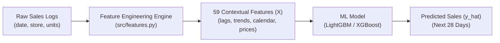
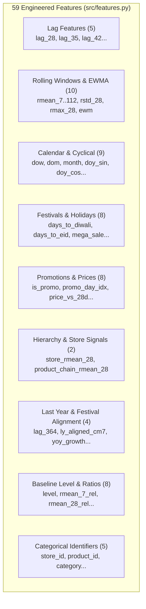

# 🎓 Phase 5: Feature Engineering — Turning Raw Data into ML Signals

> **Navigation:** [← Phase 4: SQL & Data Warehousing](file:///Users/kumarshivank/Downloads/retail-sales-forecasting/learning/04-sql-and-data-warehousing/README.md) | [Phase 6: Machine Learning Models →](file:///Users/kumarshivank/Downloads/retail-sales-forecasting/learning/06-machine-learning-models/README.md)

---

Welcome to **Phase 5** of the BharatMart learning guide! 

In earlier phases, you cleaned messy sales logs, discovered patterns through exploratory charts, and stored daily transactions into a high-performance relational database. Now comes the bridge between raw data and artificial intelligence: **Feature Engineering**.

If data is the fuel for machine learning, feature engineering is the refinery that turns crude oil into high-octane rocket fuel. Top data scientists often say:
> *"Coming up with features is difficult, time-consuming, requires expert knowledge. Applied machine learning is basically feature engineering."* — Prof. Andrew Ng

In this phase, you will learn how we transform raw dates, store IDs, and daily unit counts into **59 powerful numeric signals** in [`src/features.py`](file:///Users/kumarshivank/Downloads/retail-sales-forecasting/src/features.py).

---

## 1. What are Features?

### 1.1 The Bridge Between Raw Data and Machine Learning
Computers are fantastic at math, but they have zero common sense. A machine learning model doesn't know what "Diwali" means, doesn't know that Sundays are busier than Tuesdays, and doesn't know that milk expires quickly while rice sits on shelves for months.

Raw sales data usually looks like this:

| date | store_id | product_id | units_sold |
| :--- | :--- | :--- | :--- |
| 2024-10-31 | S001 | P01 | 142 |

An algorithm cannot predict future sales from just the text `"2024-10-31"` and `"P01"`. To predict future demand, the model needs numbers that describe the **context** of that day:
- What day of the week is it?
- Is there a major festival happening?
- How much did this product sell over the past month?
- Is there an active promotional discount?
- Has the store's overall foot traffic been growing?

These descriptive numbers are called **Features** (commonly denoted as $X$). The target variable we want to forecast is `units_sold` (commonly denoted as $y$).



### 1.2 The Umbrella Analogy ☔
Imagine your friend asks you: *"Will people buy umbrellas at our Mumbai store tomorrow?"*

How would your brain decide? You would instinctively look for clues:
1. **Weather:** Is it pouring outside right now? Is heavy rain forecast for tomorrow?
2. **Seasonality:** Is it July (monsoon season in Mumbai) or January (dry winter)?
3. **Recent History:** Did umbrella sales surge yesterday?
4. **Discounts:** Is the store offering a 20% monsoon discount tomorrow?
5. **Store Traffic:** Did the entire store experience a surge in foot traffic this week?

Each of those clues is a **feature**. In retail demand forecasting, feature engineering is the exact process of turning business domain clues into structured mathematical columns.

### 1.3 Before & After: What a Real Data Row Looks Like
Before feature engineering, your model sees almost nothing:
```
Raw Row:
[date="2024-10-31", store="S001", product="P01"] --> ???
```

After running [`build_features()`](file:///Users/kumarshivank/Downloads/retail-sales-forecasting/src/features.py#L76-L172), that single row expands into a rich 59-dimensional vector:
```
Engineered Row:
{
  "store_id": "S001",
  "product_id": "P01",
  "category": "Food",
  "dow": 3,                    # Thursday
  "is_weekend": 0,
  "days_to_diwali": 0,         # TODAY IS DIWALI!
  "lag_28": 58.0,              # Exactly 4 Thursdays ago, we sold 58 units
  "rmean_28": 52.4,            # 28-day baseline average
  "dow_mean_4w": 55.2,         # Average of the last 4 Thursdays
  "is_promo": 1,               # Active discount
  "discount_pct": 20.0,        # 20% off
  "promo_day_idx": 2,          # Day 2 of the promotion campaign
  "chain_promo_share": 1.0,    # All 10 stores nationwide are running this deal
  "store_rmean_28": 1840.5,    # Store S001 total volume is high
  "doy_sin": -0.865,           # Calendar position (late October)
  ... [44 more features]
}
```
Now the model has all the information it needs to predict a massive Diwali sales surge!

---

## 2. The Most Important Concept: DATA LEAKAGE ⚠️

If you remember only one lesson from this guide, make it this one. **Data leakage is the #1 reason machine learning models fail when deployed into production.**

### 2.1 What is Data Leakage?
> **Data Leakage** occurs when information from the **future** (or information that will not be available at prediction time) inadvertently slips into the model's training data.

Think of it like studying for an exam. If the teacher accidentally gives you the actual exam questions and answers the night before, you might score 100% on the test. You feel like a genius! But the following week, when you have to solve real problems at a job without an answer sheet, you fail completely.

In machine learning:
- **With Data Leakage:** Your model achieves 99% accuracy during testing on your laptop.
- **In Real Production:** The model makes wildly inaccurate predictions and causes stockouts or massive unsold waste.

### 2.2 The 28-Day Forecast Horizon
In BharatMart, our business requirement is defined in [`src/config.py`](file:///Users/kumarshivank/Downloads/retail-sales-forecasting/src/config.py#L32):
```python
HORIZON = 28  # We predict sales 28 days ahead (4 full weeks)
```

Why 28 days? In real-world retail supply chains, ordering inventory from manufacturers in Gujarat, shipping across regional distribution centers, and stocking store shelves in Bangalore or Delhi takes about 3 to 4 weeks. Store managers need predictions **4 weeks in advance** to place warehouse purchase orders.

Now consider how a forecast is generated in practice:

```
Today is October 3 (Forecast Day)
You must predict sales for October 31 (Target Day = 28 days ahead)

Timeline:
[... Past Days Known ...] ===> [Oct 3: Forecast Created] ------------------------> [Oct 31: Target Day]
                                                         <--- 28 Days Blind --->
                                                         (Oct 4 to Oct 30 sales DO NOT EXIST YET!)
```

### 2.3 The Beginner's Fatal Mistake
A beginner often builds a feature called `sales_yesterday` (`lag_1`) or `sales_last_week` (`lag_7`):

```python
# ❌ FATAL DATA LEAKAGE!
df["sales_yesterday"] = df["units_sold"].shift(1)
```

Why is this a disaster?
- When predicting sales for **October 31**, `sales_yesterday` would be sales on **October 30**.
- But when you run the forecast on **October 3**, October 30 has not happened yet! Its sales are in the future!
- If your training data gives the model October 30 sales, the model learns to rely heavily on it. In production on October 3, that column will be blank (`NaN`). The model crashes or outputs nonsense.

### 2.4 The BharatMart Golden Rule
In [`src/features.py`](file:///Users/kumarshivank/Downloads/retail-sales-forecasting/src/features.py#L3-L6), we enforce a strict rule:

> [!IMPORTANT]
> **The Leakage Rule:** Any feature calculated from historical sales (`units_sold`) must be shifted into the past by **at least 28 days** (`>= HORIZON`).
> 
> $$\text{Feature Value at Day } t = f(\text{Sales at Day } t - 28, t - 29, \dots)$$

```python
# In src/features.py:
h = horizon  # 28
S = W.shift(h)  # latest sales visible at forecast time
```

### 2.5 What CAN Use Day $t$ Information?
Beginners often ask: *"Wait, if everything is shifted by 28 days, can we use ANY information from Day $t$?"*

Yes! Features that are **planned or known in advance** are completely safe to use for Day $t$:
1. **Calendar:** We already know October 31, 2025 is a Friday.
2. **Festivals:** We already know Diwali in 2025 falls on October 20.
3. **Promotions:** The retail marketing team plans festive discounts weeks in advance.
4. **Price Lists:** Base retail prices are set by contract before the month begins.

### 2.6 How to Detect Data Leakage in Code
How can you tell if your ML model suffers from data leakage? Watch for these three telltale red flags:
1. **The "Too Good to Be True" Score:** If your test accuracy jumps from 75% to 99.8% overnight, you didn't invent a breakthrough algorithm — you leaked the target.
2. **Extreme Feature Importance:** If a single feature (like `lag_1`) accounts for 95% of all tree splits in LightGBM, check its shift offset immediately.
3. **Shuffling Time Series Data:** In [`src/train.py`](file:///Users/kumarshivank/Downloads/retail-sales-forecasting/src/train.py#L3-L6), we strictly use time-based splits (train on 2023–mid 2025, test on late 2025). Never use `train_test_split(shuffle=True)` on time-series data! Shuffling randomly puts tomorrow's sales into training and yesterday's sales into testing.

---

## 3. Types of Features in This Project

In [`src/features.py`](file:///Users/kumarshivank/Downloads/retail-sales-forecasting/src/features.py), we create 59 distinct features grouped into logical categories. Let's explore how each group works.



---

### 3.1 Lag Features

A **Lag** is simply the value of a variable from $K$ days in the past. 

```python
# In src/features.py (lines 98-99):
for lag in (h, h + 7, h + 14, h + 21, h + 28):
    F[f"lag_{lag}"] = W.shift(lag)
```

Why do we choose `28, 35, 42, 49, 56` days instead of `28, 29, 30, 31`?

Notice something special:
$$28 = 4 \times 7 \quad|\quad 35 = 5 \times 7 \quad|\quad 42 = 6 \times 7 \quad|\quad 49 = 7 \times 7 \quad|\quad 56 = 8 \times 7$$

Every single lag is an exact multiple of 7! 

**Why does this matter?** Retail sales have strong **weekly seasonality**. Saturday sales look like past Saturdays; Tuesday sales look like past Tuesdays. If we are forecasting for a Sunday 28 days from now:
- `lag_28` is the Sunday 4 weeks ago.
- `lag_35` is the Sunday 5 weeks ago.
- `lag_42` is the Sunday 6 weeks ago.

If we used `lag_29`, we would compare a busy Sunday to a quiet Monday, confusing the machine learning model.

#### Example Table: How Lag Shifting Works
Suppose today is Friday, Oct 31. What do the lag features see?

| Date | Day of Week | Actual Sales (Units) | `lag_28` (4 wks ago) | `lag_35` (5 wks ago) | `lag_42` (6 wks ago) |
| :--- | :--- | :--- | :--- | :--- | :--- |
| 2025-09-19 | Friday | **45** | ... | ... | ... |
| 2025-09-26 | Friday | **52** | ... | ... | **45** (Sep 19) |
| 2025-10-03 | Friday | **58** | ... | **52** (Sep 26) | **45** (Sep 19) |
| ... | ... | ... | ... | ... | ... |
| 2025-10-31 | Friday | 64 | **58** (Oct 3) | **52** (Sep 26) | **45** (Sep 19) |

---

### 3.2 Rolling Window Features

While a single lag is just a snapshot of one past day, a **Rolling Window** captures the broader recent trend by computing statistics over a moving block of time.

To guarantee zero leakage, all rolling statistics in [`src/features.py`](file:///Users/kumarshivank/Downloads/retail-sales-forecasting/src/features.py#L95-L107) are computed on the shifted sales matrix `S = W.shift(28)`:

```python
# S contains sales up to day t-28 (the latest date visible at forecast time)
for w in (7, 14, 28, 56, 112):
    F[f"rmean_{w}"] = S.rolling(w, min_periods=max(2, w // 2)).mean()

F["rstd_28"] = S.rolling(28, min_periods=14).std()
F["rmax_28"] = S.rolling(28, min_periods=14).max()
F["ewm_a10"]  = S.ewm(alpha=0.10).mean()
```

#### What Each Metric Tells the Model:
1. **Rolling Means (`rmean_7`, `rmean_14`, `rmean_28`, `rmean_56`, `rmean_112`):**
   - `rmean_7`: Very recent demand level (past week).
   - `rmean_28`: Monthly baseline demand.
   - `rmean_112`: Long-term quarterly volume (~16 weeks).
   - *Trend Intuition:* If `rmean_7` (120 units) is much higher than `rmean_56` (80 units), sales are rapidly accelerating!
2. **Rolling Standard Deviation (`rstd_28`):**
   - Measures **demand volatility**. Does this product sell a steady 10 units every single day, or does it bounce unpredictably between 0 and 50 units? High volatility alerts the model to widen its prediction uncertainty.
3. **Rolling Maximum (`rmax_28`):**
   - The single highest peak day during that month. Useful for understanding maximum surge capacity.
4. **Exponentially Weighted Moving Average (`ewm_a10`):**
   - In a simple 28-day average, day 1 and day 28 have the exact same weight ($1/28 \approx 3.5\%$).
   - But in retail, what happened 3 days ago is usually more relevant than what happened 27 days ago.
   - EWMA uses exponential decay:
   $$y_t = \alpha x_t + (1 - \alpha) y_{t-1}$$
   With $\alpha = 0.10$, recent observations get the highest weight, gently fading into the past.
5. **Weekday Average (`dow_mean_4w`):**
   - The average sales of the last 4 visible identical weekdays:
   $$\text{dow\_mean\_4w} = \frac{\text{lag\_28} + \text{lag\_35} + \text{lag\_42} + \text{lag\_49}}{4}$$
   - This provides the cleanest baseline for a specific day of the week, removing weekday noise.
6. **Promo-Free Baseline (`base_nopromo_56`):**
   - What does this product sell when there is **no promotional discount**?
   ```python
   # Filter only days where discount was 0, then calculate 56-day rolling average
   Wnp = W.where(P == 0).shift(h)
   F["base_nopromo_56"] = Wnp.rolling(56, min_periods=10).mean()
   ```
   - If a product had a 40% discount last week, sales jumped artificially. `base_nopromo_56` ignores that spike and measures true organic consumer demand.

---

### 3.3 Calendar Features & Cyclical Encoding

Time is cyclical: days of the week repeat every 7 days, and months repeat every 12 months. In [`calendar_features()`](file:///Users/kumarshivank/Downloads/retail-sales-forecasting/src/features.py#L52-L73), we extract:
- `dow`: Day of week ($0 = \text{Monday}, 6 = \text{Sunday}$)
- `dom`: Day of month ($1 \dots 31$)
- `month`: Month of year ($1 \dots 12$)
- `weekofyear`: ISO calendar week ($1 \dots 53$)
- `dayofyear`: Day of year ($1 \dots 365$)
- `is_weekend`: Binary flag ($1$ if Saturday or Sunday, else $0$)
- `is_month_start`: Binary flag ($1$ if day $\le 5$, capturing India's "salary credit" shopping boost)

#### The Cyclical Problem: Why 12 and 1 Confuse Models
Suppose you feed `month` as a number to a linear regression model or a decision tree:
- December is month `12`.
- January is month `1`.
- The computer calculates the numeric difference: $|12 - 1| = 11$.
- To the model, December and January look as far apart as possible! But in reality, **December 31 and January 1 are right next to each other**.

#### The Trigonometric Solution: Sin / Cosine Encoding
To solve this, we map the day of the year onto a 2D circle using sine and cosine functions:

```python
# In src/features.py (lines 61-62):
d["doy_sin"] = np.sin(2 * np.pi * dates.dayofyear / 365.25)
d["doy_cos"] = np.cos(2 * np.pi * dates.dayofyear / 365.25)
```

```
          (0, 1) Peak Summer (Day ~91)
             |
   Day 365   |   Day 1
   (Dec 31)  |  (Jan 1)
 (-0.01, 1)  | (0.01, 1)  <-- December 31 & January 1 are right next to each other!
       \     |     /
(-1, 0)------+------(1, 0)
             |
             |
          (0, -1) Winter (Day ~273)
```

Let's check the coordinates across key dates:

| Date | Day of Year | `doy_sin` | `doy_cos` | Note |
| :--- | :---: | :---: | :---: | :--- |
| Jan 1 | 1 | $+0.017$ | $+0.999$ | Right beside Dec 31! |
| Apr 2 | 92 | $+1.000$ | $+0.003$ | Spring peak |
| Jul 2 | 183 | $+0.004$ | $-1.000$ | Mid-year point |
| Oct 1 | 274 | $-1.000$ | $-0.009$ | Autumn peak |
| Dec 31 | 365 | $-0.004$ | $+0.999$ | Seamlessly connects to Jan 1! |

Now, the coordinate distance between December 31 and January 1 is tiny, allowing machine learning models to smoothly transition across calendar years without artificial boundary jumps.

---

### 3.4 Festival Features: The Indian Retail Engine 🪔

In Indian retail, festivals are the ultimate revenue drivers. During **Diwali**, category sales for sweets, apparel, electronics, and home goods surge by **300% to 400%**!

In [`src/calendar_india.py`](file:///Users/kumarshivank/Downloads/retail-sales-forecasting/src/calendar_india.py), we track major cultural events:
- Diwali, Dussehra, Holi, Eid, Raksha Bandhan, Christmas, and national holidays (Republic Day, Independence Day, Gandhi Jayanti).

#### Distance to Event (`days_to_event`)
Instead of just a simple yes/no flag on the holiday itself, shopping behavior begins weeks prior. People buy new clothes 10 days before Diwali, not the morning of the festival.

Using [`days_to_event()`](file:///Users/kumarshivank/Downloads/retail-sales-forecasting/src/calendar_india.py#L60-L67), we compute the signed number of days to the nearest festival:

```python
# In src/calendar_india.py:
def days_to_event(dates: pd.Series, event_dates: pd.DatetimeIndex, clip: int = 30) -> pd.Series:
    d = pd.to_datetime(dates).values.astype("datetime64[D]").astype("int64")
    e = event_dates.values.astype("datetime64[D]").astype("int64")
    diff = d[:, None] - e[None, :]
    nearest = diff[range(len(d)), abs(diff).argmin(axis=1)]
    return pd.Series(nearest, index=dates.index).clip(-clip, clip)
```

- **Negative value (e.g., `-5`):** 5 days *before* Diwali (feverish pre-festival shopping rush).
- **Zero (`0`):** Festival day itself.
- **Positive value (e.g., `+3`):** 3 days *after* Diwali (market cooling off, lower sales).
- **Clipped to `[-30, +30]`:** If Diwali is 180 days away, the exact count doesn't matter; clipping prevents extreme outliers.

#### The Tricky "Diwali Alignment" Problem
In Western retail, Christmas is always December 25. You can compare December 25, 2024 to December 25, 2023 with a standard 364-day lag (`lag_364`).

In India, **festivals follow the Hindu lunar calendar**. Look at how Diwali shifts:
- **2022:** October 24
- **2023:** November 12 (19 days later!)
- **2024:** October 31 (12 days earlier!)
- **2025:** October 20

If you simply look back 52 weeks (`lag_364`) on Diwali 2023 (Nov 12), you are comparing it to **Nov 13, 2022** — which was a completely quiet, normal day 3 weeks *after* Diwali 2022 had already ended! The model would completely miss the festival surge!

#### How BharatMart Solves It: [`_diwali_aligned_positions()`](file:///Users/kumarshivank/Downloads/retail-sales-forecasting/src/features.py#L40-L49)
```python
def _diwali_aligned_positions(dates: pd.DatetimeIndex) -> np.ndarray:
    diw = festival_dates("diwali")
    shifts = np.full(len(dates), 364)  # Normal default: 52 weeks (same weekday)
    for k in range(1, len(diw)):
        near = np.abs((dates - diw[k]).days) <= 45  # Near Diwali (+/- 45 days)
        shifts[near] = (diw[k] - diw[k - 1]).days   # Shift by exact gap (e.g., 384 days)
    return np.arange(len(dates)) - shifts
```

When we are within 45 days of Diwali, our feature shifts by the **exact calendar gap between consecutive Diwalis** (e.g., 384 days between 2022 and 2023). This aligns the peak of Diwali last year directly with the peak of Diwali this year!

This generates:
- `ly_aligned_cm7`: The 7-day centered rolling mean around last year's aligned Diwali.
- `yoy_growth`: Year-over-year sales growth ratio.
- `ly_expected`: Last year's aligned sales scaled by this year's organic growth rate.

---

### 3.5 Promotion & Price Features 🏷️

Promotions in retail are planned weeks in advance by marketing teams, making them valid "advance knowledge" features for Day $t$:

1. `is_promo`: Binary flag ($1$ if a discount is active, $0$ otherwise).
2. `discount_pct`: The percentage discount offered (e.g., `15.0%`).
3. `days_since_promo`: Number of days since this product was last on sale (clipped to $[0, 14]$). If a product was on sale yesterday, today's promo has less novelty than if it hasn't been discounted in two weeks.
4. `promo_day_idx`: How many consecutive days this promotion has been active.
   - *Behavioral Insight:* Day 1 of a sale attracts huge rush; by Day 6, deal fatigue sets in.
5. `chain_promo_share`: The fraction of all 10 BharatMart stores running a discount on this product today ($0.0 \dots 1.0$). If all 10 stores are discounting, it's a massive nationwide campaign!
6. `price_vs_28d`: Current price divided by price 28 days ago ($P_t / P_{t-28}$). Captures recent price hikes or price drops.
7. `log_price`: Natural logarithm of unit price ($\ln(\text{price})$).
8. `effective_price`: The actual customer shelf price after discount:
   $$\text{effective\_price} = \text{unit\_price} \times \left(1 - \frac{\text{discount\_pct}}{100}\right)$$

---

### 3.6 Hierarchy & Store Features 🏢

A single product does not exist in a vacuum. If the overall store is packed with customers, every product gets a lift.

In [`src/features.py`](file:///Users/kumarshivank/Downloads/retail-sales-forecasting/src/features.py#L125-L131):
- `store_rmean_28`: The 28-day rolling average of **all products combined** in that specific store. Tells the model whether this store location (e.g., Koramangala, Bangalore) is booming or slowing down.
- `product_chain_rmean_28`: The 28-day rolling average of **this specific product across all 10 stores nationwide**. Tells the model whether a product (e.g., Fortune Basmati Rice) is popular nationally regardless of store.

---

### 3.7 The Baseline "Level" and Relative Ratio Architecture 📈

Tree-based models (like LightGBM and XGBoost) have an inherent mathematical limitation: **they cannot extrapolate trends beyond the minimum and maximum values they saw during training**.

If BharatMart is growing at 16% per year:
- Diwali 2023 sold 250 units.
- Diwali 2024 sold 290 units.
- In Diwali 2025, true demand will reach 340 units.
- A raw tree model will cap out at 290 because no leaf node has ever seen 340!

#### The Solution: Train on Relative Multipliers
In [`src/features.py`](file:///Users/kumarshivank/Downloads/retail-sales-forecasting/src/features.py#L133-L139) and [`src/forecast.py`](file:///Users/kumarshivank/Downloads/retail-sales-forecasting/src/forecast.py#L74-L88), we construct a **`level`** baseline:

```python
# Level represents normal baseline demand without temporary promotions
level = F["base_nopromo_56"].fillna(F["rmean_56"]).fillna(F["rmean_28"]).clip(lower=0.5)
F["level"] = level

# Calculate relative ratios (e.g., recent sales / baseline)
for c in ("rmean_7", "rmean_28", "dow_mean_4w", "ly_aligned_cm7", "ly_expected", "lag_364", "ewm_a10"):
    F[f"{c}_rel"] = F[c] / level
```

Instead of predicting raw units, the tree model predicts:
$$\text{Target Multiplier} = \frac{\text{units\_sold}}{\text{level}}$$

A multiplier of `1.0` means average normal sales. A multiplier of `3.5` means Diwali rush. The multiplier is stable across years, so the tree model easily predicts the `3.5x` lift, and multiplying back by `level` produces the true growing unit forecast (e.g., $3.5 \times 97 = 340$ units)!

---

## 4. The Wide-Matrix Trick ⚡

How do you engineer 59 complex features across **400 time series** (10 stores $\times$ 40 products) over **1,461 days** (4 full years = 584,400 rows) without your computer running out of RAM or taking 20 minutes to compute?

### 4.1 The Naive Beginner Way (Slow 🐢)
Beginners usually use Pandas `groupby`:

```python
# ❌ SLOW: Takes 45+ seconds!
for lag in [28, 35, 42, 49, 56]:
    df[f"lag_{lag}"] = df.groupby(["store_id", "product_id"])["units_sold"].shift(lag)
```
In Python, looping through 400 groups for dozens of features creates massive interpreter overhead and repeated indexing lookups.

### 4.2 The BharatMart Vectorized Way (Instant ⚡)
In [`src/features.py`](file:///Users/kumarshivank/Downloads/retail-sales-forecasting/src/features.py#L87-L91), we pivot the long table into a **2D Wide Matrix**:

```python
# Pivot to wide matrix: Index = 1,461 dates, Columns = 400 series
W = df.pivot(index="date", columns=["store_id", "product_id"], values="units_sold")
# Shape of W: (1461, 400)
```

```
                   Store 1, Prod 1   Store 1, Prod 2  ...  Store 10, Prod 40
Date
2022-01-01             12                  45                     8
2022-01-02             15                  40                    10
...                    ...                 ...                   ...
2025-12-31             22                  55                    14
```

Now, shifting or rolling is a **single vectorized NumPy/C operation across all 400 series at the same time**:

```python
# Computes lag_28 for all 400 stores and products in 2 milliseconds!
lag_28_wide = W.shift(28)

# Computes 7-day rolling mean for all 400 series simultaneously!
rmean_7_wide = S.rolling(7).mean()
```

### 4.3 Flattening Back with `ravel()`
Because the clean grid is guaranteed complete and sorted by `(date, store_id, product_id)`, flattening the wide matrix back into the long table requires just one fast memory operation:

```python
# In src/features.py (line 164):
out[name] = wide.values.ravel().astype("float32")
```

The entire 59-feature generation across half a million rows finishes in **less than 2 seconds**!

---

## 5. Feature Count Summary

Here is the complete catalog of all **59 engineered features** built in [`src/features.py`](file:///Users/kumarshivank/Downloads/retail-sales-forecasting/src/features.py):

| # | Category | Count | Feature Names | Description & Business Purpose |
| :---: | :--- | :---: | :--- | :--- |
| 1 | **Categorical IDs** | 5 | `store_id`, `product_id`, `category`, `store_type`, `region` | Core identity attributes encoded as categorical variables for tree splits. |
| 2 | **Promotion & Price** | 8 | `discount_pct`, `is_promo`, `days_since_promo`, `promo_day_idx`, `chain_promo_share`, `price_vs_28d`, `log_price`, `effective_price` | Planned promotional calendar, deal fatigue index, chain-wide discount intensity, and price elasticity signals. |
| 3 | **Lag Features** | 5 | `lag_28`, `lag_35`, `lag_42`, `lag_49`, `lag_56` | Historical sales from 4, 5, 6, 7, and 8 weeks ago (aligned to same day of week, shifted $\ge 28$ days to avoid leakage). |
| 4 | **Rolling Statistics & EWMA** | 10 | `rmean_7`, `rmean_14`, `rmean_28`, `rmean_56`, `rmean_112`, `rstd_28`, `rmax_28`, `ewm_a10`, `dow_mean_4w`, `base_nopromo_56` | Short, medium, and long-term trend lines, volatility (std dev), peak sales, exponential memory, weekday baseline, and promo-free organic demand. |
| 5 | **Last Year & Festival Alignment** | 4 | `lag_364`, `ly_aligned_cm7`, `yoy_growth`, `ly_expected` | 52-week lag, Diwali-aligned centered rolling mean, YoY growth multiplier, and expected festive demand level. |
| 6 | **Hierarchy Aggregations** | 2 | `store_rmean_28`, `product_chain_rmean_28` | Whole-store foot traffic level and national chain-wide product popularity. |
| 7 | **Baseline Level & Relative Ratios** | 8 | `level`, `rmean_7_rel`, `rmean_28_rel`, `dow_mean_4w_rel`, `ly_aligned_cm7_rel`, `ly_expected_rel`, `lag_364_rel`, `ewm_a10_rel` | Trend baseline and relative ratio features enabling tree models to predict multiplicative lifts without saturating on growth. |
| 8 | **Calendar & Cyclical** | 9 | `dow`, `dom`, `month`, `weekofyear`, `dayofyear`, `is_weekend`, `is_month_start`, `doy_sin`, `doy_cos` | Day-of-week, salary cycle indicators, and circular sine/cosine calendar coordinate transformations. |
| 9 | **Festivals & Events** | 8 | `days_to_diwali`, `days_to_dussehra`, `days_to_holi`, `days_to_eid`, `days_to_rakhi`, `days_to_christmas`, `is_national_holiday`, `mega_sale` | Signed day distance to major Indian festivals (clipped to $\pm 30$), national holidays, and chain-wide mega sale periods. |
| | **TOTAL** | **59** | | **Complete feature matrix ready for model training!** |

---

## 6. Self-Check: Test Your Understanding 🧠

Before moving on, verify your understanding of feature engineering:

1. **Question:** Why can't we use yesterday's sales (`lag_1`) when forecasting retail demand for next month?
   <details>
   <summary><b>Click for Answer</b></summary>
   Because our forecast horizon is 28 days. When you sit at your desk on October 3 to forecast for October 31, October 30 sales have not happened yet. Using them during training would be data leakage, and the model would fail in production.
   </details>

2. **Question:** Why are our lag features spaced 7 days apart (`lag_28`, `lag_35`, `lag_42`...)?
   <details>
   <summary><b>Click for Answer</b></summary>
   To preserve day-of-week seasonality. A Sunday 28 days ago is also a Sunday. Comparing Sunday to a Tuesday would introduce huge artificial noise.
   </details>

3. **Question:** Why do we convert day-of-year into sine and cosine coordinates?
   <details>
   <summary><b>Click for Answer</b></summary>
   Because time is circular. Numeric day 365 (Dec 31) and numeric day 1 (Jan 1) look far apart to a model (|365 - 1| = 364), but on a sine/cosine unit circle, they sit immediately next to each other.
   </details>

4. **Question:** Why do decision tree models need the `level` scaling trick?
   <details>
   <summary><b>Click for Answer</b></summary>
   Tree models cannot predict numbers higher than what they saw during training. When sales grow year-over-year, raw unit trees under-predict every new peak. Predicting the ratio (units / level) solves this because the festive ratio is constant across years.
   </details>

---

## 7. Key Takeaways

1. **Features Are the Bridge:** Machine learning models cannot parse raw strings or dates. Features convert real-world retail context into numbers.
2. **Prevent Data Leakage at All Costs:** Always ask: *"Will this exact number be available on the day I generate the forecast?"* If the answer is no, shifting by `HORIZON` (28 days) is mandatory.
3. **Respect Seasonality (Multiples of 7):** When choosing lags for daily retail data, stick to weekly intervals (`28, 35, 42...`) to avoid mixing weekday patterns.
4. **Account for Moving Holidays:** Lunar festivals like Diwali move every year. Static calendar lags fail; you must align by the actual festival event distance.
5. **Normalize for Tree Models:** Decision trees cannot extrapolate upward trends. Training on relative ratios (`sales / level`) lets models predict multipliers that scale naturally with business growth.
6. **Vectorize with Wide Matrices:** Pivoting into `(dates × series)` transforms agonizingly slow row-by-row calculations into blazing fast matrix math.

---

## Next Steps

Now that we have created 59 structured features, we are ready to feed them into machine learning algorithms!

In Phase 6, we will train and compare **Linear Regression**, **Random Forest**, **XGBoost**, and **LightGBM**, and learn how to combine them into an accurate production ensemble.

👉 **Continue to [Phase 6: Machine Learning Models →](file:///Users/kumarshivank/Downloads/retail-sales-forecasting/learning/06-machine-learning-models/README.md)**
