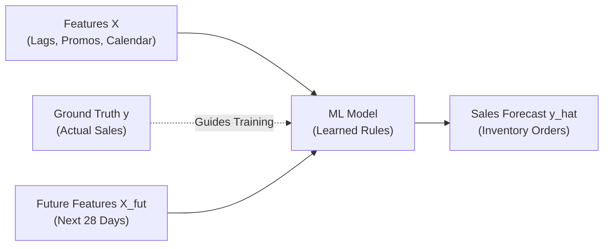
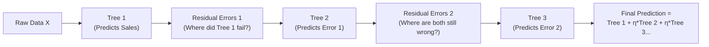
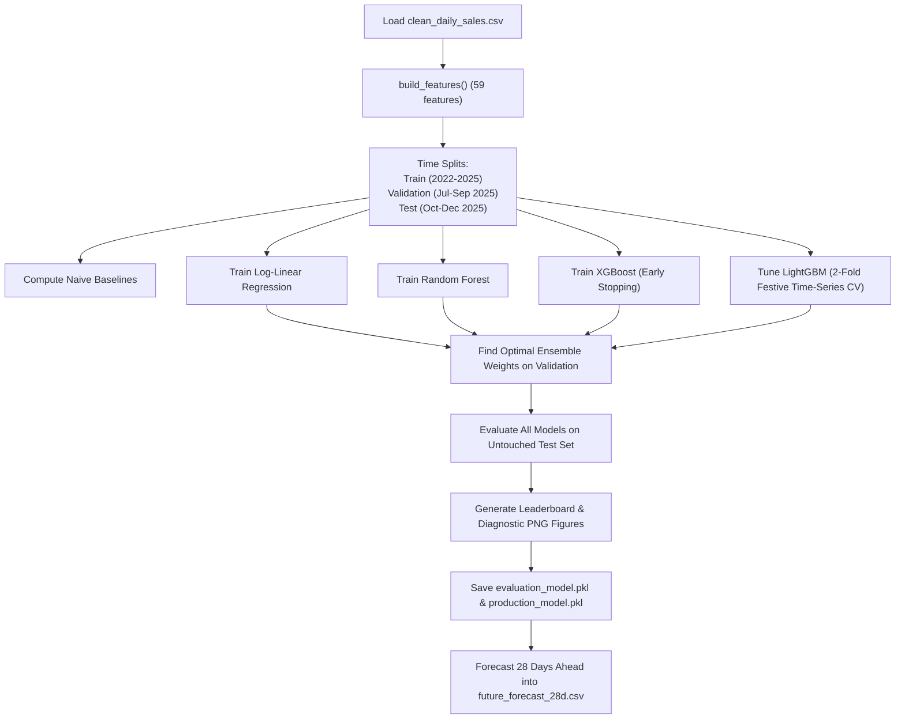

# 🤖 Phase 6: Machine Learning Models

> **Welcome to Phase 6!** This is the engine room of the BharatMart forecasting project. In [Phase 5: Feature Engineering](file:///Users/kumarshivank/Downloads/retail-sales-forecasting/learning/05-feature-engineering/README.md), we took raw dates, store codes, and sales records and engineered 59 signals: rolling averages, festival countdowns, price elasticity flags, and seasonal baselines. Now, we put those features to work. In this phase, we explore how Machine Learning algorithms learn from the past to forecast future retail demand.

---

## 📋 Table of Contents

1. [What is Machine Learning?](#1-what-is-machine-learning)
   - [1.1 Traditional Programming vs. Machine Learning](#11-traditional-programming-vs-machine-learning)
   - [1.2 The Weather & Umbrella Analogy](#12-the-weather--umbrella-analogy)
   - [1.3 The Three Flavors of Machine Learning](#13-the-three-flavors-of-machine-learning)
   - [1.4 Supervised Learning at BharatMart](#14-supervised-learning-at-bharatmart)
2. [Baseline Models — The Starting Point](#2-baseline-models--the-starting-point)
   - [2.1 Why Baselines Are Non-Negotiable](#21-why-baselines-are-non-negotiable)
   - [2.2 Naive Baseline: 4-Week Rolling Average](#22-naive-baseline-4-week-rolling-average)
   - [2.3 Seasonal Naive: Same Day Last Year × Growth](#23-seasonal-naive-same-day-last-year--growth)
   - [2.4 The Baseline Hurdle](#24-the-baseline-hurdle)
3. [Linear Regression](#3-linear-regression)
   - [3.1 The Simplest ML Model: Fitting a Straight Line](#31-the-simplest-ml-model-fitting-a-straight-line)
   - [3.2 A Simple 1-Feature Example](#32-a-simple-1-feature-example)
   - [3.3 Log-Linear Regression (Why Retail Demand Multiplies)](#33-log-linear-regression-why-retail-demand-multiplies)
   - [3.4 The Duan's Smearing Fix (Overcoming Jensen's Inequality)](#34-the-duans-smearing-fix-overcoming-jensens-inequality)
4. [Decision Trees](#4-decision-trees)
   - [4.1 The 20 Questions Game](#41-the-20-questions-game)
   - [4.2 How a Tree Splits the Data](#42-how-a-tree-splits-the-data)
   - [4.3 The Danger of Overfitting](#43-the-danger-of-overfitting)
5. [Random Forest](#5-random-forest)
   - [5.1 The Wisdom of Crowds (Bagging)](#51-the-wisdom-of-crowds-bagging)
   - [5.2 How Random Forest Tames Overfitting](#52-how-random-forest-tames-overfitting)
   - [5.3 BharatMart Performance](#53-bharatmart-performance)
6. [Gradient Boosting (XGBoost & LightGBM)](#6-gradient-boosting-xgboost--lightgbm)
   - [6.1 Boosting: Learning Sequentially from Mistakes](#61-boosting-learning-sequentially-from-mistakes)
   - [6.2 The Student Retaking a Test Analogy](#62-the-student-retaking-a-test-analogy)
   - [6.3 XGBoost: The Competition Veteran](#63-xgboost-the-competition-veteran)
   - [6.4 LightGBM: Fast, Leaf-Wise Specialist](#64-lightgbm-fast-leaf-wise-specialist)
   - [6.5 Level-Wise vs. Leaf-Wise Tree Growth](#65-level-wise-vs-leaf-wise-tree-growth)
7. [Tweedie Loss Function — Why Regular Error Fails](#7-tweedie-loss-function--why-regular-error-fails)
   - [7.1 The Rice vs. Earbuds Problem](#71-the-rice-vs-earbuds-problem)
   - [7.2 Why Mean Squared Error (MSE) Breaks Down](#72-why-mean-squared-error-mse-breaks-down)
   - [7.3 The Tweedie Solution: Variance ∝ Mean^p](#73-the-tweedie-solution-variance--meanp)
8. [Level-Normalized Target — The Extrapolation Fix](#8-level-normalized-target--the-extrapolation-fix)
   - [8.1 Why Decision Trees Cannot Extrapolate](#81-why-decision-trees-cannot-extrapolate)
   - [8.2 BharatMart's 16% Annual Growth Dilemma](#82-bharatmarts-16-annual-growth-dilemma)
   - [8.3 The Solution: Predicting Ratios (`LevelScaledModel`)](#83-the-solution-predicting-ratios-levelscaledmodel)
9. [Ensemble — Combining Models](#9-ensemble--combining-models)
   - [9.1 Why Combine Models?](#91-why-combine-models)
   - [9.2 Finding Optimal Blend Weights](#92-finding-optimal-blend-weights)
   - [9.3 Our Final Ensemble Recipe](#93-our-final-ensemble-recipe)
10. [Model Training Pipeline & Checkpointing](#10-model-training-pipeline--checkpointing)
    - [10.1 Pipeline Walkthrough in `train.py`](#101-pipeline-walkthrough-in-trainpy)
    - [10.2 Crash-Proof Training with Stage Checkpoints](#102-crash-proof-training-with-stage-checkpoints)
    - [10.3 Two Model Bundles: Evaluation vs. Production](#103-two-model-bundles-evaluation-vs-production)
11. [Leaderboard & Key Takeaways](#11-leaderboard--key-takeaways)
12. [Next Steps](#12-next-steps)

---

## 1. What is Machine Learning?

### 1.1 Traditional Programming vs. Machine Learning

In traditional computer programming, a software engineer sits down and writes explicit, step-by-step logic. If you want a computer to forecast sales, you might write code like this:

```python
# Traditional rules-based logic
if is_weekend and is_diwali:
    forecast = last_week_sales * 2.5
elif is_weekend:
    forecast = last_week_sales * 1.3
else:
    forecast = last_week_sales * 1.0
```

This works fine for small, tidy problems. But BharatMart sells **40 products** across **10 stores** in **6 cities** under fluctuating discounts, heatwaves, paydays, and festive seasons. Writing `if/elif/else` statements for every combination of store location, shelf price, product category, and holiday calendar is impossible.

**Machine Learning (ML)** flips the paradigm:

```
Traditional Programming:
  Rules + Data  ────────► [ Computer ] ────────► Answers

Machine Learning:
  Data  + Answers ──────► [ Computer ] ────────► Rules (Model)
```

Instead of humans writing rules, we feed historical data and outcomes into an algorithm. The algorithm inspects patterns, tests hypotheses, measures its errors, and extracts the mathematical rules automatically.

---

### 1.2 The Weather & Umbrella Analogy

Imagine you want to teach a 7-year-old child when to take an umbrella to school:

1. **The Traditional Programming Way**: You give them an exhaustive checklist:
   *"If the sky is dark gray AND humidity is above 75% AND wind speed is 15 km/h, take an umbrella. But if it is morning fog without rain clouds, do not take an umbrella..."*  
   The child gets confused, forgets rules, and gets soaked when an unlisted situation happens.

2. **The Machine Learning Way**: You show them a photo album of the last 100 school days. For every day, you show what the morning looked like and whether it rained in the afternoon. After browsing 100 examples, the child intuitively grasps: *"Whenever the clouds look like bruised purple cotton balls, I get wet unless I carry an umbrella."*

The child just "trained" an internal mental model.

```
                    ┌─────────────────────────┐
100 Historical Days │ Morning sky conditions  │
    with Answers:   │ + Did it rain at 3 PM?  │
                    └────────────┬────────────┘
                                 │  Child observes patterns
                                 ▼
                     Internal Intuition (Model)
                                 │
                 New day: "Dark, swirling clouds"
                                 ▼
                      Decision: "Take umbrella!"
```

---

### 1.3 The Three Flavors of Machine Learning

Machine learning is generally grouped into three major categories:

| Type | How It Works | Real-World Example | In Our Project? |
|---|---|---|---|
| **Supervised Learning** | The algorithm is given inputs ($X$) and correct historical answers ($y$). It learns a function $f(X) \approx y$. | Spam email detection (labeled "spam" vs "not spam"). | **YES!** We know past daily unit sales. |
| **Unsupervised Learning** | The algorithm receives data without any target answers. It looks for natural clusters or groupings. | Grouping retail shoppers into customer personas based on spending habits. | No (covered in advanced marketing analytics). |
| **Reinforcement Learning** | An agent takes actions in an environment and receives rewards or penalties through trial and error. | Training an AI to play Chess or park an autonomous car. | No (not needed for tabular forecasting). |

---

### 1.4 Supervised Learning at BharatMart

In our project, we practice **Supervised Regression**:
- **Inputs ($X$)**: The 59 engineered features for each (store, product, date) row — e.g., 28-day rolling average, discount percentage, day of week, days until Diwali.
- **Target Answer ($y$)**: The exact number of units sold on that day (`units_sold`).
- **Goal**: Find a predictive function $\hat{y} = f(X)$ such that our predictions $\hat{y}$ stay as close as possible to the true sales $y$ across all stores and items over a future 28-day horizon.



---

## 2. Baseline Models — The Starting Point

### 2.1 Why Baselines Are Non-Negotiable

Before opening fancy deep learning or gradient boosting packages, every professional data scientist creates **heuristic baseline models**.

A baseline is a dead-simple, rule-of-thumb prediction that requires zero advanced machine learning. 

> [!IMPORTANT]
> **The Golden Benchmark Rule**  
> If an XGBoost model with 500 decision trees and 60 engineered features cannot beat a simple rolling average, your ML model is completely useless! Never deploy a complex model without proving that it soundly defeats simple common-sense baselines.

In [`src/train.py`](file:///Users/kumarshivank/Downloads/retail-sales-forecasting/src/train.py#L141-L147), we build two standard baselines.

---

### 2.2 Naive Baseline: 4-Week Rolling Average

The simplest forecast imaginable: *"Tomorrow, a store will sell whatever it averaged over the past 4 weeks."*

$$\hat{y}_{t} = \text{Average}(\text{sales of previous 28 days})$$

- **Strengths**: Adapts to recent volume shifts; extremely easy to compute.
- **Weaknesses**: Completely blind to weekly patterns (Saturdays vs. Tuesdays), holidays, promotional discounts, and festivals. When Diwali arrives, this model predicts ordinary October volume and fails drastically.
- **Accuracy on BharatMart**: **64.52%** (Test WAPE = 0.3548).

```python
# Naive 4-week rolling average baseline from src/train.py
val_pred["Naive (last 4 weeks avg)"] = X.rmean_28[va].values
test_pred["Naive (last 4 weeks avg)"] = X.rmean_28[te].values
```

---

### 2.3 Seasonal Naive: Same Day Last Year × Growth

Retail follows an annual calendar rhythm. People buy decorative lights in October/November (Diwali), warm clothing in December, and cold beverages in May.

The **Seasonal Naive** baseline says: *"Take the sales from the exact same calendar day 365 days ago, and multiply by BharatMart's overall annual business growth rate (16%)."*

$$\hat{y}_{t} = y_{t-365} \times (1 + \text{annual\_growth})$$

- **Strengths**: Automatically captures summer surges, winter drops, and annual seasonality.
- **Weaknesses**: Religious and lunar festivals (like Diwali and Eid) shift by 10–20 days every Gregorian year. Looking at October 20 last year might miss Diwali completely if Diwali was on November 12!
- **Accuracy on BharatMart**: **67.77%** (Test WAPE = 0.3223).

---

### 2.4 The Baseline Hurdle

Here is the benchmark hurdle our machine learning models must clear:

```
┌───────────────────────────────────────────────────────────┐
│              THE BENCHMARK HURDLE TO BEAT                 │
├──────────────────────────────────────┬────────────────────┤
│ Baseline Model                       │ Test Accuracy      │
├──────────────────────────────────────┼────────────────────┤
│ Naive (4-Week Rolling Average)       │ 64.5%              │
│ Seasonal Naive (Last Year × Growth)  │ 67.8%              │
│ Target for Machine Learning          │ > 75.0%            │
└──────────────────────────────────────┴────────────────────┘
```

Now let's examine the ML models that take on this challenge.

---

## 3. Linear Regression

### 3.1 The Simplest ML Model: Fitting a Straight Line

Linear regression is the foundational model of statistics and machine learning. Its goal is simple: find a straight line (or flat hyperplane) through data points that minimizes the sum of squared distances between the points and the line.

The formula for multiple linear regression is:

$$\hat{y} = w_1 x_1 + w_2 x_2 + w_3 x_3 + \dots + w_n x_n + b$$

Where:
- $x_1, x_2, \dots, x_n$ are the input features (e.g., yesterday's sales, discount rate).
- $w_1, w_2, \dots, w_n$ are the **weights** (or coefficients) the model learns.
- $b$ is the **bias** (the intercept where the line crosses zero).
- $\hat{y}$ is the predicted sales figure.

```
 Units Sold (y)
     ▲
 200 │                                * (Actual Sale)
     │                           *   /
 150 │                      *  .----' (Residual Error)
     │                 *   .--'
 100 │            *  .----'
     │       * .----'    Predicted Line: y = w1*Discount + b
  50 │   .----'
     │  *
   0 └────────────────────────────────────────► Discount % (x)
       0%     10%     20%     30%     40%
```

---

### 3.2 A Simple 1-Feature Example

Imagine we predict daily Basmati Rice sales using only one feature: the store's 28-day rolling average ($x_1$).

After scanning historical data, our linear model might learn:
- $w_1 = 1.05$ (sales are generally 5% above the trailing average due to chain growth)
- $b = 3.2$ (base floor sales)

$$\hat{y} = 1.05 \times \text{rmean\_28} + 3.2$$

If a store's 28-day average is 100 units, the model forecasts:
$$\hat{y} = 1.05 \times 100 + 3.2 = 108.2 \text{ units}$$

---

### 3.3 Log-Linear Regression (Why Retail Demand Multiplies)

Standard linear regression makes a fatal assumption: **features combine by adding**.

$$\text{Forecast} = \text{Base} + \text{Weekend Effect} + \text{Diwali Effect} + \text{Promo Effect}$$

In retail reality, demand drivers **multiply**:
- Saturday adds a **+30%** boost ($\times 1.30$).
- Diwali week adds a **+150%** surge ($\times 2.50$).
- A 20% discount adds a **+40%** lift ($\times 1.40$).

If all three happen on the same Saturday:
$$\text{Actual Demand} \approx \text{Base} \times 1.30 \times 2.50 \times 1.40 = \text{Base} \times 4.55 \quad (\text{a 355\% spike!})$$

An additive linear model cannot capture this compounding multiplication.

#### 💡 The Logarithmic Trick
High school algebra gives us a magical property of logarithms:

$$\log(A \times B \times C) = \log(A) + \log(B) + \log(C)$$

Logarithms turn multiplication into addition! If we transform our target sales into log-space:

$$\log(\text{units\_sold}) = w_1 x_1 + w_2 x_2 + \dots + b$$

A regular linear regression model can now handle multiplicative interactions naturally. This is implemented in [`LogLinearRegression`](file:///Users/kumarshivank/Downloads/retail-sales-forecasting/src/forecast.py#L39-L71).

---

### 3.4 The Duan's Smearing Fix (Overcoming Jensen's Inequality)

When you train a model in log-space, you must convert predictions back to real units using the exponential function:

$$\hat{y} = \exp(\widehat{\log y})$$

Here is the mathematical trap: by **Jensen's Inequality**, the exponential of an average is strictly less than the average of the exponentials:

$$\mathbb{E}[\exp(Z)] > \exp(\mathbb{E}[Z])$$

If you naively run `np.exp(log_prediction)`, your forecasts will **systematically underpredict real sales by 5% to 15%**!

#### The Smearing Correction
In 1983, statistician Naihua Duan published a simple, elegant solution called **Duan's Smearing Factor**.

1. Calculate the model's residual errors in log-space: $\text{resid} = \log(y) - \widehat{\log y}$.
2. Exponentiate those residuals and take their mean:

$$\text{smear} = \frac{1}{N} \sum_{i=1}^{N} \exp(\text{resid}_i)$$

3. Multiply all future back-transformed predictions by this smearing factor:

$$\hat{y} = \exp(\widehat{\log y}) \times \text{smear} - 1$$

Here is how cleanly this is written in [`src/forecast.py`](file:///Users/kumarshivank/Downloads/retail-sales-forecasting/src/forecast.py#L61-L71):

```python
# From src/forecast.py - LogLinearRegression
def fit(self, X, y):
    self.pipe = self._build(list(X.columns))
    ly = np.log1p(y)                       # Target in log space
    self.pipe.fit(X, ly)
    resid = ly - self.pipe.predict(X)      # Log residuals
    self.smear = float(np.mean(np.exp(resid))) # Duan's smearing factor
    return self

def predict(self, X):
    # Back-transform and correct the underprediction bias
    return np.exp(self.pipe.predict(X)) * self.smear - 1
```

- **Accuracy on BharatMart**: **75.80%** (Test WAPE = 0.2420).  
  *Notice that our corrected Log-Linear model easily beats both baseline heuristics (64.5% and 67.8%)!*

---

## 4. Decision Trees

### 4.1 The 20 Questions Game

Have you ever played the game **20 Questions**? One person thinks of a secret object (say, an elephant), and the other person asks yes/no questions to guess it:
1. *"Is it alive?"* → Yes
2. *"Is it bigger than a car?"* → Yes
3. *"Does it live in the ocean?"* → No
4. *"Does it have a trunk?"* → Yes → **Elephant!**

A **Decision Tree** works in the exact same way. It learns a hierarchical flowchart of yes/no binary splits to partition retail data into homogeneous pockets of demand.

```
                     [ Is it Diwali Season? ]
                            /        \
                        YES /          \ NO
                          ▼              ▼
              [ Is Discount > 15%? ]     [ Is it a Weekend? ]
                    /        \                 /        \
                YES/          \NO          YES/          \NO
                  ▼            ▼             ▼            ▼
             Predict:     Predict:      Predict:     Predict:
             250 units    140 units     85 units     45 units
```

---

### 4.2 How a Tree Splits the Data

How does the computer decide which question to ask first?

At every step, the algorithm scans **every single feature** and **every possible threshold** (e.g., `discount > 5%`, `discount > 10%`, `lag_7 > 50`, `dow == Sunday`).

It calculates the variance (error) before and after the split:

$$\text{Variance Reduction} = \text{Variance}_{\text{parent}} - \left( \frac{N_{\text{left}}}{N} \text{Variance}_{\text{left}} + \frac{N_{\text{right}}}{N} \text{Variance}_{\text{right}} \right)$$

It picks the single question that achieves the **maximum variance reduction**. It then repeats this process recursively for each child branch until a stopping condition is reached (like maximum depth).

---

### 4.3 The Danger of Overfitting

While a single decision tree is intuitive and easy to visualize, it suffers from a fatal flaw: **overfitting**.

If you let a decision tree grow without constraints, it will create tiny leaves that isolate single rows in your dataset.

```
Overfitted Leaf:
"If store is Delhi Hyper AND day is Tuesday AND discount is 12% 
 AND temperature was 31.4°C AND product is Mustard Oil 
 ──► Predict exactly 17 units!"
```

The tree has simply **memorized** the past like a student copying exam answers without understanding the concepts. When presented with unseen data in the test period, a deep single tree performs terribly.

```
       Training Error vs. Test Error as Trees Grow Deeper
  Error
    ▲
    │      \
    │       \           Test Error (Overfitting!)
    │        \          . - - - - - - - - - - - ↗
    │         \       . '
    │          \____.'  <--- Optimal Sweet Spot
    │           \
    │            \____________________ Training Error (Memorization)
    └────────────────────────────────────────► Tree Depth
```

To fix this, we turn to **Ensembles of Trees**.

---

## 5. Random Forest

### 5.1 The Wisdom of Crowds (Bagging)

In 1906, statistician Francis Galton visited a county fair where 787 villagers entered a contest to guess the weight of an ox. Individual guesses varied wildly — some were hundreds of pounds too high, others far too low. But when Galton averaged all 787 guesses together, the crowd's estimate was **1,207 pounds** — within 1 pound of the ox's actual weight (1,198 pounds)!

This is the principle behind **Random Forest**:
Instead of relying on one gigantic, prone-to-error decision tree, we build **60 to 100 moderate decision trees** and take their average.

```
                            [ Input Features X ]
                       /              |             \
                      ▼               ▼              ▼
                 [ Tree 1 ]      [ Tree 2 ]     [ Tree 100 ]
                     │                │              │
                   Pred:            Pred:          Pred:
                  95 units        110 units       101 units
                      \               │              /
                       ───────►   AVERAGE   ◄────────
                                      │
                                 Final Forecast:
                                  102 units
```

---

### 5.2 How Random Forest Tames Overfitting

Random Forest uses two layers of randomization known as **Bootstrap Aggregation (Bagging)**:

1. **Random Data Subsets (Bootstrap Sampling)**: Each tree only sees a random 30% to 70% sample of the historical sales records.
2. **Random Feature Subsets**: At every split point, the tree is only allowed to choose from a random subset of features (e.g., 33% of our 59 features).

Because no two trees see the exact same data or features, they make **different, uncorrelated mistakes**. When their predictions are averaged together, their random individual errors cancel out, leaving a stable, accurate consensus.

In [`src/train.py`](file:///Users/kumarshivank/Downloads/retail-sales-forecasting/src/train.py#L80-L81):

```python
RF_PARAMS = dict(
    n_estimators=60,       # 60 independent trees
    max_depth=16,          # Cap depth to prevent memorization
    min_samples_leaf=10,   # Each leaf must represent at least 10 observations
    max_features=0.33,     # Each split evaluates only 33% of features
    max_samples=0.3,       # Each tree trains on 30% of data rows
    n_jobs=-1,
    random_state=RANDOM_SEED
)
```

---

### 5.3 BharatMart Performance

- **Accuracy on BharatMart**: **77.04%** (Test WAPE = 0.2296).  
- It beats Log-Linear Regression (75.80%) and baselines (64.5% / 67.8%) convincingly.

---

## 6. Gradient Boosting (XGBoost & LightGBM)

### 6.1 Boosting: Learning Sequentially from Mistakes

While Random Forest builds trees **in parallel** (each tree independently guessing sales), **Gradient Boosting** builds trees **sequentially** (in a chain).

In gradient boosting:
- Tree 1 makes its best prediction for sales.
- We calculate the errors (residuals): $\text{error}_1 = \text{actual} - \text{pred}_1$.
- Tree 2 is trained **specifically to predict those errors**.
- Tree 3 is trained to predict the leftover errors of Tree 1 + Tree 2.
- This continues for hundreds of rounds. Every new tree focuses exclusively on where the existing team is still struggling!



---

### 6.2 The Student Retaking a Test Analogy

Think of a student preparing for a competitive exam:
1. **Mock Exam 1**: The student scores 65%. They review the exam and realize they got geometry questions and organic chemistry questions wrong.
2. **Study Session 2**: Instead of re-reading the whole textbook, they spend the entire week studying *only* geometry and organic chemistry.
3. **Mock Exam 2**: Their score rises to 82%. Now their only mistakes are trigonometric identities.
4. **Study Session 3**: They laser-focus on trigonometric identities.
5. **Final Exam**: Score reaches 95%!

That is gradient boosting in a nutshell. Each booster iteration updates the model with a small learning rate ($\eta \approx 0.1$) to nudge the forecast closer to perfection.

---

### 6.3 XGBoost: The Competition Veteran

Released in 2014 by Tianqi Chen and Carlos Guestrin, **XGBoost (Extreme Gradient Boosting)** revolutionized competitive machine learning on Kaggle.

**Why XGBoost is powerful:**
- Includes built-in $L_1$ (Lasso) and $L_2$ (Ridge) regularization to penalize overly complex trees.
- Implements tree pruning and smart handling of sparse matrices.
- Extremely robust against outliers.

In [`src/train.py`](file:///Users/kumarshivank/Downloads/retail-sales-forecasting/src/train.py#L76-L79):

```python
XGB_PARAMS = dict(
    objective="reg:tweedie",       # Custom loss for retail demand
    tweedie_variance_power=1.2,
    learning_rate=0.1,             # Step size shrinkage
    max_depth=8,
    min_child_weight=20,
    subsample=0.8,
    colsample_bytree=0.8,
    tree_method="hist",            # Fast binned histogram splitting
    enable_categorical=True,
    random_state=RANDOM_SEED
)
```

- **Accuracy on BharatMart**: **77.86%** (Test WAPE = 0.2214).

---

### 6.4 LightGBM: Fast, Leaf-Wise Specialist

Developed by Microsoft in 2017, **LightGBM (Light Gradient Boosting Machine)** was engineered specifically for massive tabular datasets with millions of rows.

**Key Advantages:**
1. **Histogram-based binning**: Converts continuous features into 256 discrete integer bins, cutting memory usage by 80% and speeding up training by 5x–10x.
2. **Native categorical support**: Handles categorical variables (like `store_id` and `category`) without ballooning memory via one-hot encoding.
3. **Leaf-wise tree growth**: Instead of growing trees row by row (level-wise), it grows the single leaf that reduces error the most.

In [`src/train.py`](file:///Users/kumarshivank/Downloads/retail-sales-forecasting/src/train.py#L69-L75):

```python
LGB_BASE = dict(
    objective="tweedie",
    learning_rate=0.1,
    feature_fraction=0.8,
    bagging_fraction=0.8,
    bagging_freq=1,
    lambda_l2=1.0,
    cat_smooth=10,
    verbose=-1,
    seed=RANDOM_SEED
)
```

- **Accuracy on BharatMart**: **78.36%** (Test WAPE = 0.2164).  
  *LightGBM is our highest-performing standalone model!*

---

### 6.5 Level-Wise vs. Leaf-Wise Tree Growth

Here is the visual distinction between how traditional XGBoost and modern LightGBM build their trees:

```
LEVEL-WISE (XGBoost):
Grows symmetrically level by level across all nodes, even if some branches yield tiny gains.

               [ Root Node ]
              /             \
        [ Node A ]       [ Node B ]       <-- Level 1 (forced balance)
        /        \       /        \
      [L1]      [L2]   [L3]      [L4]     <-- Level 2


LEAF-WISE (LightGBM):
Always splits the leaf with the highest loss reduction, regardless of symmetry.

               [ Root Node ]
              /             \
        [ Node A ]          [L1]
        /        \
    [ Node B ]   [L2]                     <-- Asymmetric, deeper where
    /        \                                demand is complex!
  [L3]      [L4]
```

Leaf-wise growth achieves lower loss with fewer total nodes, making it exceptionally effective at capturing steep spikes like Diwali promotions.

---

## 7. Tweedie Loss Function — Why Regular Error Fails

### 7.1 The Rice vs. Earbuds Problem

In standard regression tutorials, courses teach you to minimize **Mean Squared Error (MSE)**:

$$\text{MSE} = \frac{1}{N} \sum (\text{Actual} - \text{Predicted})^2$$

In retail forecasting, MSE creates a severe business pathology:

Consider two items sold at BharatMart:
- **P01 (Basmati Rice)**: Fast-mover. Sells **100 units/day**.
- **P29 (Bluetooth Earbuds)**: Slow-mover. Sells **4 units/day**.

Suppose our model predicts:
- Rice: Predicted = 90 (error = 10 units)
- Earbuds: Predicted = 14 (error = 10 units)

$$\text{Squared error on Rice} = (100 - 90)^2 = 100$$
$$\text{Squared error on Earbuds} = (4 - 14)^2 = 100$$

To standard MSE, **both errors are identical!**

```
┌─────────────────┬──────────┬───────────┬─────────────┬─────────────────┐
│ Product         │ Actual   │ Forecast  │ Unit Error  │ Business Impact │
├─────────────────┼──────────┼───────────┼─────────────┼─────────────────┤
│ Basmati Rice    │ 100      │ 90        │ 10 units    │ 10% under-stock │
│ Earbuds         │ 4        │ 14        │ 10 units    │ 250% over-order!│
└─────────────────┴──────────┴───────────┴─────────────┴─────────────────┘
```

Predicting 14 earbuds when demand is 4 ties up tens of thousands of rupees in stagnant electronics inventory on store shelves. Yet MSE treats it no worse than being slightly off on a sack of rice.

---

### 7.2 Why Mean Squared Error (MSE) Breaks Down

If you train a model with standard MSE on retail data:
1. The model obsesses over high-volume items (Rice, Milk, Wheat Flour) because their raw numerical errors dominate the loss sum.
2. The model ignores low-volume, high-margin items (Earbuds, Kettles, Sarees).
3. The model risks predicting negative numbers on slow-moving days.

---

### 7.3 The Tweedie Solution: Variance ∝ Mean^p

Actuaries and retail economists solve this using the **Tweedie Distribution**.

Under a Tweedie distribution, the variance of an observation scales with its expected value according to a power law:

$$\text{Variance}(y) \propto \mu^p$$

Where $\mu$ is the expected mean sales, and $p$ is the Tweedie variance power parameter:
- When $p = 0$: Normal distribution (constant variance, regular MSE).
- When $p = 1$: Poisson distribution (variance equals mean; classic count data).
- When $p = 2$: Gamma distribution (constant percentage error / constant coefficient of variation).
- **When $1 < p < 2$**: **Compound Poisson-Gamma (The Tweedie Sweet Spot)**.

```
       Variance vs. Mean Sales Under Tweedie (p = 1.2)
 Variance
    ▲
    │                                              ..-''
    │                                         ..-'' (High volume =
    │                                    ..-''       higher variance)
    │                               ..-''
    │                          ..-''
    │                     ..-''
    │                ..-''
    │           ..-''
    │      ..-''
    │ ..-'' (Low volume = tight variance expectation)
    └───────────────────────────────────────────────────► Mean Sales (μ)
```

In our project, hyperparameter tuning identified $p = 1.2$ as optimal:
- Errors on slow-movers (earbuds) are penalized heavily relative to their small base.
- Errors on fast-movers (rice) are permitted wider variance.
- Zero sales days are naturally accommodated without zero-inflation hacks.

Both our LightGBM and XGBoost models use `objective="tweedie"` with `tweedie_variance_power=1.2`.

---

## 8. Level-Normalized Target — The Extrapolation Fix

### 8.1 Why Decision Trees Cannot Extrapolate

Decision trees have a fundamental mathematical limitation: **they cannot predict any value outside the range of targets seen during training.**

A decision tree makes a prediction by averaging the values of all training rows that landed in a particular leaf:

$$\hat{y}_{\text{leaf}} = \frac{1}{|S_{\text{leaf}}|} \sum_{i \in S_{\text{leaf}}} y_i$$

No matter how large the input features are, if the highest sales number observed during training was **180 units**, the leaf can *never* output 181!

```
 Units Sold
    ▲
250 │                                              ? (Can tree predict this?)
    │                                            /
200 │                                          /   NO! Leaf caps at 180 max.
180 │- - - - - - - - - - - - - [ Max Seen ] ───-----------------------------
    │                        /
150 │                 /\   /
100 │    /\    /\   /   \/
 50 │  /   \  /  \/
    └──────────────────────────────────────────────────────────► Time
        2023        2024         2025 (Diwali 2025 exceeds 200!)
```

---

### 8.2 BharatMart's 16% Annual Growth Dilemma

BharatMart is growing at roughly **16% year-over-year**. Every single Diwali is bigger than the previous one:
- **Diwali 2023**: Peak store volume was ~150 units.
- **Diwali 2024**: Peak store volume was ~175 units.
- **Diwali 2025 (Test Set)**: Peak store volume reaches **~210 units**!

If we train a tree directly on raw `units_sold`, the model will severely underestimate the 2025 festive surge because it has never seen numbers that large before.

---

### 8.3 The Solution: Predicting Ratios (`LevelScaledModel`)

To fix this extrapolation bottleneck, we decompose sales into two parts:

$$\text{Actual Sales} = \text{Baseline Level} \times \text{Multiplier Ratio}$$

$$\text{Ratio} = \frac{\text{units\_sold}}{\text{level}}$$

Where `level` is the series' recent 28-day rolling average (`rmean_28`).

#### Why this solves extrapolation:
1. Absolute sales grow every year ($150 \rightarrow 175 \rightarrow 210$).
2. But the **festival multiplier ratio** is remarkably stable across years! Diwali is consistently a **$\approx 3.2\times$ multiplier** over baseline, regardless of whether baseline is 50 or 70.
3. The decision tree only needs to learn the ratio ($3.2$), which was easily observed in 2023 and 2024!
4. At prediction time, we multiply the tree's predicted ratio back by the current 2025 level:

$$\widehat{\text{Sales}}_{2025} = \widehat{\text{Ratio}} \times \text{Level}_{2025} = 3.2 \times 65 = 208 \text{ units!}$$

Here is how [`LevelScaledModel`](file:///Users/kumarshivank/Downloads/retail-sales-forecasting/src/forecast.py#L74-L98) encapsulates this logic:

```python
# From src/forecast.py
class LevelScaledModel:
    """Tree model trained on target = units / level, prediction = f(x) * level."""
    def __init__(self, model, level_col: str = "level"):
        self.model = model
        self.level_col = level_col

    def predict(self, Z, **kw):
        # Multiply the model's ratio prediction by the series baseline level
        return self.model.predict(Z, **kw) * Z[self.level_col].to_numpy()
```

Furthermore, in [`src/train.py`](file:///Users/kumarshivank/Downloads/retail-sales-forecasting/src/train.py#L84-L88), we train with `sample_weight = level`. Weighting by the baseline level ensures that the model's loss function optimizes for actual unit accuracy rather than percentage accuracy on tiny denominators.

---

## 9. Ensemble — Combining Models

### 9.1 Why Combine Models?

In competitive data science, single models rarely take first place. Different algorithms have unique inductive biases:

- **LightGBM**: Highly responsive, leaf-wise splits capture rapid festival spikes, but can occasionally over-react on noisy individual series.
- **XGBoost**: Conservative, symmetric level-wise tree growth offers rock-solid stability during standard non-promotional trading weeks.
- **Random Forest / Linear**: High variance reduction, but smoother response curves.

When you blend predictions from diverse algorithms, individual errors wash out, leaving a cleaner, more resilient forecast.

---

### 9.2 Finding Optimal Blend Weights

We determine ensemble weights strictly on our **Validation Set (July–September 2025)** using a systematic grid search over candidate weights in [`src/train.py`](file:///Users/kumarshivank/Downloads/retail-sales-forecasting/src/train.py#L221-L235):

```python
# Validation weight search from src/train.py
cands = ["LightGBM", "XGBoost", "Random Forest"]
best_w, best_wape = None, 1e9
for a in np.arange(0, 1.01, 0.1):
    for b in np.arange(0, 1.01 - a, 0.1):
        w = {"LightGBM": a, "XGBoost": b, "Random Forest": 1 - a - b}
        p = sum(w[k] * val_pred[k] for k in cands)
        s = metrics(y[va], p)["WAPE"]
        if s < best_wape:
            best_w, best_wape = w, s
```

---

### 9.3 Our Final Ensemble Recipe

The validation optimization yielded the following weights:

$$\widehat{\text{Ensemble Forecast}} = 0.70 \times \text{LightGBM} + 0.30 \times \text{XGBoost}$$

```
┌─────────────────────────────────────────────────────────────┐
│                 THE PRODUCTION ENSEMBLE                     │
├───────────────────────────────┬─────────────────────────────┤
│ Model Component               │ Blend Weight                │
├───────────────────────────────┼─────────────────────────────┤
│ LightGBM (LevelScaled)        │ 70% (0.70)                  │
│ XGBoost (LevelScaled)         │ 30% (0.30)                  │
│ Random Forest                 │ 0% (pruned by validation)   │
├───────────────────────────────┼─────────────────────────────┤
│ Final Test Accuracy (1-WAPE)  │ 78.36%                      │
│ Final Test R² Score           │ 0.896                       │
└───────────────────────────────┴─────────────────────────────┘
```

The 70/30 blend gives us the fast reaction speed of LightGBM's leaf-wise trees tempered by XGBoost's regularization.

---

## 10. Model Training Pipeline & Checkpointing

### 10.1 Pipeline Walkthrough in `train.py`

The script [`src/train.py`](file:///Users/kumarshivank/Downloads/retail-sales-forecasting/src/train.py) orchestrates the entire modeling workflow:



---

### 10.2 Crash-Proof Training with Stage Checkpoints

Training multiple tree ensembles with cross-validation and hyperparameter grids can take 10–20 minutes. If your laptop battery dies or Python runs out of RAM on step 5, having to restart from step 1 is infuriating.

To solve this, [`src/train.py`](file:///Users/kumarshivank/Downloads/retail-sales-forecasting/src/train.py#L49-L62) introduces a robust pattern called **Stage Checkpointing**:

```python
CKPT = MODELS_DIR / "_checkpoints"
CKPT.mkdir(exist_ok=True)

def stage(name, fn):
    """Run fn() once and cache its result to disk.
    If interrupted, the next run loads instantly from the pickle checkpoint."""
    path = CKPT / f"{name.replace(' ', '_')}.pkl"
    if path.exists():
        log(f"{name}: loaded from checkpoint")
        return joblib.load(path)
    out = fn()
    joblib.dump(out, path)
    return out
```

Every model fit and cross-validation fold is saved into [`models/_checkpoints/`](file:///Users/kumarshivank/Downloads/retail-sales-forecasting/models/_checkpoints/). If training halts, running `python src/train.py` resumes right where it left off in seconds!

---

### 10.3 Two Model Bundles: Evaluation vs. Production

A critical subtlety in professional machine learning is knowing **what data your model was trained on**. We save two distinct model artifacts into [`models/`](file:///Users/kumarshivank/Downloads/retail-sales-forecasting/models/):

1. [`evaluation_model.pkl`](file:///Users/kumarshivank/Downloads/retail-sales-forecasting/models/evaluation_model.pkl):
   - **Trained on**: March 2022 through September 2025 (Train + Validation).
   - **Used for**: Evaluating performance on the untouched October–December 2025 Test Set.
   - **Why**: Proves that our reported 78.36% test accuracy is honest and free of data leakage.

2. [`production_model.pkl`](file:///Users/kumarshivank/Downloads/retail-sales-forecasting/models/production_model.pkl):
   - **Trained on**: March 2022 through December 31, 2025 (ALL historical data).
   - **Used for**: Live forecasting of the upcoming 28 days (January 2026) in the interactive Streamlit dashboard.
   - **Why**: In production, you never throw away your most recent 3 months of data! You retrain your winning architecture on 100% of history before predicting the unknown future.

---

## 11. Leaderboard & Key Takeaways

### 🏆 The BharatMart Model Leaderboard

Here are the official results across all models evaluated on the untouched Q4 test set (October 1 to December 31, 2025), sorted from best to worst (stored in [`reports/model_comparison.csv`](file:///Users/kumarshivank/Downloads/retail-sales-forecasting/reports/model_comparison.csv)):

| Model | Val WAPE | Test MAE | Test RMSE | Test WAPE | Test Accuracy (1-WAPE) | Test R² | Bias % |
|---|---|---|---|---|---|---|---|
| 🥇 **Ensemble (70% LGBM + 30% XGB)** | **0.2193** | **13.87** | **26.64** | **0.2164** | **78.36%** | **0.896** | **-3.11%** |
| 🥈 **LightGBM** | 0.2196 | 13.86 | 26.53 | 0.2164 | 78.36% | 0.897 | -2.82% |
| 🥉 **XGBoost** | 0.2219 | 14.19 | 27.81 | 0.2214 | 77.86% | 0.887 | -3.77% |
| 🌲 **Random Forest** | 0.2262 | 14.71 | 28.34 | 0.2296 | 77.04% | 0.883 | -2.67% |
| 📈 **Linear Regression (Log+Smear)** | 0.2375 | 15.51 | 29.24 | 0.2420 | 75.80% | 0.875 | +4.53% |
| 📉 **Seasonal Naive (LY × Growth)** | 0.3171 | 20.65 | 39.08 | 0.3223 | 67.77% | 0.777 | +1.75% |
| 📊 **Naive (4-Week Rolling Avg)** | 0.2918 | 22.73 | 44.51 | 0.3548 | 64.52% | 0.711 | -4.24% |

*(Theoretical Oracle Noise Floor: 81.48% accuracy / WAPE 0.1852. Our Ensemble captures **96.2%** of all theoretically achievable predictability!)*

---

### 🔑 Key Takeaways to Remember

1. **Always build baseline models first**: Simple rolling averages and seasonal heuristics provide the baseline threshold that any genuine ML model must beat.
2. **Retail demand is multiplicative**: Use log-space transforms for linear models, and always apply **Duan's smearing factor** to prevent systematic underforecasting when converting back.
3. **Overcome extrapolation with Level Scaling**: Tree models cannot predict values higher than their historical training targets. Modeling the ratio $\frac{\text{sales}}{\text{level}}$ lets tree models forecast record-breaking festival surges.
4. **Use Tweedie Loss for skewed counts**: Normal Mean Squared Error obsesses over fast-moving staples and neglects slow-moving goods. Tweedie loss scales variance with mean sales ($V \propto \mu^p$), balancing all categories.
5. **Bagging vs. Boosting**:
   - Random Forest builds trees in parallel to reduce variance (averages random subsets).
   - Gradient Boosting builds trees sequentially to reduce bias (each tree fixes leftover errors).
6. **Ensembling produces production resilience**: Blending 70% LightGBM with 30% XGBoost delivers the highest accuracy and safety against real-world retail volatility.

---

## 12. Next Steps

Now that our models are trained, tuned, and saved, how do we evaluate them thoroughly? How do we measure WAPE vs. MAPE, calculate bias, check category-level performance, and inspect the theoretical noise ceiling?

Proceed to **[Phase 7: Model Evaluation →](file:///Users/kumarshivank/Downloads/retail-sales-forecasting/learning/07-model-evaluation/README.md)** 🚀
