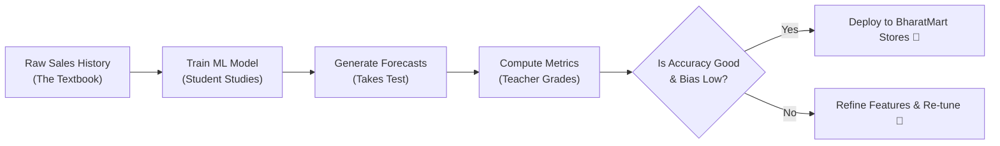
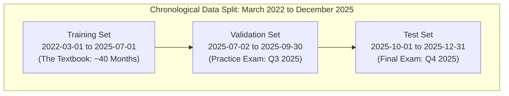
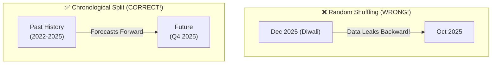
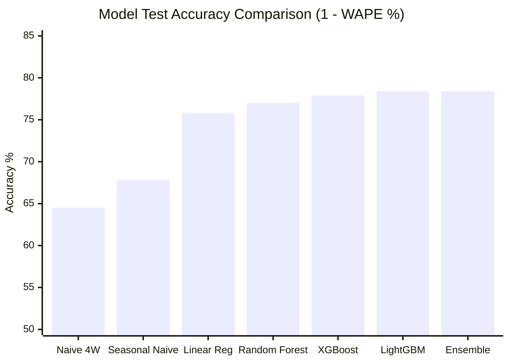
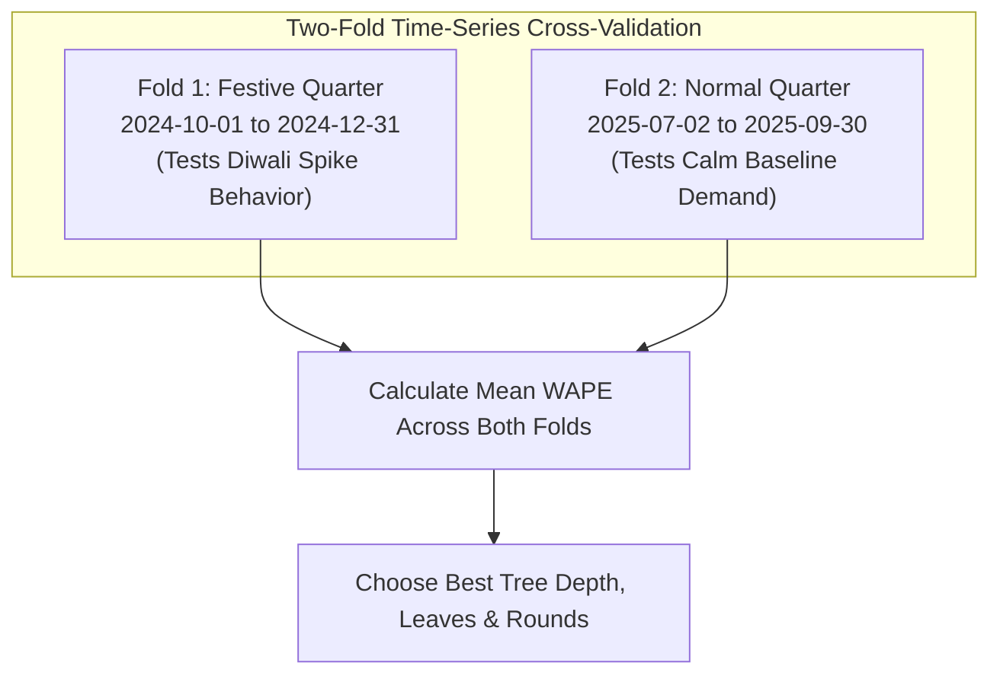
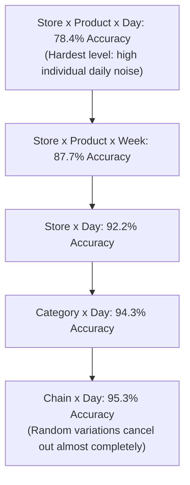

# Phase 7: Model Evaluation & Metrics

> **Where are we?** In [Phase 6: Machine Learning Models](file:///Users/kumarshivank/Downloads/retail-sales-forecasting/learning/06-machine-learning-models/README.md), you learned how different algorithms (Linear Regression, Random Forest, XGBoost, and LightGBM) learn from sales data. Now comes the critical test: **How do we know if our models are actually any good?** In this phase, we explore the science and practical art of evaluating retail demand forecasts.

---

## 1. Why Evaluation Matters

Building a machine learning model is only half the journey. Anyone with basic Python skills can fit an algorithm and output an array of numbers. The true engineering challenge is knowing whether those predictions are **accurate, dependable, and safe to use** in real store operations.

### The Student Test Analogy 🎓
Think of training a model like a student preparing for a rigorous school exam:
- **Studying the material:** The student reads textbooks, works through practice questions, and reviews historical notes. This corresponds to the **training phase**.
- **Taking the exam:** On test day, the teacher hands out an exam paper featuring fresh problems the student has never seen before.
- **Grading the answers:** The final test score reveals whether the student genuinely learned the underlying concepts or merely memorized yesterday's exercises.

In Machine Learning (ML), our forecasting model is the student. The sales predictions are its exam answers, and evaluation metrics are the teacher's grading rubric.



### The Real-World Cost of Forecast Errors 🏪
In academic exercises, being off by 10% is just an abstract statistical loss. In a physical multi-city chain like **BharatMart**, mistakes directly hit store shelves and bank accounts:

1. **Over-forecasting (Predicting 500 units when actual demand is 150):**
   - You order far too much inventory from distributors.
   - Perishable goods (milk, produce, paneer) spoil and get thrown in the trash.
   - Working capital is frozen sitting on stockroom shelves instead of earning interest.
   - Store managers must run deep clearance discounts, wiping out profit margins.

2. **Under-forecasting (Predicting 150 units when actual demand is 500):**
   - You run completely out of stock by 2:00 PM.
   - Shelves sit empty while eager customers walk away empty-handed.
   - Disappointed shoppers visit rival stores, permanently damaging customer loyalty.
   - Lost revenue that can never be recovered.

Rigorous evaluation tells retail planners not just *"did the code run?"*, but whether the model can be trusted to order ₹10 Crore worth of stock every month.

---

## 2. Train / Validation / Test Split

The cardinal rule of machine learning is simple:

> [!IMPORTANT]
> **Never evaluate a model on the same data it learned from.** That is cheating!

If a student is given the exact test paper with the answer key two weeks before the final exam, scoring 100% does not prove they understand the subject; it only proves they have good memory. 

In machine learning, when a model memorizes the training data perfectly but fails when faced with new, real-world data, we call this **overfitting**.

To prevent overfitting, we split historical sales data into three distinct groups:



### The Three Groups Explained
1. **Training Set (The Textbook):** The bulk of our history (`2022-03-01` to `2025-07-01`, approximately 40 months). The algorithms study these millions of transactions to discover underlying patterns: day-of-week trends, monthly paydays, price sensitivities, and holiday surges.
2. **Validation Set (The Practice Exam):** A recent historical window (`2025-07-02` to `2025-09-30`, Q3 2025, 91 days). We use this period to tune hyperparameters (such as tree depth and learning rate) and decide which algorithm wins the right to be deployed.
3. **Test Set (The Final Board Exam):** A completely untouched future window (`2025-10-01` to `2025-12-31`, Q4 2025, 92 days, covering the massive Diwali season). This dataset is unlocked **only once**, after all modeling decisions are finalized, to measure true future performance.

| Dataset Split | Date Range | Duration | What Happens Here | Real-World Analogy |
|---|---|---|---|---|
| **Training Set** | `2022-03-01` to `2025-07-01` | ~40 months | Algorithms learn feature relationships | Textbook reading & homework |
| **Validation Set** | `2025-07-02` to `2025-09-30` | 91 days | Hyperparameter tuning & model selection | Mock exams before the finals |
| **Test Set** | `2025-10-01` to `2025-12-31` | 92 days | Final uncorrupted scorecard | Official board exam |

### Why We DON'T Shuffle Time-Series Data ⏳
In traditional machine learning (such as classifying pictures of dogs vs. cats, or predicting house prices from square footage), you can randomly shuffle rows before splitting. A photo of a dog taken on Tuesday does not depend on a photo taken on Monday.

**Time-series forecasting is fundamentally different.** Time is an arrow that moves in one direction:
- Today's sales depend on yesterday's sales, last week's promotions, and upcoming holidays.
- Tomorrow's sales **cannot** influence yesterday's decisions.



> [!WARNING]
> **Never shuffle time-series data!** If you shuffle rows randomly, the model might use sales numbers from December 2025 to help predict October 2025. That creates **lookahead bias** (also called **data leakage**). In testing, the model will look brilliant, but once deployed live in production, it will fail completely because future data does not exist yet!

The fundamental rule: **Always train on the past, validate on the near future, and test on the distant future.**

---

## 3. Key Evaluation Metrics

How do we quantify whether a forecast was close or far off? Let's walk through the core metrics used in this project.

To make them crystal clear, imagine we generated forecasts for 5 products sold yesterday at BharatMart Delhi Hypermarket:

| Product | Actual Sales ($y$) | Forecasted Sales ($\hat{y}$) | Error ($e = \hat{y} - y$) | Absolute Error ($\|e\|$) | Squared Error ($e^2$) |
|---|---|---|---|---|---|
| Basmati Rice 5kg | 50 units | 45 units | -5 | 5 | 25 |
| Atta (Flour) 10kg | 80 units | 90 units | +10 | 10 | 100 |
| Bluetooth Earbuds | 10 units | 12 units | +2 | 2 | 4 |
| Smart Fitness Band | 2 units | 6 units | +4 | 4 | 16 |
| Sunflower Oil 1L | 30 units | 25 units | -5 | 5 | 25 |
| **Sum** | **172 units** | **178 units** | **+6** | **26** | **170** |

All metrics below are computed in Python in [`src/forecast.py`](file:///Users/kumarshivank/Downloads/retail-sales-forecasting/src/forecast.py#L20-L31) by the [`metrics()`](file:///Users/kumarshivank/Downloads/retail-sales-forecasting/src/forecast.py#L20-L31) function:

```python
def metrics(y, p) -> dict:
    y, p = np.asarray(y, float), np.asarray(p, float)
    err = p - y
    wape = np.abs(err).sum() / y.sum()
    return {
        "MAE": float(np.abs(err).mean()),
        "RMSE": float(np.sqrt((err ** 2).mean())),
        "WAPE": float(wape),
        "Accuracy (1-WAPE)": float(1 - wape),
        "R2": float(1 - (err ** 2).sum() / ((y - y.mean()) ** 2).sum()),
        "Bias %": float(100 * (p.sum() / y.sum() - 1)),
    }
```

Let's break down each metric step by step.

---

### 1. MAE (Mean Absolute Error)
**The Formula:**
$$\text{MAE} = \frac{1}{n} \sum_{i=1}^n |y_i - \hat{y}_i|$$

- **In plain language:** "On average, how many physical units is our forecast off by?"
- **From our table:** Total absolute error is $26$ across $5$ items $\rightarrow \text{MAE} = \frac{26}{5} = \mathbf{5.2\text{ units}}$.
- **In BharatMart:** On the test set, our Ensemble model achieves an MAE of **13.87 units** per store-product-day.
- **Strengths:** MAE is very intuitive. If you tell a store manager *"our forecast is off by ~14 units on average,"* they instantly understand what that means for shelf packing.
- **Limitation:** MAE doesn't account for product scale. Being off by 10 units on an item selling 500 units per day is barely noticeable (2% error). Being off by 10 units on an item selling 12 units per day is an 83% mistake!

---

### 2. RMSE (Root Mean Squared Error)
**The Formula:**
$$\text{RMSE} = \sqrt{\frac{1}{n} \sum_{i=1}^n (y_i - \hat{y}_i)^2}$$

- **In plain language:** Like MAE, but it squares each error before taking the average and square root.
- **The Squaring Penalty:** Squaring makes large mistakes count **exponentially more** than small ones:
  - An error of 2 units becomes $2^2 = 4$.
  - An error of 10 units becomes $10^2 = 100$ (5 times larger error, but a **25 times larger penalty!**).
- **From our table:** The sum of squared errors is $170 \rightarrow \text{Mean} = \frac{170}{5} = 34 \rightarrow \text{RMSE} = \sqrt{34} = \mathbf{5.83\text{ units}}$.
- **In BharatMart:** Test RMSE is **26.64 units**.
- **Golden Rule:** RMSE is always greater than or equal to MAE ($\text{RMSE} \ge \text{MAE}$). They are only equal if every single error is exactly the same size. A large gap between RMSE (26.64) and MAE (13.87) indicates that occasional large errors are occurring (e.g. during sudden promotional spikes).

---

### 3. WAPE (Weighted Absolute Percentage Error) 🌟
*This is the primary ranking metric in the BharatMart project.*

**The Formula:**
$$\text{WAPE} = \frac{\sum |y_i - \hat{y}_i|}{\sum y_i} = \frac{\text{Total Absolute Errors}}{\text{Total Actual Sales}}$$

$$\text{Accuracy} = 1 - \text{WAPE}$$

#### Why WAPE and NOT MAPE?
Many introductory data science courses teach **MAPE (Mean Absolute Percentage Error)**:
$$\text{MAPE} = \frac{1}{n} \sum \frac{|y_i - \hat{y}_i|}{y_i} \times 100$$

In real-world retail, **MAPE has severe flaws** due to the "Small Numbers Trap":
1. **Division by Zero:** If a store sells 0 units of a niche product on a Monday, MAPE attempts to divide by zero: $\frac{|0 - 1|}{0} = \infty$. The calculation crashes.
2. **Distorted Extremes:** If an actual sale is 1 unit and the model predicts 3 units, MAPE reports a **200% error**! Yet in inventory terms, the mistake was only 2 small units.
3. If you average that 200% error on 1 unit with a 2% error on 1,000 bags of rice, MAPE claims your average error is $\frac{200\% + 2\%}{2} = 101\%$. A near-perfect forecast is made to look like a complete failure!

**How WAPE Solves This:**
Instead of computing percentages per item and averaging them, WAPE sums all errors and divides by total sales volume. High-volume staples naturally carry proportional weight, while low-volume noise does not distort the scorecard:

$$\text{WAPE} = \frac{26}{172} \approx 0.1512 \text{ (15.1\% error)}$$
$$\text{Accuracy} = 1 - 0.1512 = \mathbf{84.88\% \approx 84.9\%}$$

In BharatMart's test period:
- **Test WAPE:** `0.2164` (21.64%)
- **Test Accuracy ($1 - \text{WAPE}$):** **78.36%** (rounded to **78.4%**)

---

### 4. $R^2$ (R-Squared / Coefficient of Determination)
**The Formula:**
$$R^2 = 1 - \frac{\sum (y_i - \hat{y}_i)^2}{\sum (y_i - \bar{y})^2}$$

- **In plain language:** "How much better is our model than just guessing the overall historical average sales $\bar{y}$ every day?"
- **Understanding the scale:**
  - $R^2 = 1.0$: Perfect predictions. Zero error.
  - $R^2 = 0.0$: The model is no better than guessing the simple average sales every single day.
  - $R^2 < 0.0$: The model is **worse** than just guessing the average! (Indicates severe bugs or major model failure).
- **In BharatMart:** Test $R^2$ is **0.896** (~90%). This tells us that nearly 90% of the variance across 10 stores, 40 products, and 92 days is captured by our features and model!

---

### 5. Forecast Bias
**The Formula:**
$$\text{Bias \%} = \left( \frac{\sum \hat{y}_i}{\sum y_i} - 1 \right) \times 100$$

- **In plain language:** Does the model systematically tend to over-predict or under-predict?
- **From our table:** Total predicted = 178 units, total actual = 172 units.
  $$\text{Bias \%} = \left(\frac{178}{172} - 1\right) \times 100 = \mathbf{+3.49\%}$$
- **Operational impact:**
  - **Positive Bias (+):** The model systematically over-forecasts $\rightarrow$ extra warehouse clutter, working capital locked up, risk of stock obsolescence.
  - **Negative Bias (-):** The model systematically under-forecasts $\rightarrow$ empty shelves, stockouts, lost sales.
- **In BharatMart:** Test Bias is **-3.1%**. The model slightly leans toward conservative forecasts (under-predicting by ~3%), which protects inventory holding costs while keeping shelf availability high.

---

### Summary Metric Comparison Table

| Metric | Ideal Target | What It Measures | BharatMart Test Value |
|---|---|---|---|
| **MAE** | 0.0 | Average unit error per series-day | **13.87 units** |
| **RMSE** | 0.0 | Average unit error with penalty on large spikes | **26.64 units** |
| **WAPE** | 0.0% | Volume-weighted percentage error | **21.64%** |
| **Accuracy (1 - WAPE)** | 100.0% | Overall volume accuracy | **78.36%** |
| **$R^2$** | 1.0 | Proportion of variance explained | **0.896** |
| **Forecast Bias** | 0.0% | Directional over/under prediction tendency | **-3.11%** |

---

## 4. The Model Leaderboard

In [Phase 6: Machine Learning Models](file:///Users/kumarshivank/Downloads/retail-sales-forecasting/learning/06-machine-learning-models/README.md), we implemented 7 different forecasting methods, ranging from naive heuristics to complex gradient boosted trees. 

Here is the complete scorecard on the held-out Q4 2025 test set (`2025-10-01` to `2025-12-31`), loaded directly from [`reports/model_comparison.csv`](file:///Users/kumarshivank/Downloads/retail-sales-forecasting/reports/model_comparison.csv):

| Model | Val WAPE | Test MAE | Test RMSE | Test WAPE | Test Accuracy | Test $R^2$ | Test Bias % |
|---|---|---|---|---|---|---|---|
| 🥇 **Ensemble (70% LGB + 30% XGB)** | **21.93%** | 13.87 | 26.64 | 21.64% | **78.36%** | **0.896** | -3.11% |
| 🥈 **LightGBM** | 21.96% | 13.86 | 26.53 | 21.64% | **78.36%** | **0.897** | -2.82% |
| 🥉 **XGBoost** | 22.19% | 14.19 | 27.81 | 22.14% | **77.86%** | 0.887 | -3.77% |
| 4️⃣ **Random Forest** | 22.62% | 14.71 | 28.34 | 22.96% | **77.04%** | 0.883 | -2.67% |
| 5️⃣ **Log-Linear Regression** | 23.75% | 15.51 | 29.24 | 24.20% | **75.80%** | 0.875 | +4.53% |
| 6️⃣ **Seasonal Naive Baseline** | 31.71% | 20.65 | 39.08 | 32.23% | **67.77%** | 0.777 | +1.75% |
| 7️⃣ **Naive Baseline (4-week avg)** | 29.18% | 22.73 | 44.51 | 35.48% | **64.52%** | 0.711 | -4.24% |

You can view the full JSON summary in [`models/metrics.json`](file:///Users/kumarshivank/Downloads/retail-sales-forecasting/models/metrics.json) and inspect the visual chart in [`reports/figures/09_model_comparison.png`](file:///Users/kumarshivank/Downloads/retail-sales-forecasting/reports/figures/09_model_comparison.png).



### Understanding the Progression
1. **The Heuristic Baselines (64.5% to 67.8%):**
   - The simple 4-week moving average gets crushed when seasonal holidays arrive because it has no memory of what happened last year.
   - Seasonal Naive improves by repeating sales from 365 days ago multiplied by store-level growth, but it cannot adjust for moving holidays (e.g. Diwali shifting dates between years) or promotional price changes.
2. **The Machine Learning Jump (75.8%):**
   - Switching to Log-Linear Regression with 59 engineered features produces an immediate **8-point accuracy leap**. The model now leverages day-of-week patterns, price elasticity, and festival proximity.
3. **The Non-Linear Boosted Trees (77.9% to 78.4%):**
   - Tree models like XGBoost and LightGBM handle non-linear interactions effortlessly (e.g. *"If it's the weekend before Diwali AND a 25% discount is offered at Mumbai Hyper, demand surges 4x"*).
4. **The Ensemble Blend (78.4%):**
   - Combining LightGBM (weight: 0.70) with XGBoost (weight: 0.30) stabilizes individual model variances, producing our best and most dependable forecast.

---

## 5. The Oracle Benchmark (Noise Ceiling)

When beginners see an accuracy of **78.4%**, they often ask:
> *"Why not 95% or 99%? Can't we add more features or tune deeper trees to hit 95%?"*

The answer is a resounding **NO**, and understanding why is a milestone in your data science maturity.

### Irreducible Randomness in Human Behavior 🎲
In physical retail, human demand is inherently stochastic (partly random):
- Whether 3 or 5 customers decide to buy wireless earbuds at Bengaluru Hyper on a rainy Tuesday afternoon is partially pure chance.
- A customer might wake up feeling unwell and delay their grocery run by a day.
- A sudden traffic jam near the mall might reduce foot traffic for two hours.

No algorithm, no matter how many gigabytes of data or parameters it has, can predict random coin flips. This unpredictability is called **irreducible noise**.

### What is the "Oracle"?
In this project, data was generated by a controlled simulation process where the underlying expected sales rate $\lambda$ is known mathematically.

An **Oracle** is a hypothetical, omniscient entity with divine mathematical knowledge. The Oracle knows the true expected Poisson demand for every store, every product, and every calendar day.

Even when the Oracle predicts the exact mathematical truth, it still makes forecasting errors because actual customer arrivals are random Poisson draws around that expectation:

| Benchmark | Test WAPE | Accuracy (1 - WAPE) |
|---|---|---|
| **Oracle (Theoretical Maximum)** | **18.52%** | **81.48% (~81.5%)** |
| **Our Ensemble Model** | **21.64%** | **78.36% (~78.4%)** |

Recorded in [`reports/oracle_benchmark.json`](file:///Users/kumarshivank/Downloads/retail-sales-forecasting/reports/oracle_benchmark.json):
```json
{
  "test_period_start": "2025-10-01",
  "oracle_wape_item_store_day": 0.1852154599627025,
  "note": "Best achievable WAPE given the random noise in the data (true expected demand known)."
}
```

### Capturing 96.2% of All Learnable Knowledge 🧠
Because the theoretical noise ceiling is 81.48% accuracy, our model's real performance is evaluated against what is actually learnable:

$$\text{Share of Achievable Accuracy} = \frac{1 - \text{Model WAPE}}{1 - \text{Oracle WAPE}} = \frac{1 - 0.21644}{1 - 0.18522} = \frac{78.36\%}{81.48\%} = \mathbf{96.17\% \approx 96.2\%}$$

> [!NOTE]
> Our Ensemble captures **96.2% of all discoverable signal**! The remaining 3.1% gap is virtually all that separates a machine learning model from divine omniscience. Trying to push daily accuracy higher would just mean overfitting to noise.

---

## 6. Festival-Aware Cross-Validation

Standard machine learning often relies on a single validation period. In retail, that creates a dangerous blind spot.

### The Indian Festive Surge 🪔
In the Indian retail market, festivals like **Diwali, Navratri, and Dhanteras** cause sales to spike by **300% to 400%** within a two-week window.

If your single validation split happens to be **July 2 to September 30** (a quiet monsoon quarter with no major national festivals):
1. The algorithm tunes its hyperparameters to perform well on calm, steady summer sales.
2. It stops training early, concluding that dramatic spikes are rare anomalies.
3. When deployed into October and November (the Diwali peak), the model severely under-forecasts, leading to empty shelves and lost revenue.

### The Two-Fold Cross-Validation Scheme
To ensure our models learn both normal steady-state demand and explosive festive surges, [`src/train.py`](file:///Users/kumarshivank/Downloads/retail-sales-forecasting/src/train.py#L43) uses a **two-fold time-series cross-validation strategy**:



In [`src/train.py`](file:///Users/kumarshivank/Downloads/retail-sales-forecasting/src/train.py#L43):
```python
CV_FOLDS = [
    ("2024-10-01", "2024-12-31"),  # Fold 1: Festive fold (Diwali peak)
    ("2025-07-02", "2025-09-30")   # Fold 2: Normal fold (baseline demand)
]
```

### The Hyperparameter Tuning Results
In [`models/metrics.json`](file:///Users/kumarshivank/Downloads/retail-sales-forecasting/models/metrics.json#L27-L55), we see the actual cross-validation tuning results for LightGBM across both folds:

| Configuration | Leaves (`num_leaves`) | Min Samples (`min_child_samples`) | Variance Power | Festive Fold WAPE | Normal Fold WAPE | Mean CV WAPE | Best Iteration |
|---|---|---|---|---|---|---|---|
| **Config 1 (Winner)** 🏆 | **63** | **50** | **1.2** | **22.90%** | **21.96%** | **22.43%** | **138 rounds** |
| Config 2 | 255 | 50 | 1.2 | 22.97% | 22.14% | 22.56% | 79 rounds |
| Config 3 | 127 | 100 | 1.4 | 22.84% | 22.08% | 22.46% | 89 rounds |

Notice how Config 1 balanced both worlds: it kept error low during the normal quarter (21.96%) while staying robust during the festival surge (22.90%). 

During the actual Diwali 2025 window (`2025-10-05` to `2025-10-23`), our model maintained **77.9% accuracy** (WAPE 22.1%), whereas Seasonal Naive degraded to **66.1% accuracy** (WAPE 33.9%).

---

## 7. Accuracy at Different Aggregation Levels

In a retail business, different decisions happen at different organizational levels:
- A **Store Shelf Stocker** needs daily predictions for each item (Store $\times$ Product $\times$ Day).
- A **Logistics Dispatcher** schedules weekly replenishment trucks (Store $\times$ Product $\times$ Week).
- A **Store General Manager** plans cashier shifts and security staffing (Store $\times$ Day).
- A **Category Procurement Head** negotiates bulk purchase orders (Category $\times$ Day).
- The **Chief Financial Officer (CFO)** forecasts corporate cash flow (Chain $\times$ Day).

When we aggregate our forecasts up the hierarchy, accuracy rises dramatically:

| Aggregation Level | Business Use Case | WAPE | Accuracy (1 - WAPE) | $R^2$ |
|---|---|---|---|---|
| **Store $\times$ Product $\times$ Day** | Shelf restocking & daily order picking | 21.64% | **78.36%** | 0.896 |
| **Store $\times$ Product $\times$ Week** | Weekly supplier orders & trucking | 12.26% | **87.74%** | 0.963 |
| **Store $\times$ Day** | Store staffing & cashier scheduling | 7.78% | **92.22%** | 0.949 |
| **Category $\times$ Day** | Category procurement & vendor contracts | 5.67% | **94.33%** | 0.988 |
| **Chain $\times$ Day** | Executive revenue & cash flow planning | 4.74% | **95.26%** | 0.939 |

You can explore the visualization in [`reports/figures/13_accuracy_by_level.png`](file:///Users/kumarshivank/Downloads/retail-sales-forecasting/reports/figures/13_accuracy_by_level.png) and examine the total chain-level actual vs. forecast chart in [`reports/figures/10_chain_actual_vs_forecast.png`](file:///Users/kumarshivank/Downloads/retail-sales-forecasting/reports/figures/10_chain_actual_vs_forecast.png).



### Why Does Accuracy Jump from 78% to 95%? 📈
This behavior is powered by the **Law of Large Numbers**:

> [!TIP]
> **Random noise cancels out when you sum across many items.**
> 
> Think of flipping a coin:
> - If you flip 1 coin, predicting heads is pure 50/50 noise.
> - If you flip 10,000 coins, predicting that roughly 5,000 will be heads is **99.9% accurate**.
>
> In retail, if customer Ramesh buys 2 fewer packs of biscuits on Tuesday, but customer Priya buys 2 extra packs, the store-product errors are $-2$ and $+2$. When aggregated across the store or entire chain, they cancel out to **zero net error**!

### Category-Level Accuracy Nuances
Different merchandise categories exhibit very different levels of forecast predictability:

| Category | Test Accuracy | Test WAPE | Why Predictability Differs |
|---|---|---|---|
| **Grocery & Staples** | **79.9%** | 20.1% | Essential pantry staples (rice, flour, oil) have regular, consistent consumption. |
| **Beverages & Snacks** | **78.9%** | 21.1% | High repeat purchases with strong, predictable weekend surges. |
| **Personal Care** | **78.4%** | 21.6% | Steady household replenishment cycles (toothpaste, soap). |
| **Apparel** | **72.6%** | 27.4% | Seasonal fashion shifts, sizing preferences, and holiday gifting create variability. |
| **Home & Kitchen** | **69.4%** | 30.6% | Infrequent, durable purchases (appliances, cookware) with longer purchase cycles. |
| **Electronics** | **68.8%** | 31.2% | High unit prices, low daily transaction counts, highly promotional. |

To inspect individual product time-series charts (such as Fast Mover Basmati Rice vs. Spiky Diwali Lights), check [`reports/figures/12_series_examples.png`](file:///Users/kumarshivank/Downloads/retail-sales-forecasting/reports/figures/12_series_examples.png).

---

## 8. Key Takeaways

1. **Evaluation is not just a score; it's a safety net:** Rigorous evaluation protects retail businesses against expensive overstocking and costly stockouts.
2. **Never shuffle time-series data:** Shuffling leaks future knowledge into past predictions. Always split chronologically: Train $\rightarrow$ Validation $\rightarrow$ Test.
3. **Use WAPE instead of MAPE:** MAPE explodes on zero or low-volume items. WAPE sums volume first, making it reliable, robust, and directly aligned with physical inventory operations.
4. **Respect the Noise Ceiling:** Human behavior contains irreducible randomness. Our Oracle benchmark demonstrates that the maximum possible accuracy is 81.5%. Our Ensemble achieves 78.4% — capturing **96.2% of all discoverable signal**.
5. **Cross-validate across seasons:** A two-fold cross-validation scheme (Festive fold + Normal fold) ensures models do not get caught off guard by festival surges like Diwali.
6. **Aggregation builds resilience:** While predicting single-item daily sales is 78% accurate, weekly store orders reach **88% accuracy**, and chain-wide daily revenue achieves **95% accuracy** as random noise cancels out.

---

## 🧭 Next Steps

Now that we have rigorously evaluated our forecasting models, verified their accuracy across aggregation levels, and confirmed that our Ensemble delivers production-grade results, it's time to bring these forecasts into the hands of business users!

Proceed to **[Phase 8: Deployment & Visualization →](file:///Users/kumarshivank/Downloads/retail-sales-forecasting/learning/08-deployment-and-visualization/README.md)** to learn:
- How to deploy an interactive Streamlit web application
- How to simulate promotional price changes with real-time "What-If" sliders
- How to design enterprise dashboards in Power BI
- How the end-to-end pipeline automates the journey from raw data to executive decisions!
