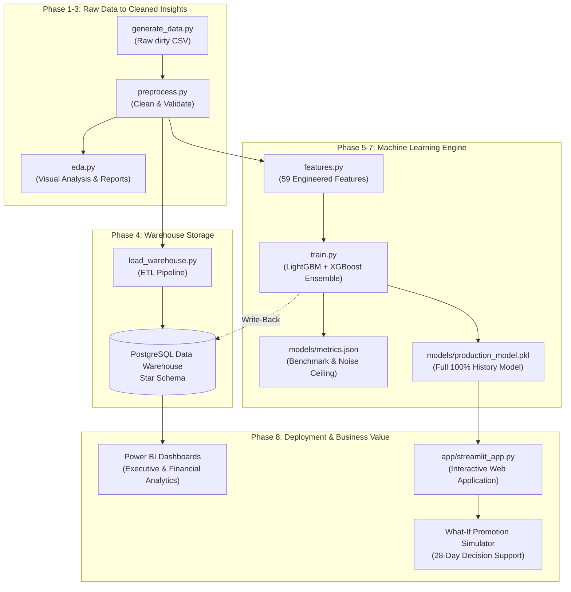

# 🚀 Phase 8: Deployment & Visualization

> **Welcome to the grand finale of your BharatMart learning journey!**  
> In [Phase 7: Model Evaluation](file:///Users/kumarshivank/Downloads/retail-sales-forecasting/learning/07-model-evaluation/README.md), you evaluated multiple forecasting models, discovered that our LightGBM + XGBoost Ensemble hit **78.36% accuracy** (capturing **96% of the theoretical noise ceiling**), and proved that the predictions are rock-solid.  
> Now comes the ultimate question: **How does a store manager actually use this model to run their business?**

---

## 🧭 Navigation & Overview

- [← Back to Learning Guide Home](file:///Users/kumarshivank/Downloads/retail-sales-forecasting/learning/learning.md)
- **Phase 8 Focus:** Turning machine learning models into live, interactive products (Streamlit web application and Power BI enterprise dashboards).
- **Key Project Files:**
  - [`app/streamlit_app.py`](file:///Users/kumarshivank/Downloads/retail-sales-forecasting/app/streamlit_app.py) — Interactive web app with What-If promotion simulator
  - [`src/forecast.py`](file:///Users/kumarshivank/Downloads/retail-sales-forecasting/src/forecast.py) — Future frame generator & prediction pipeline
  - [`run_pipeline.py`](file:///Users/kumarshivank/Downloads/retail-sales-forecasting/run_pipeline.py) — Single-command end-to-end automation
  - [`powerbi/POWERBI_GUIDE.md`](file:///Users/kumarshivank/Downloads/retail-sales-forecasting/powerbi/POWERBI_GUIDE.md) — Step-by-step dashboard creation guide
  - [`powerbi/measures.dax`](file:///Users/kumarshivank/Downloads/retail-sales-forecasting/powerbi/measures.dax) — 39 production DAX analytical measures
  - [`sql/01_schema.sql`](file:///Users/kumarshivank/Downloads/retail-sales-forecasting/sql/01_schema.sql) — `fact_forecast` write-back schema
  - [`models/`](file:///Users/kumarshivank/Downloads/retail-sales-forecasting/models/) — Evaluation vs production model bundles

---

## 1. Why Deployment Matters: The "Last Mile" Problem

Imagine you are a world-class chef. You spend three days crafting the most exquisite gourmet dish, testing spices, perfecting the temperature, and plating it like a work of art. 

Now imagine you take that dish, lock it inside a metal safe in the kitchen basement, and walk away. **Nobody ever eats it.**

In data science, this happens all the time:
- An engineer spends 3 months building a clever model inside a Jupyter Notebook (`.ipynb`).
- They print out charts and calculate a high $R^2$ score on their laptop.
- Then the notebook sits idle in a folder. The business never sees it, store managers keep guessing inventory with paper clipboards, and stockouts continue.

```
                    THE "LAST MILE" GAP
┌──────────────────────────┐          ┌──────────────────────────┐
│  Data Scientist Laptop   │          │  BharatMart Operations   │
│  - Python script         │   ????   │  - Store Managers        │
│  - Jupyter Notebook      │ ═══════> │  - Supply Chain Team     │
│  - Pickle file (.pkl)    │          │  - Category Buyers       │
│  - High Math / Code      │          │  - Business Executives   │
└──────────────────────────┘          └──────────────────────────┘
```

> [!IMPORTANT]
> **Deployment** is the process of taking a machine learning model out of the development lab and placing it where non-technical decision-makers can interact with it effortlessly.

In the BharatMart project, we solve the "last mile" problem using **two complementary deployment channels**:
1. **The Streamlit Web App** ([`app/streamlit_app.py`](file:///Users/kumarshivank/Downloads/retail-sales-forecasting/app/streamlit_app.py)): A fast, interactive web interface for store managers to look up 28-day forecasts and test promotional "What-If" pricing scenarios on the fly.
2. **The Power BI Dashboards** ([`powerbi/`](file:///Users/kumarshivank/Downloads/retail-sales-forecasting/powerbi/)): An enterprise reporting suite connected directly to our PostgreSQL data warehouse, allowing regional directors and executive leadership to track chain-wide revenue, profit margins, and forecast error trends.

---

## 2. What is Streamlit? Web Apps in Pure Python

Building traditional web applications is complicated. You usually need:
- **HTML** to structure pages
- **CSS** to style buttons and layouts
- **JavaScript** to handle button clicks and user interactions
- A backend framework like **FastAPI**, **Flask**, or **Django** to serve data

For a data scientist who knows Python, Pandas, and machine learning, learning a full web-development stack just to show a model is a massive hurdle.

### Enter Streamlit 🎈
**Streamlit** is an open-source Python framework that converts plain Python scripts into interactive, responsive web applications. **You write zero HTML, zero CSS, and zero JavaScript.** You simply write standard Python, and Streamlit translates your variables, charts, and tables into modern web interfaces.

### How Streamlit Works: The Reactive Execution Model
Streamlit uses a wonderfully simple mental model: **whenever the user touches any widget (moves a slider, selects a dropdown, clicks a button), Streamlit re-runs the Python script from top to bottom.**

```
User changes dropdown ──> Streamlit re-runs script ──> Screen updates instantly
```

Because modern computers and cached Python code run in milliseconds, this top-to-bottom re-run feels completely seamless to the user.

### Key Streamlit Primitives
Here are the core functions used throughout [`app/streamlit_app.py`](file:///Users/kumarshivank/Downloads/retail-sales-forecasting/app/streamlit_app.py):

| Function | Purpose | Real BharatMart Example |
|---|---|---|
| `st.title()`, `st.caption()` | Header text and annotations | Displaying "📈 BharatMart: Retail Sales Forecasting" |
| `st.metric()` | Prominent KPI card with delta indicator | Showing "Next 28 days: 4,120 units (+12.4% ahead)" |
| `st.selectbox()` | Single-item dropdown picker | Letting the user pick Store `S01` and Product `P01` |
| `st.slider()`, `st.select_slider()` | Numeric or interval sliders | Setting discount percentage (0%, 10%, 20%, 30%) |
| `st.plotly_chart()` | Interactive zoomable graphics | Visualizing daily historical sales vs 28-day forecast |
| `st.tabs()` | Multi-tab horizontal navigation | Organizing `🔮 Forecast`, `📊 Business view`, and `🧪 Model report` |
| `st.sidebar` | Collapsible side configuration bar | Housing the CSV upload tool and model metadata |

### A 10-Line Streamlit Example
To understand how concise Streamlit is, look at this complete, functional app:

```python
import streamlit as st
import pandas as pd

st.title("🛒 Mini Store Sales Viewer")

# User input widget
discount = st.slider("Select Planned Discount %", min_value=0, max_value=40, value=10)

# Computation
estimated_lift = discount * 1.8
st.metric(label="Estimated Sales Lift", value=f"+{estimated_lift:.1f}%")

# Display a chart
sample_data = pd.DataFrame({"Day": [1, 2, 3, 4, 5], "Units": [100, 115, 120, 140, 160]})
st.line_chart(sample_data.set_index("Day"))
```

Save that as `mini_app.py`, run `streamlit run mini_app.py` in your terminal, and you instantly have a local web server running at `http://localhost:8501`!

---

## 3. The BharatMart Streamlit App Architecture

Our production web application lives in [`app/streamlit_app.py`](file:///Users/kumarshivank/Downloads/retail-sales-forecasting/app/streamlit_app.py). Let's take a tour of its layout, capabilities, and performance optimizations.

```
┌────────────────────────────────────────────────────────────────────────┐
│  SIDEBAR                 BHARATMART SALES FORECASTING                  │
│  - Logo & Brand          ┌──────────────┬──────────────┬─────────────┐ │
│  - Upload CSV            │  🔮 Forecast │📊 Business   │🧪 Model Rep │ │
│  - Model Metadata        └──────────────┴──────────────┴─────────────┘ │
│                          Store: [ S01 · Delhi Hyper        ▼ ]         │
│                          Product: [ P01 · Basmati Rice     ▼ ]         │
│                          --------------------------------------------- │
│                          🎯 What-If Promotion Simulator                │
│                          Discount: [ 20% ]  Days: [ 15 Oct - 28 Oct ]  │
│                          --------------------------------------------- │
│                          [ KPI 1 ]   [ KPI 2 ]   [ KPI 3 ]   [ KPI 4 ] │
│                          Next 28D    Last 28D    Revenue     Promo Lift│
│                                                                        │
│                          [ Interactive Plotly History & Forecast ]     │
│                                                                        │
│                          [ Forecast Table ]   [ ⬇️ Download CSVs ]      │
└────────────────────────────────────────────────────────────────────────┘
```

### The Three Application Tabs

#### Tab 1: 🔮 Forecast Tab
- **Store & Product Selectors**: Choose from all 10 stores and 40 products.
- **KPI Row**: Displays the 28-day forecast total, previous 28-day comparison, expected revenue in Indian Rupees (formatted in Lakhs `₹L` and Crores `₹Cr`), and promotion uplift.
- **Interactive Chart**: An interactive Plotly chart showing the last 180 days of actual historical sales, the baseline forecast line, and the promotional scenario forecast line.
- **Data Export**: Buttons to download the filtered 28-day forecast or the entire chain forecast as CSV files.

#### Tab 2: 📊 Business View Tab
- **Financial Health**: Displays annual revenue, year-over-year revenue growth, total units sold, profit margins, and promotional day frequency.
- **Visual Breakdowns**:
  - Stacked area chart showing monthly revenue broken down by merchandise category.
  - Horizontal bar chart comparing store revenue across hypermarkets, supermarkets, and express formats.
  - Day-of-week demand heatmap identifying peak shopping days across categories.

#### Tab 3: 🧪 Model Report Tab
- **Transparency & Trust**: Business managers are skeptical of "black box" AI. This tab reveals exactly how the model performed during the rigorous test period.
- **Metrics Displayed**: Test Accuracy (78.4%), Noise Ceiling (81.6%), Share of Achievable Accuracy (96%), and $R^2$ (0.697).
- **Hierarchical Accuracy**: Bar chart showing how accuracy climbs from 78.4% at the individual item level to **94.2% at the chain level**.
- **Diagnostic Visuals**: Pre-generated plots embedded directly from [`reports/figures/`](file:///Users/kumarshivank/Downloads/retail-sales-forecasting/reports/figures/) showing feature importance and actual vs predicted traces across fast and slow movers.

---

### Caching — Making the App Lightning Fast ⚡

Remember Streamlit's reactive model: *every widget interaction re-runs the script.*
- Our cleaned sales history contains **584,000+ rows**.
- Re-reading a 50 MB CSV from disk on every button click takes ~1.5 seconds.
- Deserializing a machine learning model bundle from disk takes ~1.0 second.
- Computing 59 features across 400 store-item combinations takes ~3.0 seconds.

Without caching, if a manager dragged a discount slider, the app would freeze for 5+ seconds on every tick. That is unusable.

Streamlit solves this with **caching decorators**:

```python
# 1. Cache heavyweight, persistent objects (ML model, DB connections)
@st.cache_resource
def get_model():
    return load_bundle(MODELS_DIR / "production_model.pkl")

# 2. Cache data loading and heavy transformations
@st.cache_data
def load_default():
    return pd.read_csv(CLEAN_FILE, parse_dates=["date"])

@st.cache_data(show_spinner="Forecasting the next 28 days for every store and product ...")
def forecast_all(df: pd.DataFrame, _bundle, plan_key: str, promo_plan: pd.DataFrame | None):
    return forecast_future(_bundle, df[REQUIRED], HORIZON, promo_plan)
```

#### `@st.cache_resource` vs `@st.cache_data`

| Decorator | When to Use | How It Works | In BharatMart |
|---|---|---|---|
| `@st.cache_resource` | Global objects that shouldn't be copied (ML models, database pools) | Keeps one shared instance in memory across all user sessions | Keeps `production_model.pkl` warm in RAM |
| `@st.cache_data` | Functions that return data (DataFrames, arrays, dicts) | Serializes output and returns a cached copy if inputs match | Remembers the clean CSV and pre-computed forecasts |

Thanks to this caching setup, once the forecasts are calculated for a plan key, moving between stores and products is **instantaneous (< 50 milliseconds)**!

---

## 4. What-If Analysis — The Superpower of Prescriptive ML

Most machine learning courses stop at *predictive analytics*: *"Here is what will happen if things stay the same."*

In business, leaders want *prescriptive analytics*: *"What happens if we take action? Should we run a sale? If so, how big of a discount?"*

Our What-If Simulator lets store and category managers test business hypotheses in a virtual sandbox before spending a single Rupee on advertising or inventory markdowns.

### The Business Scenario
A merchandising manager in Delhi asks:  
> *"If we run a 20% discount on Basmati Rice (P01) at Delhi Hypermarket (S01) during the first two weeks of next month, how many extra bags will we sell? Will the revenue increase offset the discount?"*

### The Simulation Engine Under the Hood
This feature is powered by [`make_future_frame()`](file:///Users/kumarshivank/Downloads/retail-sales-forecasting/src/forecast.py#L126) and [`forecast_future()`](file:///Users/kumarshivank/Downloads/retail-sales-forecasting/src/forecast.py#L150). Here is the 5-step simulation sequence:

```
┌────────────────────────────────────────────────────────────────────────┐
│                     WHAT-IF SIMULATION SEQUENCE                        │
│                                                                        │
│ 1. Future Frame Creation:                                              │
│    Expand the calendar 28 days forward for all 10 stores x 40 products │
│                                                                        │
│ 2. Promotion Injection:                                                │
│    Set discount_pct = 20 for (S01, P01) across target promo dates      │
│                                                                        │
│ 3. Feature Pipeline Re-run:                                            │
│    Calculate promo_flag, discounted unit_price, calendar features,      │
│    and history lags from actual past sales                             │
│                                                                        │
│ 4. Ensemble Prediction:                                                │
│    Model processes new features -> outputs predicted daily units       │
│                                                                        │
│ 5. Lift Comparison:                                                    │
│    Compare promo forecast against baseline no-promo forecast:          │
│    Promo Lift = Sum(Forecast_Promo) - Sum(Forecast_Baseline)          │
└────────────────────────────────────────────────────────────────────────┘
```

Look at how cleanly this is implemented in [`src/forecast.py`](file:///Users/kumarshivank/Downloads/retail-sales-forecasting/src/forecast.py):

```python
def make_future_frame(history: pd.DataFrame, days: int = HORIZON, promo_plan: pd.DataFrame | None = None):
    # Take the latest row for each store-product to get unit prices & categories
    last = history.sort_values("date").groupby(["store_id", "product_id"]).tail(1)
    future_dates = pd.date_range(history.date.max() + pd.Timedelta(days=1), periods=days, freq="D")
    
    # Cross-join future dates with all store-product combinations
    fut = (last.drop(columns=["date"]).assign(key=1)
           .merge(pd.DataFrame({"date": future_dates, "key": 1}), on="key").drop(columns="key"))
    fut["units_sold"] = np.nan
    fut["discount_pct"] = 0
    
    # Overlay scheduled chain-wide mega sales (e.g., Republic Day, Diwali)
    for start, end, _, cat in mega_sale_windows():
        m = (fut.date >= start) & (fut.date <= end)
        if cat is not None:
            m &= fut.category == cat
        fut.loc[m, "discount_pct"] = 20 if cat is None else 30
        
    # Override with specific user-defined What-If promotion plan
    if promo_plan is not None and len(promo_plan):
        plan = promo_plan.set_index(["date", "store_id", "product_id"])["discount_pct"]
        key = pd.MultiIndex.from_frame(fut[["date", "store_id", "product_id"]])
        override = plan.reindex(key).to_numpy()
        fut["discount_pct"] = np.where(np.isnan(override), fut["discount_pct"], override)
        
    return pd.concat([history, fut[history.columns]], ignore_index=True)
```

In the web app, the user sees:
- **Baseline forecast (no promo):** 3,200 units (₹2,24,000 revenue)
- **Promo scenario (20% discount):** 4,450 units (₹2,49,200 revenue)
- **Promo Lift:** **+1,250 units (+39.1%)**
- The manager immediately discovers that demand is highly elastic for staple grains: the volume jump is large enough to increase total cash revenue despite the lower per-unit margin!

---

## 5. Power BI Dashboards: Enterprise Business Intelligence

While store managers prefer the lightweight Streamlit app on their tablets, regional directors, financial controllers, and executives rely on **Power BI** for cross-departmental governance and fiscal tracking.

All resources to build the BharatMart Power BI suite are organized in [`powerbi/`](file:///Users/kumarshivank/Downloads/retail-sales-forecasting/powerbi/).

```
powerbi/
├── POWERBI_GUIDE.md        ← Step-by-step setup instructions
├── bharatmart_theme.json   ← Corporate visual theme (teal & slate palette)
└── measures.dax            ← 39 pre-built analytical calculations
```

### What is Power BI?
Power BI is Microsoft's enterprise business analytics service. It allows organizations to connect to hundreds of data sources, build robust relational data models, author expressive formula logic (DAX), and publish secure dashboards accessible via desktop, web, and mobile.

### Connecting to the Data Warehouse
Power BI connects directly to our PostgreSQL data warehouse (`retail_dw`) built in [Phase 4: SQL & Data Warehousing](file:///Users/kumarshivank/Downloads/retail-sales-forecasting/learning/04-sql-and-data-warehousing/README.md).

Users can connect via two routes:
- **Route A (Database Direct)**: Connect to `localhost:5432/retail_dw` and import `vw_sales_fact`, `dim_date`, `dim_store`, `dim_product`, and `vw_forecast_vs_actual`.
- **Route B (CSV Exports)**: Import pre-dumped CSV files from `data/exports/` without needing a local PostgreSQL installation.

### Star Schema Relationships in Power BI
In Power BI's **Model View**, the tables connect in a clean **Star Schema** with `1:*` (one-to-many) single-direction filter propagation:

```
    ┌──────────────┐         ┌──────────────┐         ┌──────────────┐
    │   dim_date   │         │  dim_store   │         │ dim_product  │
    └──────┬───────┘         └──────┬───────┘         └──────┬───────┘
           │ 1                      │ 1                      │ 1
           │                        │                        │
           ├──────────────┬─────────┼──────────────┬─────────┤
           │ *            │ *       │ *            │ *       │ *
    ┌──────┴───────┐      │  ┌──────┴───────┐      │  ┌──────┴───────┐
    │    Sales     │      │  │ ForecastEval │      │  │FutureForecast│
    │ (fact_sales) │      │  │(actual vs fc)│      │  │  (next 28d)  │
    └──────────────┘      └──┴──────────────┘      └──┴──────────────┘
```

When a user clicks on the "North" region in a store slicer, the filter automatically trickles down from `dim_store` to all three fact tables simultaneously!

---

### DAX Measures: The Logic Engine of Power BI

**DAX (Data Analysis Expressions)** is the formula language of Power BI (and Excel Power Pivot). While SQL queries retrieve tables, DAX evaluates dynamic metrics on the fly based on whatever filters the user has active on the screen.

The project defines **39 DAX measures** in [`powerbi/measures.dax`](file:///Users/kumarshivank/Downloads/retail-sales-forecasting/powerbi/measures.dax). Here are four crucial business examples:

#### 1. Total Revenue
```dax
Total Revenue = SUM ( Sales[revenue] )
```
*The foundational measure. Every visual, slice, and filter builds on this.*

#### 2. Year-over-Year Growth (YoY %)
```dax
Revenue LY = CALCULATE ( [Total Revenue], SAMEPERIODLASTYEAR ( dim_date[full_date] ) )
Revenue YoY % = DIVIDE ( [Total Revenue] - [Revenue LY], [Revenue LY] )
```
*Uses Power BI's built-in time intelligence to compare identical calendar periods across years.*

#### 3. Same-Store Sales Growth (SSSG %)
```dax
// Same-store sales growth: only stores that were active in both periods
SSSG % =
VAR StoresBoth =
    FILTER (
        VALUES ( dim_store[store_id] ),
        [Total Revenue] > 0 && [Revenue LY] > 0
    )
RETURN
    DIVIDE (
        SUMX ( StoresBoth, [Total Revenue] ) - SUMX ( StoresBoth, [Revenue LY] ),
        SUMX ( StoresBoth, [Revenue LY] )
    )
```
*In retail, opening new stores inflates total revenue. SSSG is the golden metric that reveals whether existing mature stores are actually growing their customer base.*

#### 4. Pareto ABC Classification
```dax
Cumulative Revenue Share % =
VAR CurRev = [Total Revenue]
VAR AllProducts = ALLSELECTED ( dim_product[product_name] )
RETURN
    DIVIDE (
        SUMX ( FILTER ( AllProducts, [Total Revenue] >= CurRev ), [Total Revenue] ),
        CALCULATE ( [Total Revenue], AllProducts )
    )

ABC Class =
SWITCH (
    TRUE (),
    [Cumulative Revenue Share %] <= 0.80, "A",  // Top 80% revenue
    [Cumulative Revenue Share %] <= 0.95, "B",  // Next 15% revenue
    "C"                                         // Long-tail bottom 5%
)
```
*Automates the Pareto Principle (80/20 rule), classifying inventory into high-priority 'A' items, secondary 'B' items, and low-volume 'C' items.*

---

### The 5 Power BI Report Pages

As outlined in [`powerbi/POWERBI_GUIDE.md`](file:///Users/kumarshivank/Downloads/retail-sales-forecasting/powerbi/POWERBI_GUIDE.md):

1. **Executive Overview**: High-level financial cockpit featuring top KPI cards (Total Revenue, YoY %, Profit Margin %, Units), monthly revenue trends, category donut breakdown, and regional performance.
2. **Store Performance**: Store-level matrix ranking stores by revenue, profit margin, and **Revenue per Sq Ft** (showing that compact Express stores generate the highest sales density).
3. **Products & Promotions**: Interactive Pareto table sorted by revenue with dynamic ABC classification, promotion discount bands, and promotional uplift indicators.
4. **Festivals & Seasonality**: Aligns daily sales relative to festival dates using `days_to_diwali` (-30 to +10 days), allowing executives to compare Diwali buying patterns year over year.
5. **Demand Forecast (ML Evaluation)**: Compares actual sales against the ML Ensemble and Seasonal Naive baseline during the Q4 2025 holdout period, highlighting accuracy across merchandise categories.

---

## 6. The Full Pipeline: Putting It All Together

Data science projects often fail because they are fragile collections of loose scripts. If you must manually run seven separate files in the right order while remembering precise arguments, mistakes will happen.

In BharatMart, the entire lifecycle is codified into a single automation script: [`run_pipeline.py`](file:///Users/kumarshivank/Downloads/retail-sales-forecasting/run_pipeline.py).

```bash
# Run the complete end-to-end pipeline (requires PostgreSQL)
python run_pipeline.py

# Run everything in pure-file mode (skips database, ML models still train & deploy)
python run_pipeline.py --skip-db
```

```
┌────────────────────────────────────────────────────────────────────────┐
│                      BHARATMART END-TO-END PIPELINE                    │
│                                                                        │
│  1. python src/generate_data.py                                        │
│     └─ Synthesizes 4 years of retail transactions (586k rows)          │
│                                                                        │
│  2. python src/preprocess.py                                           │
│     └─ Cleans typos, handles negative returns, imputes missing dates   │
│                                                                        │
│  3. python src/eda.py                                                  │
│     └─ Produces 8 exploratory figures & statistical summaries         │
│                                                                        │
│  4. python src/load_warehouse.py --export                              │
│     └─ Creates star schema, populates partitions, dumps BI tables      │
│                                                                        │
│  5. python src/train.py                                                │
│     └─ Builds 59 features, tunes LightGBM, trains 6 models,            │
│        evaluates on test set, refits production model,                 │
│        and writes forecasts back into database                         │
│                                                                        │
│  6. streamlit run app/streamlit_app.py                                 │
│     └─ Launches the interactive UI for end users                       │
└────────────────────────────────────────────────────────────────────────┘
```

The script measures runtime, logs every step with clear progress banners, and ensures that any change made to data generation or feature engineering propagates seamlessly to the web app.

---

## 7. Forecast Write-Back: Bridging ML, SQL, and BI

In many companies, a wall separates data science from business intelligence:
- The data scientist generates forecasts in a private Python environment.
- The business analyst queries the relational database in SQL.
- Because the forecasts aren't in the database, the analyst cannot build dashboards showing actual sales versus forecasted sales!

We solve this using **Forecast Write-Back** implemented in [`src/train.py`](file:///Users/kumarshivank/Downloads/retail-sales-forecasting/src/train.py#L381).

### The `fact_forecast` Table
In [`sql/01_schema.sql`](file:///Users/kumarshivank/Downloads/retail-sales-forecasting/sql/01_schema.sql#L99), we created a dedicated fact table with foreign keys linking back to the dimension tables:

```sql
CREATE TABLE fact_forecast (
    date_key       INTEGER       NOT NULL REFERENCES dim_date (date_key),
    store_key      SMALLINT      NOT NULL REFERENCES dim_store (store_key),
    product_key    SMALLINT      NOT NULL REFERENCES dim_product (product_key),
    model_name     VARCHAR(30)   NOT NULL,
    forecast_units NUMERIC(10,2) NOT NULL,
    actual_units   INTEGER,      -- NULL for future horizon dates!
    created_at     TIMESTAMP     NOT NULL DEFAULT now(),
    PRIMARY KEY (date_key, store_key, product_key, model_name)
);
```

### How `write_back_to_warehouse()` Works
When `train.py` finishes evaluation and production forecasting, it:
1. Connects to PostgreSQL using `psycopg2`.
2. Reads `dim_store` and `dim_product` to resolve natural IDs (`S01`, `P01`) into surrogate integer keys (`store_key`, `product_key`).
3. Formats three sets of forecasts into a single standardized DataFrame:
   - **Test Set Best Model** (with `actual_units` populated)
   - **Test Set Seasonal Naive Baseline** (for benchmarking)
   - **Future 28-Day Production Forecast** (`actual_units = NULL`)
4. Truncates stale forecasts and performs a high-speed bulk `COPY` into `fact_forecast`.
5. Calls `export_bi_tables()` to generate updated CSV files for Power BI Route B.

### The Power of the Resulting SQL View
With forecasts residing inside the warehouse, analysts can query forecast performance using standard SQL via [`vw_forecast_vs_actual`](file:///Users/kumarshivank/Downloads/retail-sales-forecasting/sql/03_bi_views.sql#L54):

```sql
SELECT 
    category,
    model_name,
    SUM(actual_units) AS total_actual,
    SUM(forecast_units) AS total_forecast,
    ROUND(100.0 * (1 - SUM(abs_error_units)::numeric / SUM(actual_units)), 2) AS accuracy_pct
FROM vw_forecast_vs_actual
GROUP BY category, model_name
ORDER BY category, accuracy_pct DESC;
```

Now, software engineers, data scientists, and business analysts all share a **single source of truth**!

---

## 8. Model Serving: Evaluation vs Production Bundles

When you examine the [`models/`](file:///Users/kumarshivank/Downloads/retail-sales-forecasting/models/) folder, you will notice two distinct model bundle files:

1. [`evaluation_model.pkl`](file:///Users/kumarshivank/Downloads/retail-sales-forecasting/models/)
2. [`production_model.pkl`](file:///Users/kumarshivank/Downloads/retail-sales-forecasting/models/)

Why do we need two models?

```
TIME HORIZON:
2022-01-01              2025-07-01       2025-10-01            2025-12-31  Next 28 Days
├───────────────────────────┼────────────────┼─────────────────────┤ ───────────►
│          TRAIN            │   VALIDATION   │        TEST         │   FUTURE
└───────────────────────────┴────────────────┴─────────────────────┘

EVALUATION MODEL:
Trained on: [ Train + Validation ] ─────────► Evaluated on: [ Test ]
(Stops on 2025-10-01 so it never peeks at test data)

PRODUCTION MODEL:
Refit on: [ Train + Validation + Test (100% of History) ] ─────────► Forecasts [ FUTURE ]
```

### 1. The Evaluation Model (`evaluation_model.pkl`)
- **Trained on:** Data through September 30, 2025.
- **Purpose:** Rigorous, honest benchmarking against the Q4 2025 test set.
- **Data Integrity Rule:** To assess genuine generalization ability, this model was strictly forbidden from seeing any data from October to December 2025.

### 2. The Production Model (`production_model.pkl`)
- **Trained on:** 100% of available data (January 1, 2022 through December 31, 2025).
- **Purpose:** Generating the actual predictions for January 2026 inside the Streamlit web application.
- **Why Refit on All Data?** In retail demand forecasting, **the most recent data is the most valuable data**. The test period (Oct–Dec 2025) contained the latest Diwali festival patterns, recent inflation adjustments, and modern product trends. Throwing away the last 3 months of data when deploying to production would deliberately handicap the model!

### Anatomy of a Model Bundle
In [`src/train.py`](file:///Users/kumarshivank/Downloads/retail-sales-forecasting/src/train.py#L305), we save more than just the scikit-learn or LightGBM objects. We package an entire **prediction bundle**:

```python
prod = {
    "models": prod_models,           # Dict of fitted estimators (LightGBM, XGBoost)
    "weights": {"LightGBM": 0.7, "XGBoost": 0.3},
    "input_kind": {"LightGBM": "categories", "XGBoost": "codes"},
    "features": feats,               # List of all 59 exact feature column names
    "cat_levels": cat_levels,        # Master list of store, product, category values
    "horizon": 28,                   # 28-day forecasting window
    "trained_until": "2025-12-31",   # Last historical training date
    "name": "Ensemble"               # Winning model architecture
}
```

Packaging the feature lists and categorical encodings with the estimators ensures that [`src/forecast.py`](file:///Users/kumarshivank/Downloads/retail-sales-forecasting/src/forecast.py#L110) can format incoming data identically during inference without risking silent schema mismatch errors.

---

## 9. What You've Learned: The Complete 8-Phase Journey

Take a deep breath and look back at what you have accomplished across this curriculum. When you started, this project was an empty directory. You have mastered the entire lifecycle of enterprise data science:

| Phase | Topic | Key Skills & Tools | What You Built in BharatMart |
|:---:|---|---|---|
| **1** | [Python & Data Basics](file:///Users/kumarshivank/Downloads/retail-sales-forecasting/learning/01-python-and-data-basics/README.md) | Pandas, NumPy, DataFrames, Vectorization | Data loading, group operations, sales metrics |
| **2** | [Data Cleaning & Preprocessing](file:///Users/kumarshivank/Downloads/retail-sales-forecasting/learning/02-data-cleaning/README.md) | Quality audits, Rolling Medians, Outliers | Cleaned 584,000 transaction rows, fixed anomalies |
| **3** | [Exploratory Data Analysis](file:///Users/kumarshivank/Downloads/retail-sales-forecasting/learning/03-exploratory-data-analysis/README.md) | Seaborn, Matplotlib, Trends, Seasonality | 8 analytical charts, festival uplift discovery |
| **4** | [SQL & Data Warehousing](file:///Users/kumarshivank/Downloads/retail-sales-forecasting/learning/04-sql-and-data-warehousing/README.md) | PostgreSQL, Star Schema, Window Functions | Partitioned warehouse, dimensions & analytical queries |
| **5** | [Feature Engineering](file:///Users/kumarshivank/Downloads/retail-sales-forecasting/learning/05-feature-engineering/README.md) | Lags, Rolling Stats, Leakage Prevention | 59 predictive features with zero data leakage |
| **6** | [Machine Learning Models](file:///Users/kumarshivank/Downloads/retail-sales-forecasting/learning/06-machine-learning-models/README.md) | Tweedie Loss, LightGBM, XGBoost, Ensembles | Trained 6 models, built level-scaled architectures |
| **7** | [Model Evaluation & Metrics](file:///Users/kumarshivank/Downloads/retail-sales-forecasting/learning/07-model-evaluation/README.md) | WAPE, Bias, Noise Ceiling, CV Folds | Validated 78.4% item accuracy (94.2% chain level) |
| **8** | [Deployment & Visualization](file:///Users/kumarshivank/Downloads/retail-sales-forecasting/learning/08-deployment-and-visualization/README.md) | Streamlit, Power BI, DAX, What-If Analysis | Live web application, BI dashboards, full automation |

### The Complete Project Architecture



You didn't just train a model in isolation — you built a **complete, production-grade retail intelligence platform**.

---

## 10. Where to Go From Here: Next Horizons in Data Science

With the foundations you now possess, you are ready to explore advanced specializations across machine learning and data engineering:

```
                         YOUR FUTURE ROADMAP
                                  │
         ┌────────────────────────┼────────────────────────┐
         ▼                        ▼                        ▼
┌──────────────────┐    ┌──────────────────┐    ┌──────────────────┐
│  Deep Learning   │    │ Advanced Time-   │    │  MLOps & Cloud   │
│  & Transformers  │    │ Series Models    │    │  Infrastructure  │
│  - PyTorch       │    │  - NeuralProphet │    │  - Docker & K8s  │
│  - Embeddings    │    │  - PatchTST      │    │  - MLflow / DVC  │
│  - Temporal GNNs │    │  - Chronos / TSM │    │  - AWS / GCP / AZ│
└──────────────────┘    └──────────────────┘    └──────────────────┘
```

### 1. Deep Learning & Temporal Architectures
- **Entity Embeddings**: Instead of one-hot encoding or integer encoding categorical variables like stores and products, neural networks can learn dense mathematical vectors (embeddings) that capture hidden product similarities.
- **Foundation Models for Time Series**: Explore emerging time-series foundation models like **Chronos** (Amazon), **TimesFM** (Google), or **PatchTST**, which apply Transformer attention mechanisms directly to temporal signals.

### 2. Specialized Time-Series Libraries
- **Statsmodels / ARIMA / SARIMAX**: Learn classical statistical forecasting based on autoregression and moving averages.
- **Prophet / NeuralProphet**: Facebook's decomposable additive model for trend and multi-period seasonality.
- **Darts & Nixtla (NeuralForecast)**: High-performance Python ecosystems providing unified APIs for dozens of deep learning time-series models (N-BEATS, N-HiTS, TFT).

### 3. MLOps: Machine Learning at Scale
In enterprise environments, models must be monitored and retrained continuously:
- **Containerization (Docker)**: Package the Streamlit app, Python environment, and dependencies into a lightweight, portable container that runs identically on any server.
- **Experiment Tracking (MLflow / Weights & Biases)**: Automatically log hyperparameters, metrics, and artifact files for every model training run.
- **Data Versioning (DVC)**: Track changes in datasets just like Git tracks changes in code.
- **Orchestration (Apache Airflow / Prefect)**: Schedule the daily extraction, feature engineering, and inference jobs on automated cron triggers with alerting.

### 4. Cloud Platforms
Take your local pipeline to the cloud:
- **AWS**: Amazon S3 (storage), RDS PostgreSQL (database), SageMaker (model training and endpoint deployment).
- **GCP**: Google Cloud Storage, BigQuery (cloud data warehousing), Vertex AI.
- **Azure**: Azure Data Lake, Azure SQL, Azure Machine Learning.

### Recommended Free Learning Resources
- **Book**: *Forecasting: Principles and Practice* by Rob J Hyndman and George Athanasopoulos (The definitive, free online textbook on forecasting principles).
- **Course**: *Machine Learning Specialization* by Andrew Ng (DeepLearning.AI / Coursera) for core mathematical intuition.
- **Documentation**: [Streamlit Documentation](https://docs.streamlit.io/) and [Power BI Guided Learning](https://learn.microsoft.com/en-us/power-bi/).

---

## 11. Key Takeaways & Graduation 🎉

As you wrap up this guide, remember these core principles that distinguish exceptional data scientists from average coders:

1. **Deployment is not an afterthought:** If users cannot access your predictions easily, your model does not exist.
2. **Business intuition drives feature design:** The math in gradient boosted trees is powerful, but our model succeeded because we engineered domain features (festivals, rolling medians, price discounts).
3. **Respect the temporal arrow:** Never shuffle time-series data, never leak future observations, and evaluate models exactly as they will run in the real world.
4. **Bridge the gap between tools:** Machine learning, SQL data warehouses, and BI dashboards are not rivals — they are partners in a unified data ecosystem.
5. **Optimize for speed:** User adoption hinges on low latency; leverage `@st.cache_resource` and `@st.cache_data` to ensure fluid experiences.
6. **Celebrate progress:** You have mastered data cleaning, warehousing, statistical feature engineering, gradient boosting, and interactive deployment.

---

### 🎓 Congratulations!

You have completed the entire **BharatMart Retail Sales Forecasting Learning Guide**!

You now possess the practical, end-to-end skills required to take messy real-world transaction logs, build an enterprise data warehouse, engineer high-signal time-series features, train state-of-the-art machine learning models, and deliver value directly to end users through interactive web tools and executive dashboards.

```
                  🏆 CERTIFICATE OF COMPLETION 🏆
                      BharatMart Data Science
               End-to-End Retail Forecasting Master
```

Keep building, keep experimenting, and happy forecasting! 🚀

---

[← Return to Learning Guide Home](file:///Users/kumarshivank/Downloads/retail-sales-forecasting/learning/learning.md)
